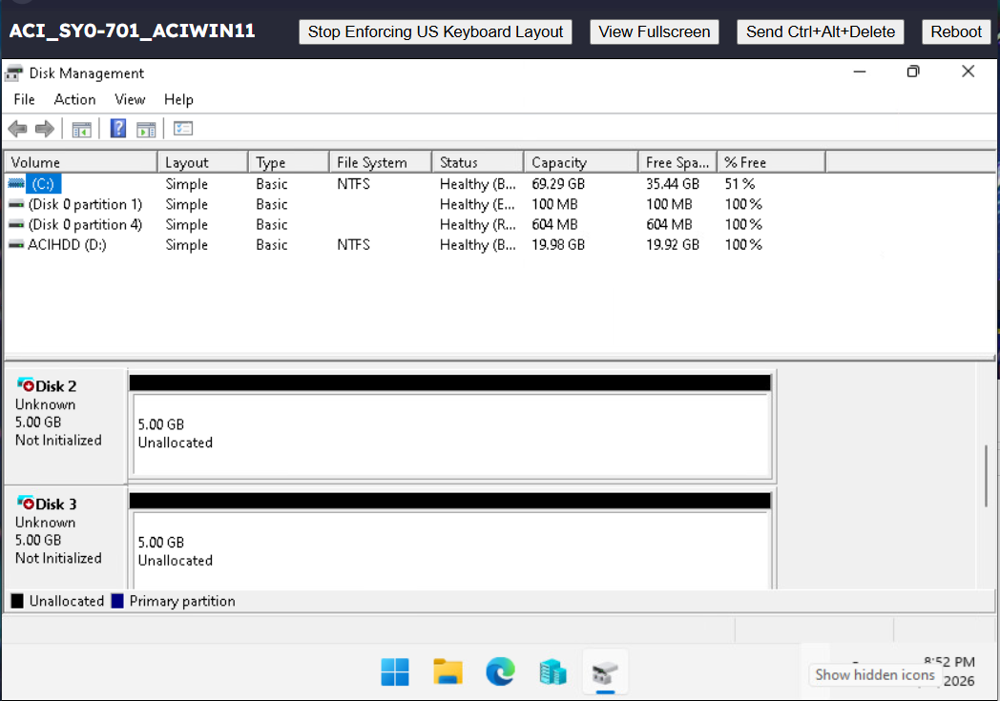
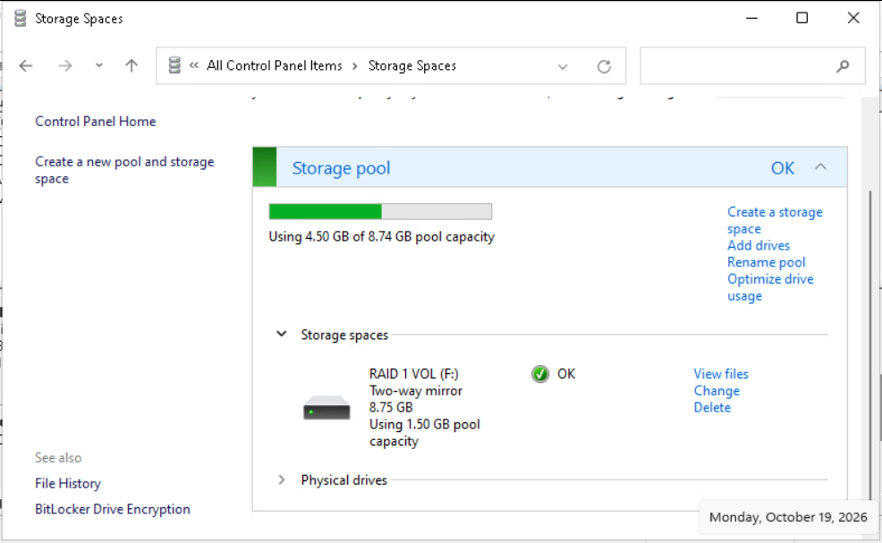
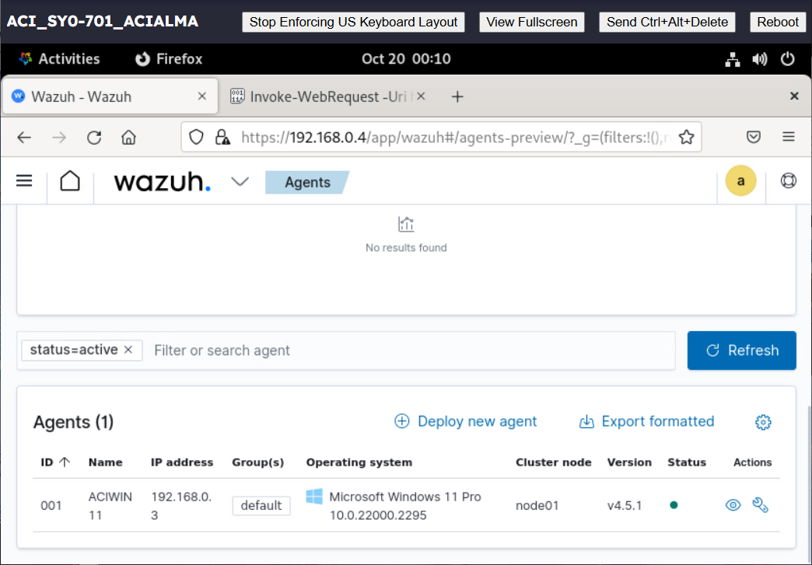
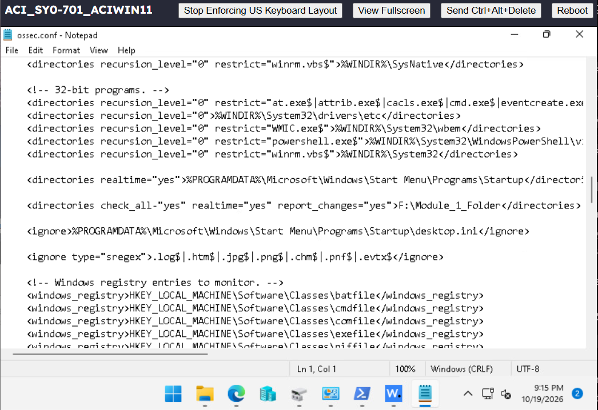
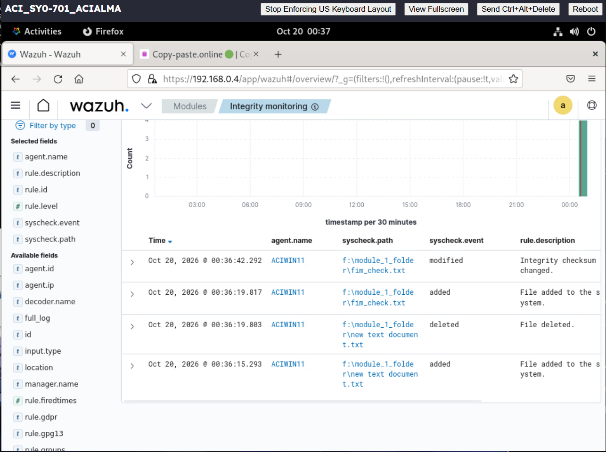
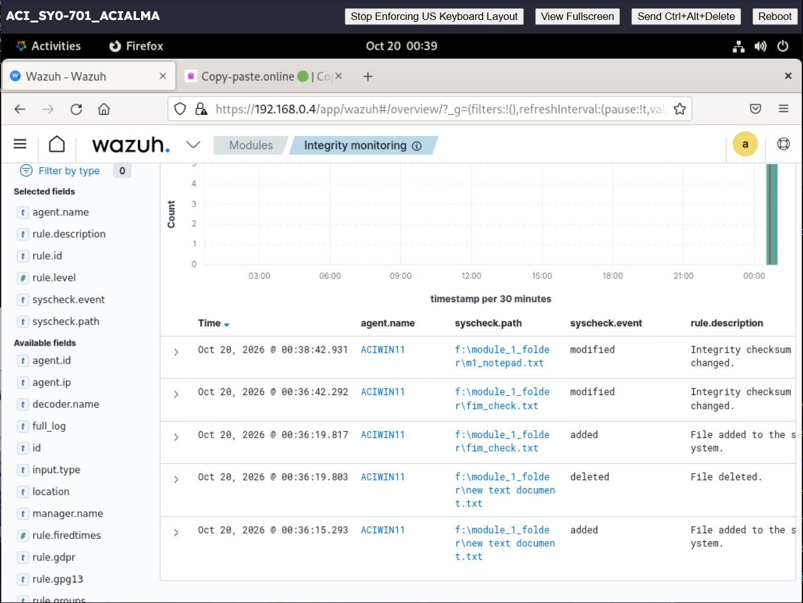

# Security Concept Fundamentals — Storage Resilience & File Integrity Monitoring

**Training environment:** ACI Learning, CompTIA Security+ (SY0-701) Skill Labs  
**Lab status:** Completed — both exercises verified  
**Focus:** Availability (two-way storage mirroring) and integrity (Wazuh File Integrity Monitoring)

## Overview

This lab demonstrated two practical security concepts:

1. **Availability:** Configure two virtual hard disks as a mirrored storage space in Windows 11.
2. **Integrity:** Deploy a Wazuh Windows agent, monitor a folder on the mirrored volume, and validate file-change detections by performing authorized tests.

This is an independently written record of my work in a guided ACI Learning training environment, not a reproduction of the course instructions.

## Lab Environment

| Component | Configuration | Role |
|---|---|---|
| `ACIWIN11` | Windows 11 Pro | Storage Spaces, monitored endpoint, Wazuh agent v4.5.1 |
| `ACIALMA` | AlmaLinux 9.1 | Preconfigured Wazuh manager and dashboard |
| `ACIDC01` | Windows Server 2022 | Lab domain controller (available in the environment) |
| `F:\Module_1_Folder` | Mirrored NTFS volume | Directory targeted for FIM testing |

> **Scope:** The environment and IP addresses shown in the screenshots belong to the isolated training lab. No production systems were used.

## Exercise 1 — Configure Mirrored Storage

### Objective

Create two virtual hard disks and use Windows Storage Spaces to demonstrate storage redundancy.

### Implementation

- Created two **5 GB VHDs** using Windows Disk Management.
- Verified that Windows detected both as initially uninitialized and unallocated disks.
- Created a storage pool from the two VHDs and configured a **two-way mirror** called `RAID 1 VOL`.
- Assigned drive letter `F:` and used NTFS.
- Verified the storage pool and storage space reported **OK** in Windows Storage Spaces.
- Copied `Module_1_Folder` from the lab's `D:` drive to the `F:` volume to prepare for FIM testing.

### Verification evidence

**Two VHDs visible in Disk Management:**



**Storage Spaces explicitly identifies the two-way mirror as healthy:**



### Interpretation and limitations

The interface confirmed that the mirrored storage space was configured and healthy. **A disk-failure or recovery test was not performed**, so this exercise did not independently demonstrate failover behavior. Also, because the VHDs reside on the same underlying lab storage, the exercise models logical mirroring rather than providing resilience to a physical host-disk failure. Mirroring is not a replacement for backups: deletions and malicious modifications can be mirrored too.

## Exercise 2 — Configure and Test Wazuh FIM

### Objective

Configure endpoint file-integrity monitoring and verify that monitored file creation, renaming, and modification generate Wazuh events.

### Implementation

- Started the preinstalled Wazuh manager service on `ACIALMA`.
- Installed and started Wazuh agent **v4.5.1** on `ACIWIN11`.
- Verified that Wazuh showed the Windows endpoint as an active agent.
- Configured the Wazuh agent's `ossec.conf` file to monitor `F:\Module_1_Folder`:

```xml
<directories check_all="yes" realtime="yes"
report_changes="yes">F:\Module_1_Folder</directories>
```

- Saved the configuration and restarted the Windows Wazuh agent.
- Performed controlled file-system modifications inside the monitored directory.

### Verification evidence

**Windows endpoint registered and active:**



**Monitored directory configuration:**



### Test A — Create, rename, and edit a file

Created a new text file in `F:\Module_1_Folder`, renamed it to `FIM_Check.txt`, then entered and saved text in it.

The Wazuh dashboard recorded this event sequence (timestamps as displayed in the training VM):

| Timestamp (Oct. 20, 2026) | Observed event | Path / file |
|---|---|---|
| 00:36:15 | Added | `New Text Document.txt` |
| 00:36:19 | Deleted | `New Text Document.txt` |
| 00:36:19 | Added | `FIM_Check.txt` |
| 00:36:42 | Modified; integrity checksum changed | `FIM_Check.txt` |

**Evidence:**



**Interpretation:** In this test, Wazuh represented the filename change as deletion of the old path and addition of the new path. The later checksum alert showed that the newly named file's monitored integrity information had changed. These were **authorized test actions**, not evidence of a real intrusion.

### Test B — Modify an existing file

Opened `F:\Module_1_Folder\M1_Notepad.txt`, deleted a single character, and saved the file.

| Field | Observed result |
|---|---|
| Agent | `ACIWIN11` |
| File | `F:\Module_1_Folder\M1_Notepad.txt` |
| Event | `modified` |
| Rule description | `Integrity checksum changed.` |
| Observed rule ID | **550** (`Integrity checksum changed.`) |
| Reported rule level | **7** |
| Alert timestamp shown | **2026-10-20 00:38:42** (lab VM time) |
| Integrity evidence | **Before and after SHA-1 and SHA-256 hashes** shown in expanded event details |
| Alert identifier | `1792471122.1579478` (reported from the event details) |

**Evidence:**



**Rule ID clarification:** The expanded event showed **`rule.id: 550`** (the Wazuh `Integrity checksum changed.` rule) with **`rule.level: 7`**. The longer value `1792471122.1579478` is the individual **alert `id`**, not the rule ID.

### Analysis

The FIM test confirmed that the Windows agent reported monitored file-system changes to Wazuh. The recorded previous and current hash values provide integrity evidence that can be compared across file versions. Hash evidence alone **does not identify the actor, motive, or authorization status**. In an operational investigation, an analyst would correlate this event with contextual telemetry (for example, process activity, user attribution when collected, and approved change records) before determining whether to escalate it.

## Key Takeaways

- Learned how Windows Storage Spaces implements two-way mirroring in a lab environment.
- Configured and validated Wazuh endpoint monitoring on Windows 11.
- Used real-time FIM to observe file creation, deletion/rename, and content modification events.
- Examined the distinction between a Wazuh detection rule, a severity level, and an individual alert identifier.
- Practiced evidence-based interpretation: **a detected change is not automatically a security incident**.

## Limitations / Follow-up Opportunities

- No simulated disk outage or mirror recovery verification was performed.
- The course exercise used a prepared environment and a guided installation procedure.
- The visible FIM alerts confirmed changes, but the exercise did not establish user/process attribution.
- A useful independent follow-up in the Black Shores homelab would be to monitor a sensitive directory, generate authorized and unauthorized-style test changes, collect supporting host logs, and practice alert triage.

## References

- ACI Learning, *Security Concept Fundamentals*, CompTIA Security+ SY0-701 Skill Lab (guided training exercise; course material not republished here).
- [Wazuh documentation — File integrity monitoring and threat detection rules](https://documentation.wazuh.com/current/user-manual/capabilities/malware-detection/fim-threat-detection-rules.html)

