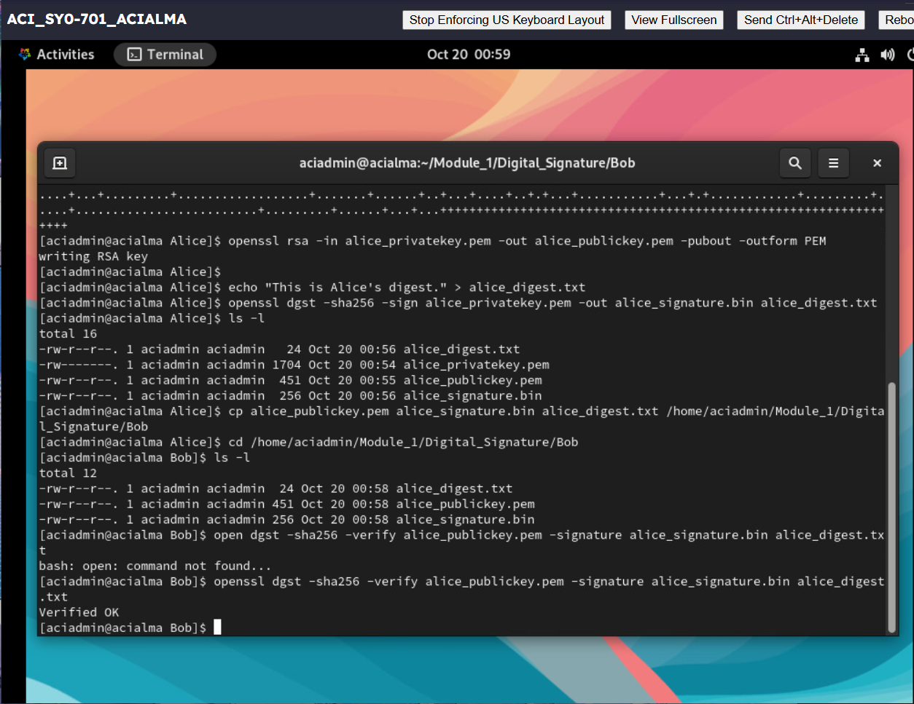
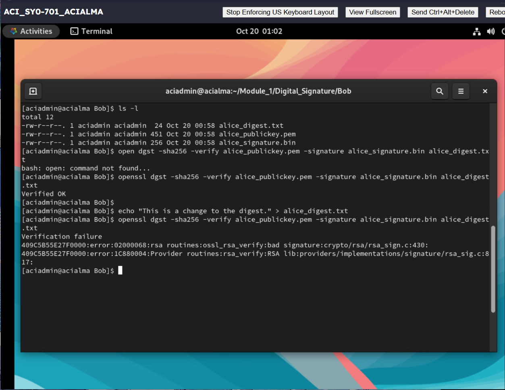
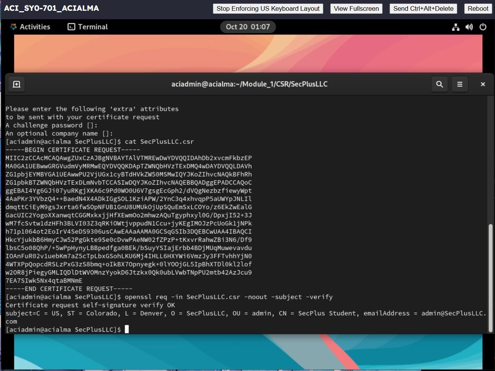
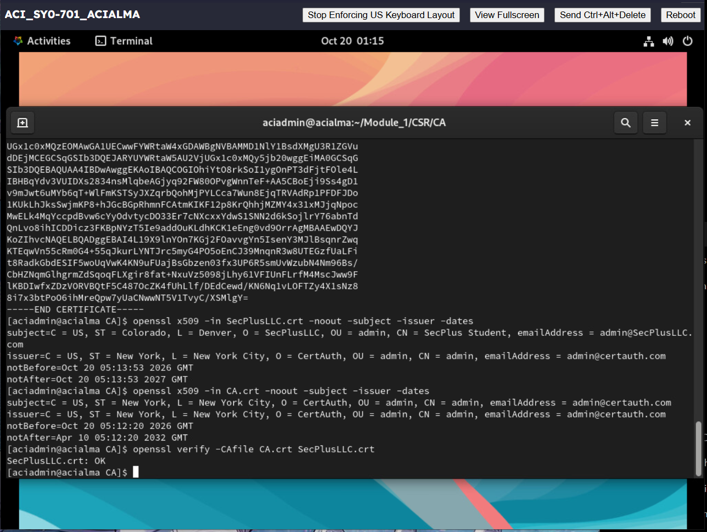

# Cryptographic Solutions — Digital Signatures & Certificate Issuance

**Training platform:** ACI Learning — CompTIA Security+ (SY0-701) Skill Labs  
**Status:** Completed — both guided exercises verified  
**Tools:** OpenSSL, AlmaLinux 9.1, Bash  
**Focus:** Asymmetric cryptography, RSA signatures, SHA-256, certificate signing requests (CSRs), certificate authorities (CAs)

## Overview

This lab used OpenSSL to demonstrate two related applications of asymmetric cryptography:

1. **Digital signatures:** Generate Alice's RSA key pair, sign a text message, verify the signature as Bob, and observe verification failure after modifying the message.
2. **Certificate issuance:** Generate a CSR for the fictional organization SecPlusLLC, act as a simulated certificate authority named CertAuth, issue a signed certificate, and verify it using the CA certificate.

The environment and exercises were provided by **ACI Learning**. The explanations, observations, verification steps beyond the base exercise, and screenshots in this repository document my hands-on lab work. They are not a reproduction of the course's step-by-step instructional material.

## Lab environment

| Component | Role |
|---|---|
| `ACIALMA` | AlmaLinux 9.1 training VM where all OpenSSL commands were executed |
| OpenSSL CLI | RSA key generation, SHA-256 signing/verification, CSR creation, and X.509 certificate issuance/verification |
| `Alice/` and `Bob/` | Local directories simulating message signing and receipt |
| `SecPlusLLC/` and `CA/` | Local directories simulating the certificate requester and issuing CA |

**Scope:** All actors and organizations were fictional, and no production PKI or external certificate service was involved. The private-key files and other generated cryptographic artifacts are **not** included in this repository.

## Exercise 1 — Create and verify a digital signature

### Objective

Demonstrate that an RSA digital signature can validate the integrity of a specific message relative to a corresponding public key, and detect changes to that message.

### Implementation

Created separate `Alice` and `Bob` directories. In Alice's directory, generated a private RSA key and exported its public key:

```bash
openssl genpkey -algorithm RSA -out alice_privatekey.pem
openssl rsa -in alice_privatekey.pem -out alice_publickey.pem -pubout -outform PEM
```

Created a short plaintext message and signed it using SHA-256 and Alice's private key:

```bash
echo "This is Alice's digest." > alice_digest.txt
openssl dgst -sha256 -sign alice_privatekey.pem \
  -out alice_signature.bin alice_digest.txt
```

> **Terminology:** The course names the text file `alice_digest.txt`, but its contents are the **original plaintext message**, not a precomputed hash. OpenSSL computes the SHA-256 digest as part of the signing operation; the signature is not encryption of the whole message.

Copied only the **public key**, **message**, and **signature** into Bob's directory. Alice's private key stayed in Alice's directory.

```bash
cp alice_publickey.pem alice_signature.bin alice_digest.txt \
  /home/aciadmin/Module_1/Digital_Signature/Bob
```

### Test A — Verify the unchanged message

From Bob's directory:

```bash
openssl dgst -sha256 -verify alice_publickey.pem \
  -signature alice_signature.bin alice_digest.txt
```

**Observed output:** `Verified OK`.



**Interpretation:** The signature verifies for the supplied message and public key. This supports message integrity and possession of the matching private key by the signer, but does **not independently establish that the public key truly belongs to Alice**. Authenticating the key's owner requires a separate trust mechanism.

### Test B — Modify the message without re-signing

Replaced Bob's copy of the text file while retaining the original signature:

```bash
echo "This is a change to the digest." > alice_digest.txt
openssl dgst -sha256 -verify alice_publickey.pem \
  -signature alice_signature.bin alice_digest.txt
```

**Observed output:** `Verification failure`, accompanied by an RSA `bad signature` diagnostic. The original `Verified OK` output is also visible in this screenshot.



| Condition | Expected | Observed | Result |
|---|---|---|---|
| Original message and original signature | Verification succeeds | `Verified OK` | Pass |
| Changed message and original signature | Verification fails | `Verification failure` | Pass |

**Interpretation:** The original signature did not validate against the modified message. This demonstrates tamper detection, not who made the change or whether the modification was malicious.

## Exercise 2 — Generate a CSR and issue a certificate

### Objective

Demonstrate a basic PKI workflow by generating a CSR for SecPlusLLC, issuing an X.509 certificate from a simulated CA, and checking the resulting certificate against the supplied CA certificate.

### Implementation

In `Module_1/CSR/SecPlusLLC`, generated a 2048-bit RSA private key and a CSR:

```bash
openssl req -newkey rsa:2048 \
  -keyout SecPlusLLC_privatekey.pem -out SecPlusLLC.csr
```

Used the fictional organization and certificate subject values supplied by the lab (including `O=SecPlusLLC` and `CN=SecPlus Student`). The generated private key was protected with the lab-specified passphrase; the passphrase is **not** reproduced here.

Independently inspected the CSR and verified its self-signature:

```bash
openssl req -in SecPlusLLC.csr -noout -subject -verify
```

**Observed:** `Certificate request self-signature verify OK`, along with the CSR subject including `C=US`, `ST=Colorado`, `L=Denver`, `O=SecPlusLLC`, `OU=admin`, and `CN=SecPlus Student`.



**Interpretation:** CSR self-signature verification checks cryptographic consistency and that the request was signed using the private key corresponding to the included public key. It **does not** validate the organization's identity, domain ownership, or authorization to obtain a publicly trusted certificate.

Copied the CSR to the simulated `CA` directory. Then created a CA private key and self-signed CA certificate using CertAuth's fictional identity:

```bash
openssl genpkey -algorithm RSA -out CA_privatekey.pem
openssl req -x509 -new -key CA_privatekey.pem -days 1999 -out CA.crt
```

Issued a 365-day certificate for SecPlusLLC using the local CA key:

```bash
openssl x509 -req -in SecPlusLLC.csr \
  -CA CA.crt -CAkey CA_privatekey.pem -CAcreateserial \
  -out SecPlusLLC.crt -days 365 -sha256
```

### Verification evidence

Inspected the newly issued certificate's subject, issuer, and validity period, then verified it using the explicitly supplied CA certificate:

```bash
openssl x509 -in SecPlusLLC.crt -noout -subject -issuer -dates
openssl verify -CAfile CA.crt SecPlusLLC.crt
```

| Field | Observed result |
|---|---|
| Leaf certificate subject | `O=SecPlusLLC`, `CN=SecPlus Student` |
| Leaf certificate issuer | `O=CertAuth`, `CN=admin` |
| Leaf certificate validity | Oct. 20, 2026–Oct. 20, 2027 (lab clock, GMT output) |
| CA certificate | Self-signed: subject and issuer both identify CertAuth |
| Trust check | `SecPlusLLC.crt: OK` |



**Interpretation:** `SecPlusLLC.crt: OK` confirms that OpenSSL accepted the issued certificate with `CA.crt` supplied as its trust anchor. This does **not** mean the certificate is trusted by browsers or the public Internet; we established trust locally for this exercise.

Finally, copied `SecPlusLLC.crt` into the requester's directory. Verified that `SecPlusLLC/` contained the three expected files:

- `SecPlusLLC_privatekey.pem`
- `SecPlusLLC.csr`
- `SecPlusLLC.crt`

This confirmed the simulated delivery step was completed; no extra screenshot was necessary.

## Security observations and limitations

- **Private-key permissions:** An `ls -l` result during Exercise 1 showed Alice's unencrypted private key with `-rw-r--r--` permissions (world-readable on a typical Unix filesystem). Real private keys should be restricted to their intended owner, for example with `chmod 600 alice_privatekey.pem`, and protected with appropriate storage and access controls. The lab did not include a private-key hardening step.
- **Training-only CA:** The CA was created locally and the lab simulated approval. No real identity or domain-control validation was performed.
- **Trust is contextual:** Cryptographic signature verification is distinct from establishing the signer's real-world identity. The certificate validation depended on an explicitly trusted self-signed CA.
- **Certificate usage:** The subject's common name was a fictional student identity. This exercise did not demonstrate issuance of a production TLS server certificate with a validated DNS identity and suitable Subject Alternative Name.
- **No key material published:** This repository includes only user-captured terminal screenshots and explanatory notes, not generated private keys, encrypted-key files, passphrases, or certificate bundles.

## Key takeaways

1. Created a private/public RSA key pair and used SHA-256 with RSA to sign a plaintext message.
2. Verified a matching signature and intentionally caused signature verification to fail by altering the signed message.
3. Created a CSR and checked its self-signature and identifying attributes.
4. Issued a certificate through a simulated CA and verified it against a local trust anchor.
5. Distinguished **integrity/authenticity checks** from **confidentiality**, **identity proofing**, and **public trust**.

## Further practice

A useful next exercise in the independent **Black Shores homelab** would be to build a small internal CA, apply restrictive key permissions, issue a certificate with an appropriate Subject Alternative Name for an internal service, and inspect how clients establish (or fail to establish) trust. This is a proposed extension, **not work completed in this ACI lab**.

## References

- ACI Learning, *Cryptographic Solutions*, CompTIA Security+ SY0-701 Skill Lab (guided training source; instructions not reproduced).
- OpenSSL command-line utilities used during the exercise: `genpkey`, `rsa`, `dgst`, `req`, `x509`, and `verify`.
