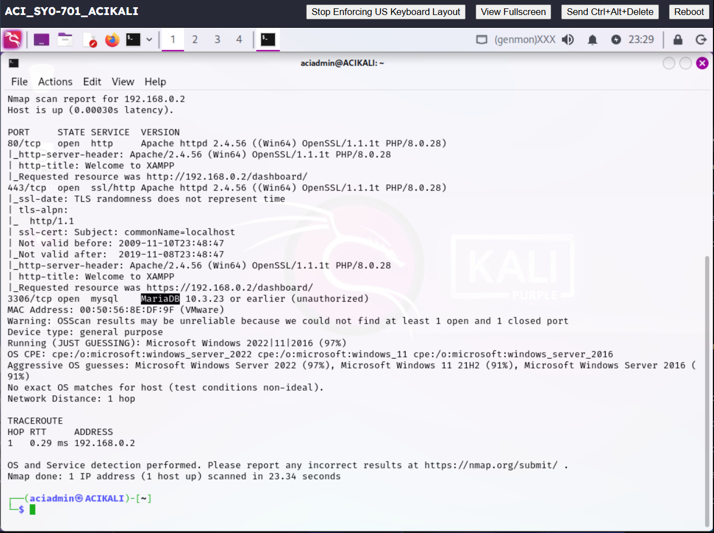
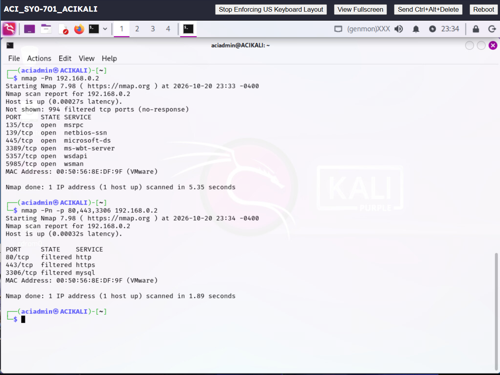
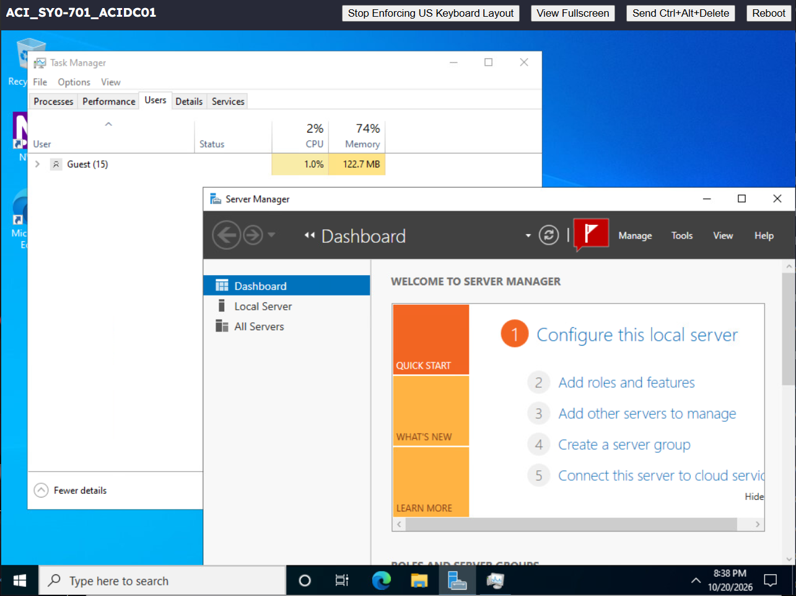
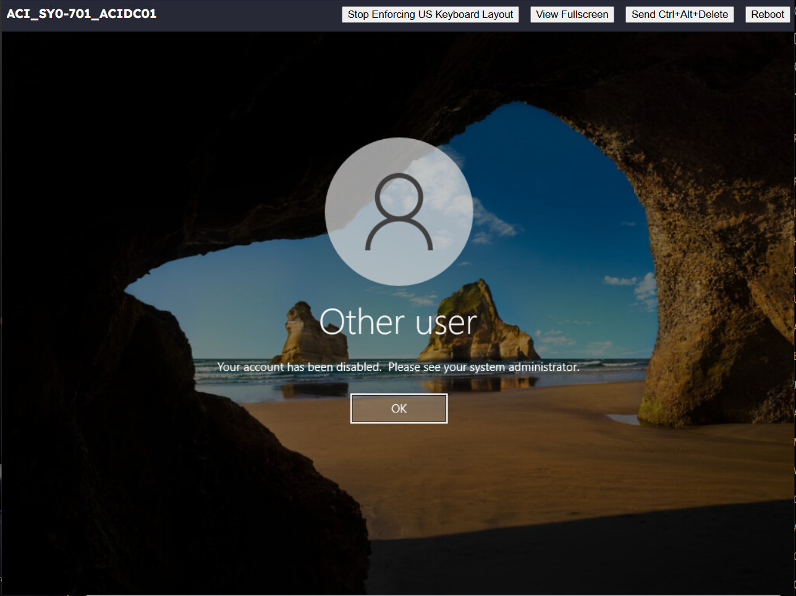
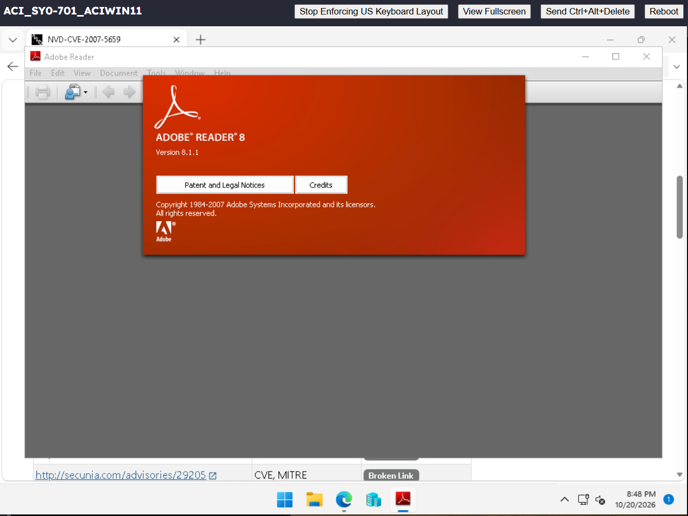
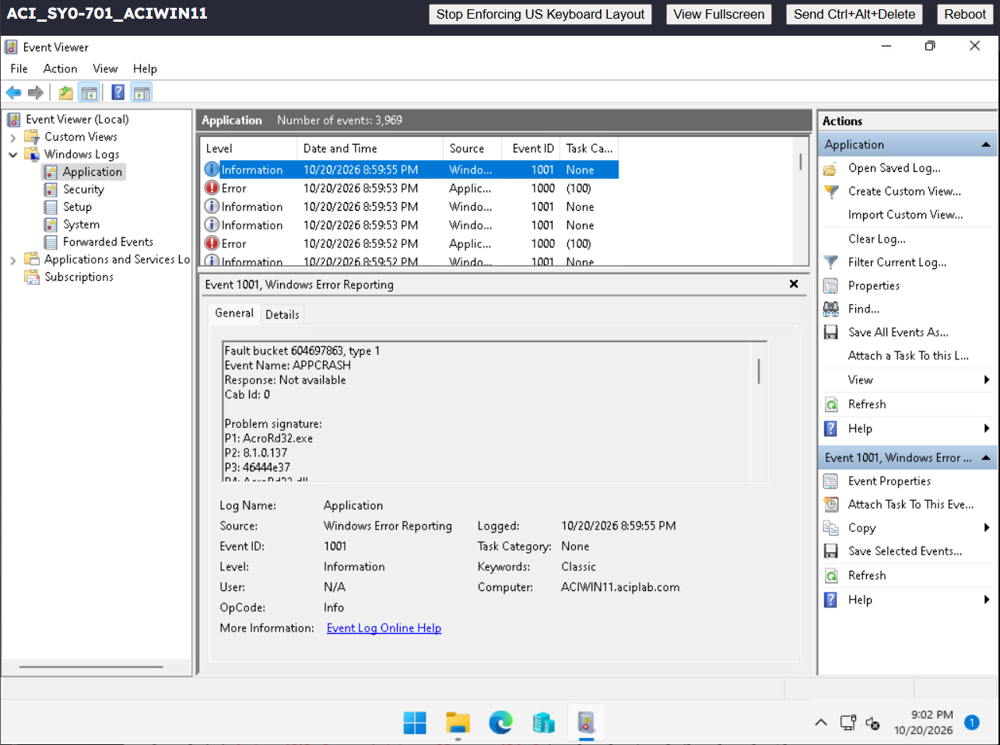
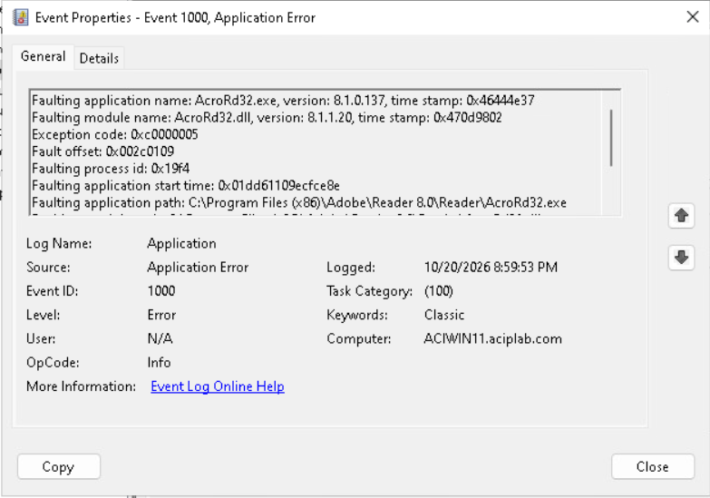

# Threat Vectors and Attack Surfaces — Exposure Assessment, Remediation & Log Investigation

**Training platform:** ACI Learning — CompTIA Security+ (SY0-701) Skill Labs  
**Status:** Completed — three guided exercises, with independently reviewed verification evidence  
**Tools:** Nmap, Windows Defender Firewall, Active Directory Users and Computers (ADUC), Microsoft Event Viewer, Metasploit, Kali Purple  
**Focus:** Attack surface identification, port filtering, account hardening, vulnerable software assessment, and crash-event correlation

## Overview

This guided lab examined three sources of attack surface exposure in a fictional Windows domain environment:

1. **Unnecessary network services:** Identify exposed Apache and database ports from a separate workstation, restrict inbound traffic with a Windows firewall rule, and validate the change with a second scan.
2. **Unnecessary Guest access:** Demonstrate passwordless Guest login to a domain controller, disable the Guest account, and test that sign-in is denied.
3. **Vulnerable client software:** Identify Adobe Reader 8.1.1, research the vulnerability identified in the training materials, conduct a contained attack simulation, and correlate Windows application crash events.

The lab environment and scenario were supplied by **ACI Learning**. This repository contains my own screenshots, implementation summary, observations, and analysis—not copies of the provider's instructional pages. The attack-simulation component occurred only within the authorized training environment.

## Environment and scope

| Host | Operating system / role | Activity |
|---|---|---|
| `ACIDM01` (`192.168.0.2`) | Windows Server 2022, domain member | XAMPP services; inbound firewall remediation |
| `ACIKALI` | Kali Purple 2023.1 | Authorized Nmap service discovery; contained simulation |
| `ACIDC01` | Windows Server 2022, domain controller | Guest account assessment and remediation |
| `ACIWIN11` | Windows 11 Pro, domain member | Adobe Reader version check and Event Viewer investigation |

IP addresses and names shown here belong to the self-contained training lab. No external systems were scanned or targeted.

---

## Exercise 1 — Identify and restrict exposed services

### Objective

Find services on `ACIDM01` that are unnecessary for the server's assigned function and reduce their network exposure.

### Discovery

Started the preconfigured Apache and MySQL/MariaDB services using XAMPP on the training Windows server. From `ACIKALI`, performed a baseline TCP scan and a detailed scan of the three relevant ports:

```bash
nmap -Pn 192.168.0.2
nmap -Pn -A -p 80,443,3306 192.168.0.2
```

The `-Pn` option skips host discovery; `-A` enables additional service/OS identification, default scripts, and traceroute. The targeted `-A` scan was confined to the three ports identified in the exercise.

**Observed findings:**

| Port | Initial state | Service information |
|---|---|---|
| `80/tcp` | Open | Apache HTTP Server 2.4.56 |
| `443/tcp` | Open | Apache HTTP Server 2.4.56 |
| `3306/tcp` | Open | MariaDB 10.3.23 or earlier (as reported by Nmap) |



**Assessment:** These services were unexpected for the domain member's intended role in the scenario. Their exposure increased the available network attack surface. An open port is not inherently a vulnerability; the risk comes from unnecessary access and the software or configuration behind the service.

**Other observations:** The HTTPS endpoint presented a certificate issued for `localhost` with a displayed expiration date in 2019. Nmap also warned that its operating-system identification might be unreliable under the scan conditions. Neither observation was separately remediated during this exercise.

### Remediation and verification

On `ACIDM01`, created an **enabled inbound TCP Block rule** in Windows Defender Firewall for ports **80, 443, and 3306**, applying it to Domain, Private, and Public profiles. Named the rule `Close unnecessary ports`.

Returned to `ACIKALI` to repeat the baseline scan and run a targeted recheck:

```bash
nmap -Pn 192.168.0.2
nmap -Pn -p 80,443,3306 192.168.0.2
```

| Port | Before | After |
|---|---|---|
| `80/tcp` | Open | **Filtered** |
| `443/tcp` | Open | **Filtered** |
| `3306/tcp` | Open | **Filtered** |



**Result:** From the scanning workstation, Nmap could no longer confirm access to the three services. `Filtered` supports the effectiveness of the network restriction; it does **not** mean the listening services themselves were stopped or uninstalled. Other ports such as SMB (445), RDP (3389), and WinRM (5985) remained visible in the post-change scan and were outside this exercise's remediation scope.

**Operational consideration:** In production, unnecessary services should also be evaluated for shutdown or removal, and any remaining accessible management services should be justified and access-controlled.

---

## Exercise 2 — Disable unnecessary Guest authentication

### Objective

Test whether the domain's Guest account allowed an unauthenticated-password login, then prevent further Guest sign-in.

### Assessment

On `ACIDC01`, attempted the supplied `Guest` logon with the password field empty. The sign-in succeeded. Task Manager's **Users** tab showed the active Guest session.



**Finding:** The prepared lab allowed a passwordless Guest session. This represented an unnecessary authentication path. The exercise did **not** establish that Guest had administrative privileges or specific access to sensitive resources.

### Remediation and verification

Signed out, authenticated as the authorized lab administrator, and used **Active Directory Users and Computers → Users → Guest → Disable Account**.

Repeated the sign-in attempt as Guest. Windows displayed: *Your account has been disabled. Please see your system administrator.*



**Result:** Guest login was permitted before the change and explicitly denied after the account was disabled. This demonstrates attack surface reduction via identity and access management rather than network filtering.

---

## Exercise 3 — Identify vulnerable software and investigate an attempted exploit

### Objective

Identify an unapproved, outdated application, examine its documented exposure, and interpret the event evidence produced by a **contained, unsuccessful** simulated attack.

### Vulnerability identification

On `ACIWIN11`, opened Adobe Reader's **About** dialog and verified **Adobe Reader 8.1.1** was installed.



The ACI training material identified **CVE-2007-5659** and cited a **CVSS v2 base score of 9.3/10** for the historical vulnerability. This is a version-specific software exposure finding; it is not evidence that the workstation had already been compromised.

**External reference:** [NIST NVD — CVE-2007-5659](https://nvd.nist.gov/vuln/detail/CVE-2007-5659).

### Contained simulation and observed behavior

Using the provided ACI virtual machines and guided Metasploit file-format module, generated the test file `msf.pdf`, copied it within the authorized ACI environment, and opened it using the legacy Adobe Reader installation on `ACIWIN11`. The lab states that this historical exploit is not expected to succeed against Windows 11 because of its target-environment requirements.

The test PDF was **not** retained or published, and the screenshots do not demonstrate execution of a remote shell or other successful post-exploitation behavior.

### Windows application log investigation

After the test PDF was opened, inspected **Event Viewer → Windows Logs → Application**. Two temporally associated records were captured:

| Local VM time, Oct. 20, 2026 | Source | Event ID | Evidence |
|---|---|---|---|
| 8:59:53 PM | Application Error | **1000** | Adobe Reader process failure |
| 8:59:55 PM | Windows Error Reporting | **1001** | `APPCRASH` report naming `AcroRd32.exe` |



The **Event 1000** General tab provided the more actionable crash details:

| Field | Observed value |
|---|---|
| Faulting application | `AcroRd32.exe` |
| Executable version | `8.1.0.137` |
| Faulting module | `AcroRd32.dll` |
| Module version | `8.1.1.20` |
| Exception code | `0xc0000005` |
| Fault offset | `0x002c0109` |
| System | `ACIWIN11.aciplab.com` |



**Interpretation:** `0xc0000005` indicates an **access violation**—a disallowed memory operation by the process. The crash occurred immediately following a known controlled test involving a crafted PDF, supporting an association between the test and the failure. The application and DLL version values refer to different binaries and need not match exactly.

**Evidence limitations:** A crash and APPCRASH report alone do **not** establish arbitrary code execution, persistence, credential access, or successful compromise. More telemetry, such as process creation events, file activity, and endpoint security detections, would be needed to assess those possibilities in a real investigation.

### Recommended response in a production setting

Remove or replace obsolete software; investigate unauthorized software installation; restrict application execution or installation as appropriate; and correlate suspicious attachment/file activity with endpoint and user telemetry. These are **recommendations**, not remediation steps executed in this training exercise.

---

## Consolidated results

| Exercise | Security issue | Control or investigation | Verified result |
|---|---|---|---|
| Open ports | Unexpected Apache and MariaDB exposure | Windows inbound firewall rule and Nmap rescan | TCP 80, 443, 3306 changed from **open** to **filtered** |
| Guest account | Passwordless Guest sign-in | Disabled account in ADUC, attempted login again | Sign-in denied with disabled-account message |
| Vulnerable application | Adobe Reader 8.1.1 and historical CVE exposure | Version check; controlled PDF test; Event Viewer analysis | Correlated Event IDs 1000 and 1001, including access-violation details; **no successful exploitation established** |

## Key takeaways

1. **Detect, remediate, verify:** A baseline scan and a post-change scan made the firewall control's effect observable.
2. **Different controls reduce different risks:** Network firewall rules restrict reachability, while disabling unnecessary accounts reduces authentication paths.
3. **Version-specific context matters:** Exact software versions and trusted vulnerability references help prioritize risk.
4. **Event correlation matters:** Event 1000 provided the crash mechanics; Event 1001 provided the Windows Error Reporting context.
5. **Avoid overclaiming:** A crafted file and access-violation crash are consistent with an attack attempt but are not proof of successful compromise.

## Further practice — not part of this completed lab

In an independent homelab such as **Black Shores**, repeat a baseline/mitigation/retest workflow using a deliberately exposed nonproduction service, then forward endpoint crash and process telemetry into a SIEM to practice alert enrichment and triage. This is a **proposed extension**, not evidence of work completed here.

## References and publication notes

- ACI Learning, *Threat Vectors and Attack Surfaces*, CompTIA Security+ SY0-701 Skill Lab (source scenario and lab environment; proprietary training instructions are **not** reproduced).
- [NIST NVD — CVE-2007-5659](https://nvd.nist.gov/vuln/detail/CVE-2007-5659).
- All screenshots in `screenshots/` were captured from my own lab session. No malicious test document, credentials, private keys, secrets, or third-party training diagrams are included.
