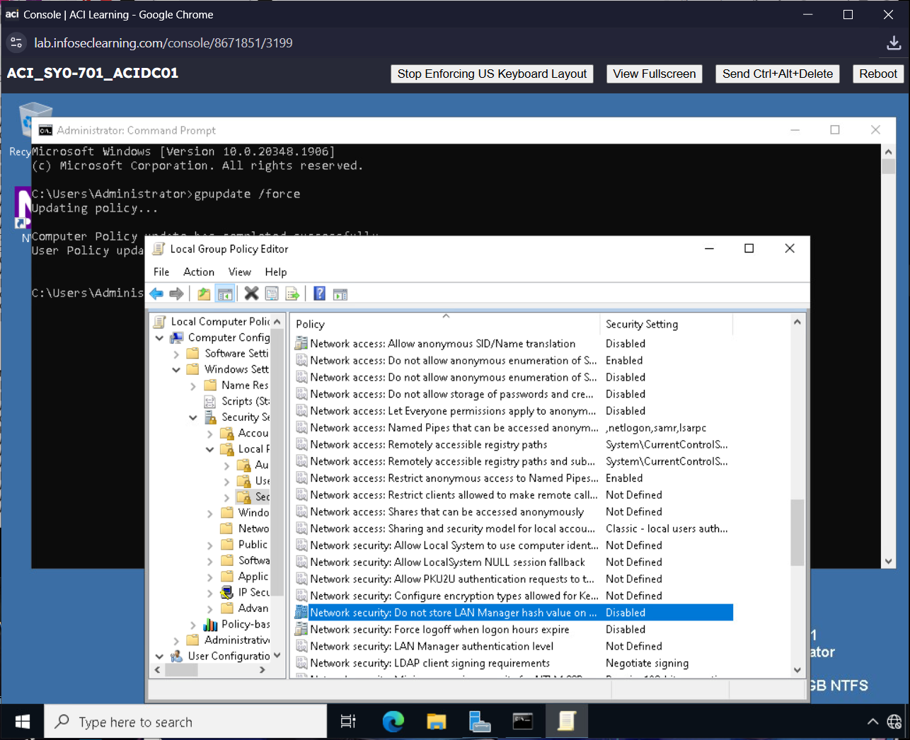
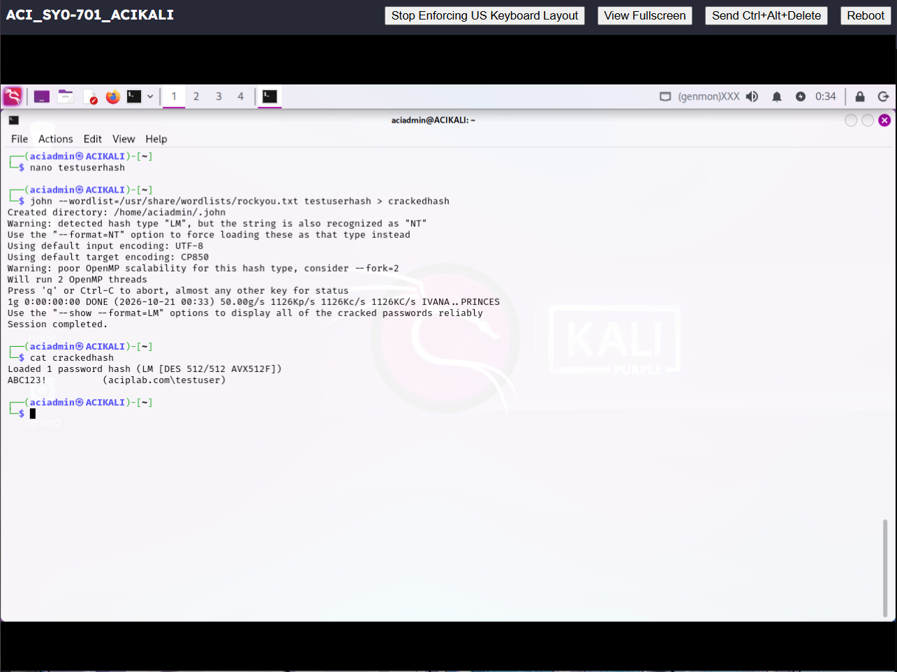
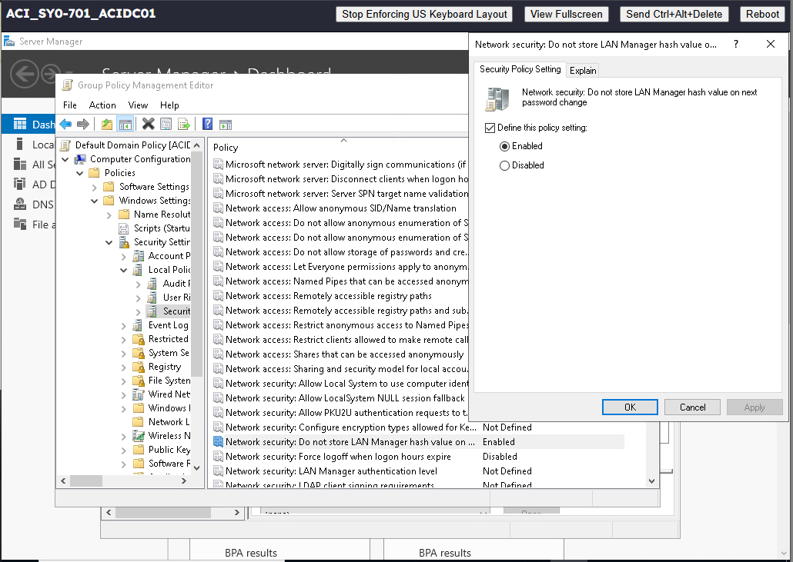
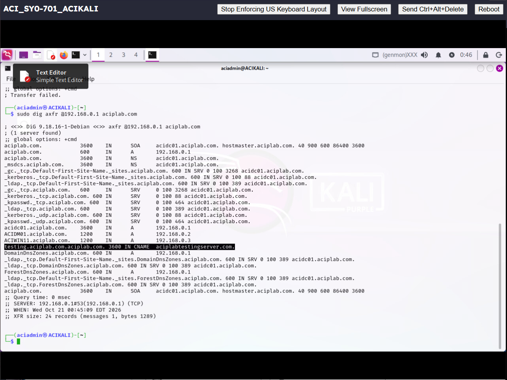

# Identifying Security Vulnerabilities — LM Hash Storage and DNS Zone Transfers

**Training platform:** ACI Learning — CompTIA Security+ (SY0-701) Skill Labs  
**Lab:** 04 of 18 · *Identifying Security Vulnerabilities*  
**Status:** Lab demonstrations completed; LM domain policy restored in Group Policy Management; final DNS restriction restoration **not performed or verified** before the lab session closed  
**Focus:** Credential-storage misconfiguration, password-hash exposure, DNS zone disclosure, and security-control validation  
**Tools:** Windows Server 2022, Active Directory, Group Policy Management, Kali Purple, Impacket, John the Ripper, DNS Manager, `dig`

## Overview

This ACI Learning guided lab investigated two configuration weaknesses within a fictional Active Directory environment:

1. **Legacy LM password hashes:** Compare an initially secure credential-storage state with a deliberately weakened domain policy, then examine the risk through a disposable test account.
2. **Unrestricted DNS zone transfers:** Confirm the DNS server initially refuses a full zone transfer, enable transfers to demonstrate the resulting exposure, and analyze the returned resource records.

I performed the work in ACI's authorized virtual lab and recorded my own results and screenshots. The guidance and environment were provided by ACI Learning; this writeup is my independent summary and analysis, not a reproduction of their instructions. No credential-dump output or recovered hash values are included.

> **Evidence boundary:** The domain policy was visibly changed back to its secure setting. A forced policy refresh after restoration and deletion of the temporary account were recommended, but are **not independently evidenced** here. The DNS setting was **not restored and retested** before the training session was closed. These actions are presented as follow-up controls, not as completed work.

## Environment and scope

| System | Role | Activity |
|---|---|---|
| `ACIDC01` (`192.168.0.1`) | Windows Server 2022 domain controller and DNS server | Group Policy, test account, DNS zone configuration |
| `ACIKALI` | Kali Purple 2023.1 | Authorized credential-storage assessment, controlled password audit, DNS query testing |
| `aciplab.com` | Fictional training domain | Assessment target |

Hostnames, accounts, and internal IP addresses belong only to the supplied training environment. All activity was limited to the authorized lab.

---

## Exercise 1 — LM hash storage misconfiguration

### Objective

Determine whether legacy LAN Manager (LM) password hashes were present, simulate a policy misconfiguration that permits LM hash storage, and demonstrate the risk using a deliberately weak test account.

### Initial assessment: LM storage not observed

From `ACIKALI`, performed the lab-authorized credential-storage assessment of `ACIDC01` using Impacket. The results included **six existing credential entries**. Every LM field showed the standard empty/unavailable LM-hash placeholder:

```text
aad3b435b51404eeaad3b435b51404ee
```

**Interpretation:** This placeholder is consistent with meaningful LM hashes not being stored for those accounts. It does **not** imply those accounts have blank passwords. The NT hash portions of the same output are sensitive credential material and were neither captured as GitHub screenshots nor published.

Confirmed that **Network security: Do not store LAN Manager hash value on next password change** was initially **Enabled**. That policy is intentionally phrased in the negative:

| Policy setting | Meaning |
|---|---|
| **Enabled** | Prevent LM hashes from being stored on subsequent password changes |
| **Disabled** | Permits LM hash storage where supported |

### Introduced misconfiguration

In **Group Policy Management → Default Domain Policy → Computer Configuration → Policies → Windows Settings → Security Settings → Local Policies → Security Options**, set the policy to **Disabled** for the exercise. Ran `gpupdate /force` on `ACIDC01`, then inspected the effective local security setting and confirmed it displayed **Disabled**.



Created a disposable domain account, `testuser`, with a deliberately weak test password supplied in the lab. A second authorized assessment showed that this account now had a populated LM-hash field **different from the baseline placeholder**. The original six accounts still displayed the placeholder.

**Finding:** The deliberate policy change permitted LM credential material to be stored for the newly created training account. That expands the potential impact of credential disclosure.

### Password-recovery test

For the disposable account only, performed the lab-prescribed wordlist audit with **John the Ripper**. The tool recognized an **LM** hash, reported that **1 of 1** hashes had been recovered, and displayed the expected deliberately weak training password.



**Interpretation:** The test illustrates the weakness of combining legacy LM password storage with an easily guessed password. LM's uppercase normalization and independent processing of seven-character portions weaken resistance to offline password attacks. This single result does **not** establish a general cracking time for all passwords or provide a controlled benchmark against a modern storage mechanism.

### Policy restoration and verification scope

Returned to **Default Domain Policy** and changed the LM-hash prevention policy back to **Enabled**. The screenshot shows the setting **Enabled** in the domain Group Policy editor.



**Observed remediation:** The domain GPO setting was restored. **Not separately evidenced:** a post-restoration `gpupdate /force`, effective-setting verification on the machine, or deletion of the `testuser` account. Also, restoring the prevention policy does not retroactively remove already-generated hashes. In a persistent environment, follow-through would include deleting the disposable account and validating the applied policy and credential state.

---

## Exercise 2 — DNS zone transfer information disclosure

### Objective

Test whether a DNS server permits an unauthorized full zone transfer, then deliberately remove transfer restrictions to observe which DNS records become accessible.

### Baseline: transfer denied

On `ACIDC01`, created a training **CNAME** in the `aciplab.com` forward lookup zone. The intended alias was `testing.aciplab.com`, pointing to `aciplabtestingserver.com`.

From `ACIKALI`, attempted a full-zone transfer:

```bash
dig axfr @192.168.0.1 aciplab.com
```

The initial query reported **one server found** and **`Transfer failed`**. This established the restricted baseline; the failure alone does not identify the precise mechanism of the restriction.

### Introduced misconfiguration and test result

In DNS Manager, opened the `aciplab.com` zone's **Properties → Zone Transfers** settings and enabled zone transfers to any server for the training exercise. Repeated the identical `dig axfr` query from `ACIKALI`.

The second request **succeeded**, returning **24 DNS resource records** with an AXFR response size of **1,289 bytes**.



**Records visible in the returned zone included:**

| Record type | Observed examples | Why useful to an analyst |
|---|---|---|
| `A` | `ACIDC01`, `ACIDM01`, `ACIWIN11` and private addresses | Reveals host inventory and addressing |
| `SRV` | LDAP, Kerberos, Global Catalog, and domain services | Reveals likely Active Directory service endpoints |
| `SOA` | `acidc01.aciplab.com`, `hostmaster.aciplab.com`, serial and timing fields | Reveals primary DNS authority and zone metadata |
| `CNAME` | Test alias pointing at `aciplabtestingserver.com` | Reveals configured hostname relationships |

**Unexpected observation:** The actual CNAME in the screenshot appears as `testing.aciplab.com.aciplab.com.` rather than the intended `testing.aciplab.com.`. This appears consistent with entering a fully qualified alias into a field that appends the zone name. The record was returned by the transfer, but it is not the intended label; this is worth validating when configuring DNS aliases independently.

**Assessment:** Allowing an unrestricted AXFR revealed internal naming, host-address mappings, and AD-related service records to the querying lab workstation. This is an **information-disclosure exposure**, not evidence that those hosts were compromised.

### Recommended remediation — not verified in this session

The lab session was closed **before** the unrestricted DNS setting was turned off and retested. Therefore, this writeup does **not** claim DNS transfer restrictions were successfully restored.

For a persistent environment, the follow-up would be:

1. Open **DNS Manager → Forward Lookup Zones → `aciplab.com` → Properties → Zone Transfers**.
2. **Clear “Allow zone transfers”**, or restrict transfer permissions to specifically authorized secondary servers if replication is required.
3. Re-run `dig axfr @192.168.0.1 aciplab.com` from the same unauthorized test client.
4. Record the resulting refusal/failure as the remediation evidence, and correct the unexpected CNAME label if needed.

**Expected result (not observed):** The AXFR request is denied once restrictions are applied. No final post-remediation screenshot was collected.

---

## Consolidated results and evidence

| Assessment | Baseline | Deliberate change | Verified result / evidence |
|---|---|---|---|
| LM hash storage | Six existing accounts had LM placeholder | Set negative LM-prevention policy to Disabled; created `testuser` | Populated LM field observed, weak test password recovered; GPO later shown Enabled again |
| DNS zone transfer | AXFR failed | Allowed transfers to any server | AXFR succeeded and returned 24 records; **DNS remediation not verified** |

**Portfolio evidence saved in this repository:**

1. `screenshots/01-lm-hash-policy-disabled.PNG` — Insecure effective LM hash policy.
2. `screenshots/02-lm-hash-password-recovered.PNG` — Successful disposable-account wordlist audit (no hash dump).
3. `screenshots/03-lm-hash-policy-restored.PNG` — Restored domain GPO setting.
4. `screenshots/04-dns-zone-transfer-successful.PNG` — Failed and successful AXFR behavior and exposed DNS records.

## Key takeaways

- **Misconfigurations can produce concrete security exposures.** A single domain policy or DNS zone option changed what sensitive information was available.
- **Preserve a baseline.** The six preexisting LM placeholders and the initially denied AXFR request gave a comparison against which to interpret the changes.
- **Handle credential evidence carefully.** Raw NT/LM credential data should not be included in a public portfolio.
- **Validate results, and label gaps.** Restoring a GPO setting is not the same as independently verifying that the effective setting refreshed. Likewise, a DNS control cannot be described as remediated without the post-change test.
- **Scope conclusions to the evidence.** Successful password recovery concerns the known weak disposable account; exposed DNS records are information disclosure, not proof of exploitation of the named hosts.

## Follow-on practice — not part of this completed lab

In an independently managed nonproduction environment (such as **Black Shores**), validate DNS zone-transfer restrictions from a separate test host and inspect effective Group Policy settings without intentionally weakening a real identity environment. Record pre-change and post-change control evidence as part of a change-management workflow.

## References and publication notes

- ACI Learning, *Identifying Security Vulnerabilities*, CompTIA Security+ (SY0-701) Skill Labs; guided source scenario, environment, and expected outcomes. ACI's proprietary instructional PDF and graphics are **not** reproduced here.
- All screenshots were captured during my own authorized ACI lab session.
- Do **not** add password dumps, raw hash files, recovered real-world credentials, wordlist archives, or secret-bearing output to the repository. The test environment and test-account password shown in the instructional exercise are fictional.
