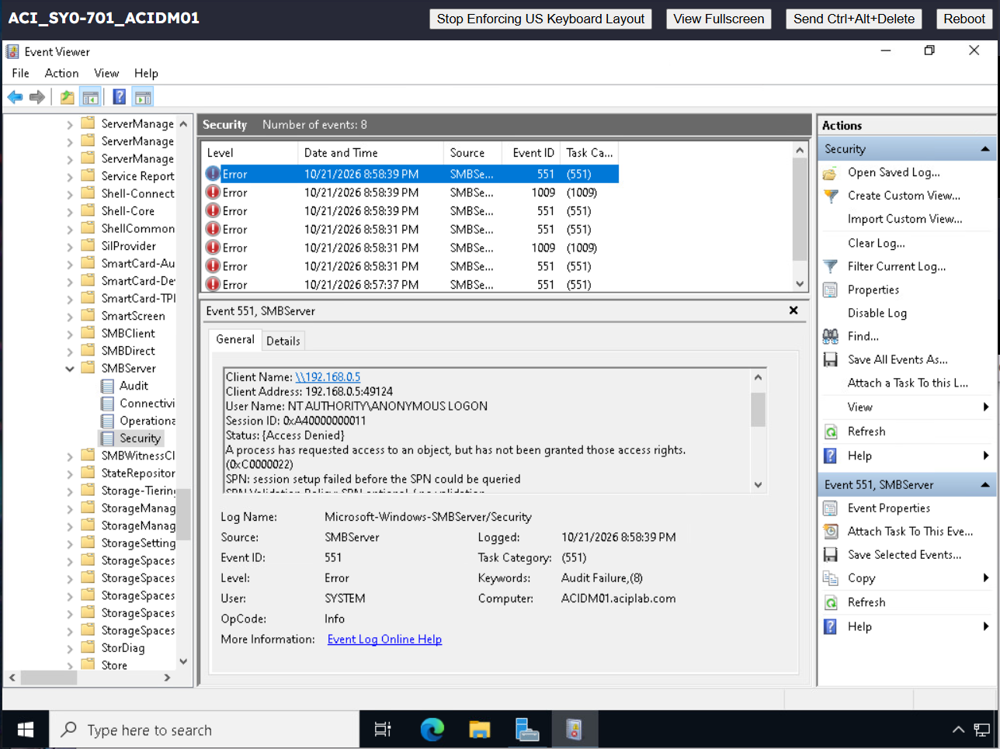
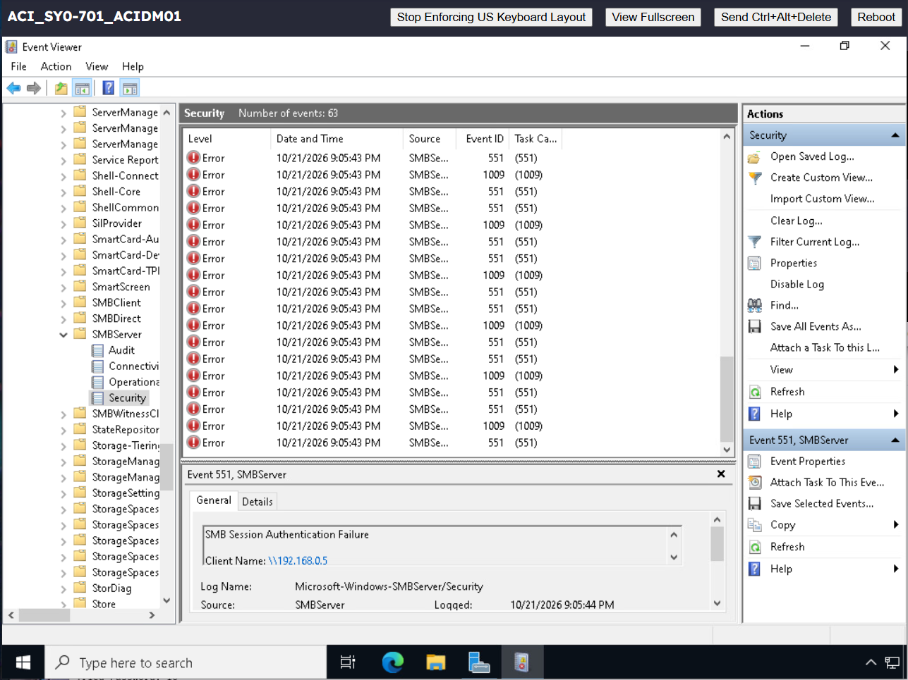
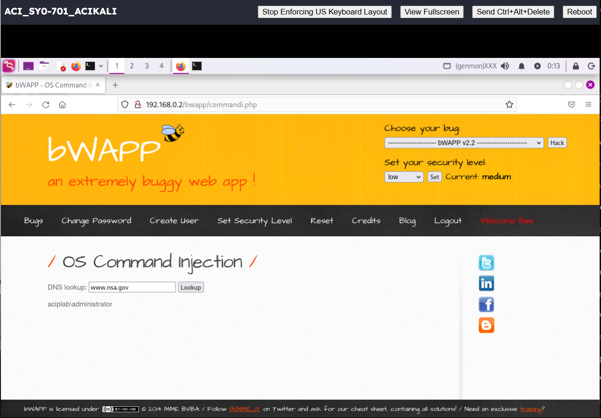
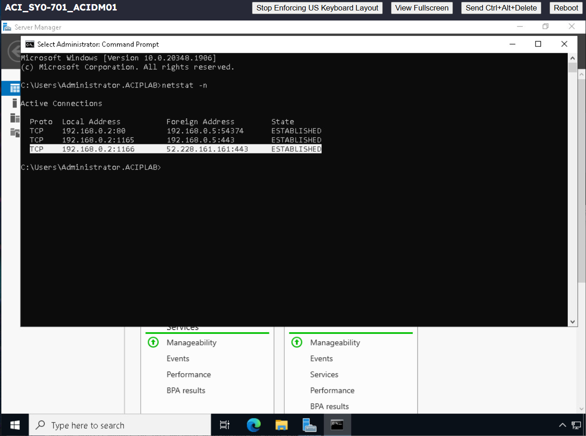
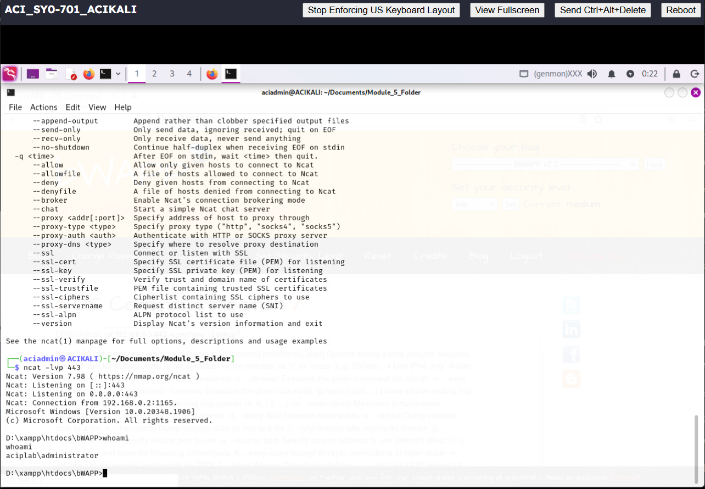
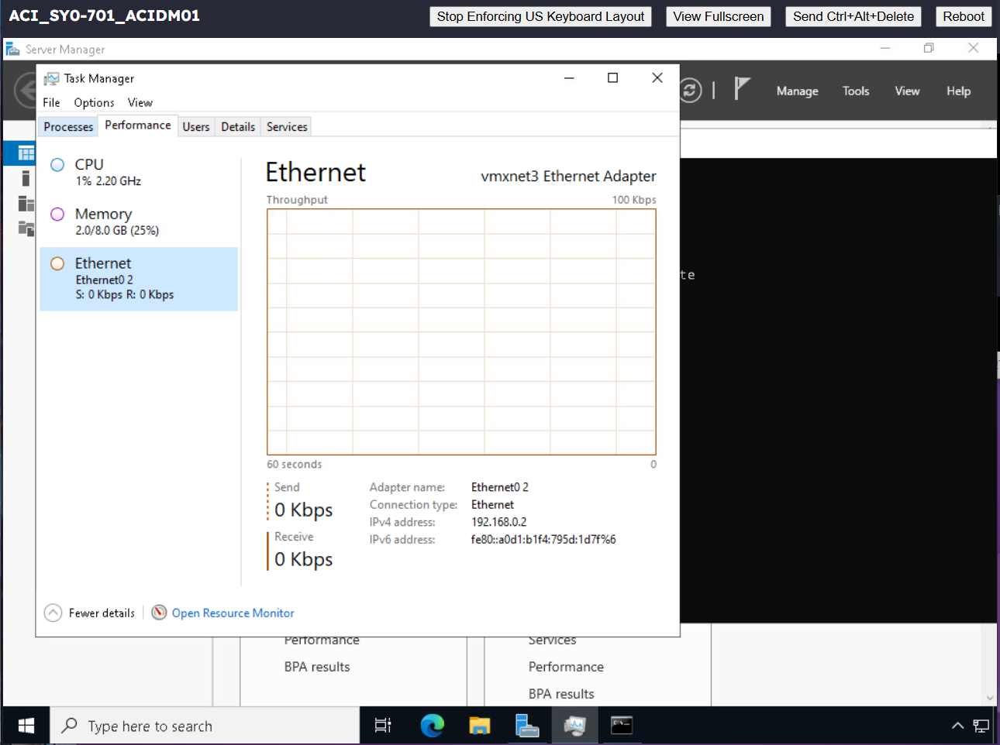
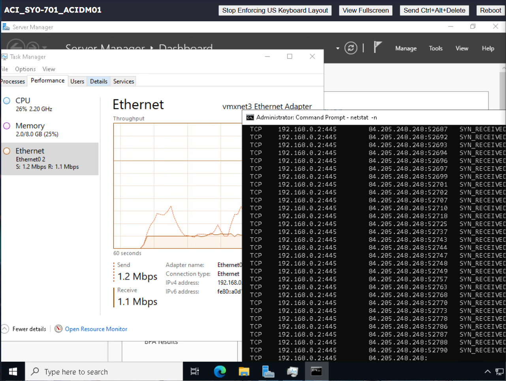

# Analyze Malicious Activity — SMB Authentication, Command Injection & SYN Flood Investigation

**Training platform:** ACI Learning — CompTIA Security+ (SY0-701) Skill Labs  
**Lab:** 05 of 18 — *Analyze Malicious Activity*  
**Status:** All three guided demonstrations observed; final attack termination not independently documented  
**Tools:** Nmap, enum4linux, smbclient, Bash, Windows Event Viewer, bWAPP, Ncat, Windows `netstat`, Task Manager, Metasploit  
**Focus:** Security event investigation, behavior correlation, command-injection exposure, reverse connections, and network traffic anomalies

## Overview

This guided, contained lab investigated three attack patterns and the defender-side evidence they generated:

1. **SMB password guessing:** Compare the log footprint of one denied SMB connection with a short scripted series of failed attempts.
2. **OS command injection:** Observe unintended command execution through an intentionally vulnerable web application and correlate a reverse connection with command-shell access.
3. **SYN flood activity:** Compare an idle network baseline with increased throughput and numerous half-open TCP connections on SMB port 445.

The exercise environment, lab scenario, and attack simulations were supplied by **ACI Learning**. The screenshots, findings, interpretations, and writeup are from my own lab session. Activity was confined to the provider's authorized training VMs; this repository does not contain lab instruction PDFs or generated malicious artifacts.

## Environment

| Host | Training role | Address |
|---|---|---|
| `ACIDM01` | Windows Server 2022 domain member; monitored SMB and web server | `192.168.0.2` |
| `ACIKALI` | Kali Purple workstation; authorized assessment client | `192.168.0.5` |
| `ACIDC01` | Windows Server 2022 domain controller; part of supplied lab environment | Address not necessary for documented tests |

Hostnames, addresses, and test accounts in this report are from the fictional ACI environment and are not production targets. The activities described are authorized lab exercises, not instructions to use against unrelated systems.

---

## Exercise 1 — Investigate SMB authentication failures

### Objective and baseline

On `ACIDM01`, opened **Event Viewer → Applications and Services Logs → Microsoft → Windows → SMBServer → Security**. From `ACIKALI`, scanned the training server and identified SMB-related ports **139/tcp** and **445/tcp** using Nmap. Used `enum4linux` for SMB enumeration and `smbclient` for a single deliberately unsuccessful connection.

Representative assessment commands:

```bash
nmap -Pn 192.168.0.2
enum4linux 192.168.0.2
smbclient //192.168.0.2/administrator
```

The SMB client returned `NT_STATUS_ACCESS_DENIED` following the test login. The SMBServer Security log reported access-denied events.



**Selected Event 551 fields:**

| Field | Observed value |
|---|---|
| Event provider / ID | SMBServer / **551** |
| Source client | `192.168.0.5` |
| Client source port | `49124` |
| Account shown | `NT AUTHORITY\ANONYMOUS LOGON` |
| Outcome | `Access Denied` |
| Status code | `0xC0000022` |
| Log time | October 21, 2026, **8:58:39 PM** (VM display) |

**Interpretation:** Event 551 establishes an SMB session-related access failure, not, by itself, the precise cause of a password failure. The `ANONYMOUS LOGON` value could refer to an earlier stage of session setup. The known test action and matching source make the event relevant, but additional authentication logs would be needed to identify the exact logon failure mechanism.

### Controlled repeated-attempt test

The ACI-provided `brute.sh` script made password attempts numbered **0–20**, corresponding to **21** SMB connection attempts. Before this step, the previous SMBServer Security log was saved and cleared using Event Viewer so the new activity could be examined separately.

After running the supplied script inside ACI and refreshing the SMBServer Security log, the window showed **63 events**, with repeated **Event IDs 551 and 1009** and a visible concentration at approximately **9:05:43 PM**.



**Assessment:** The event burst, repetition, consistent source address, and known execution of the guided script support the conclusion that this was an **automated SMB password-guessing simulation**. Multiple events can be generated by one connection attempt. Although 63 is three times the planned 21 attempts, the exact event-per-attempt mapping was not independently established. The script returned access-denied results; no successful logon was demonstrated.

**Investigation lesson:** A single access-denied event should not automatically be escalated as brute force. Frequency, timing, source consistency, and corroborating logs help distinguish a pattern of automated attempts from isolated user error.

---

## Exercise 2 — Command injection and reverse-connection investigation

### Context and initial proof

The ACI Windows member server hosted **bWAPP**, an intentionally vulnerable web application served using XAMPP. Using the **OS Command Injection** exercise at the application's *Medium* security setting, tested whether the DNS lookup field would execute additional operating-system commands.

A command separator in the supplied exercise allowed the application to run a command unrelated to DNS lookup. The test using `whoami` returned the execution identity:

```text
aciplab\administrator
```



**Finding:** Input to the web application's DNS lookup function could trigger unintended operating-system commands. The displayed `whoami` result indicates that the command ran under the domain Administrator identity. This makes the injection especially consequential because the application appears to execute with excessive privileges.

**Evidence note:** The browser input field reverted to its original lookup value in the screenshot, but the injected command's result remains visible. The conclusion is based on the known lab test and observed output.

### Reverse-connection demonstration and correlation

As part of the same contained guided simulation, `ACIKALI` listened on TCP **443**, and the vulnerable application initiated an outbound connection from `ACIDM01`. In the Kali session, the connection presented a Windows command prompt; a `whoami` check again returned the domain Administrator identity.





The two views correlate:

| Evidence source | Observed result |
|---|---|
| Windows `netstat -n` | `192.168.0.2:1165 → 192.168.0.5:443`, **ESTABLISHED** |
| Kali Ncat | Incoming connection from `192.168.0.2:1165` |
| Shell output on Kali | Windows command prompt in the bWAPP/XAMPP directory |
| Shell identity | `aciplab\administrator` |
| Separate web connection | `192.168.0.2:80 ↔ 192.168.0.5:54374`, **ESTABLISHED** |

**Assessment:** Windows `netstat` independently confirms an outbound network connection, while Kali-side interactive command execution establishes that the connection carried shell access. The web traffic on TCP 80 is distinct from the connection to Kali's TCP 443 listener. Using port 443 alone does **not** establish that HTTPS or TLS was used for the reverse connection.

**Scope limitation:** The evidence supports remote command execution under the observed identity during this lab scenario; persistence, additional movement, and any further compromise were **not** tested or demonstrated.

**Defensive lesson:** Investigate suspicious outbound connections from application servers together with web request context, parent/child process activity, privilege level, and endpoint telemetry. A `netstat` connection alone is insufficient to establish its payload or purpose.

---

## Exercise 3 — Recognize SYN flood indicators

### Normal traffic baseline

On `ACIDM01`, checked **Task Manager → Performance → Ethernet** and used `netstat -n` to examine normal connections. At the moment captured, the Ethernet adapter showed **0 Kbps send** and **0 Kbps receive**, with no active TCP connections observed in the accompanying `netstat` check.



This is a point-in-time baseline, not a long-term statement about normal operating behavior. The ACI reference material shows a different background outbound connection; such short-lived network activity naturally varies across sessions.

### Observed activity during the controlled simulation

After launching the ACI-provided SYN flood exercise against the training server's SMB service on **TCP 445**, Task Manager and `netstat` showed substantial changes.



| Signal | Before | During test |
|---|---|---|
| Send throughput | 0 Kbps | **1.2 Mbps** at captured moment |
| Receive throughput | 0 Kbps | **1.1 Mbps** at captured moment |
| TCP connection states | No active entries seen in baseline check | Numerous **`SYN_RECEIVED`** entries |
| Destination service | No abnormal connection pattern observed | `192.168.0.2:445` repeatedly targeted |

The displayed remote endpoint in many `SYN_RECEIVED` rows was **`84.205.248.248`** with varying source ports, rather than Kali's assigned IP `192.168.0.5`. Because SYN flood tools may send packets with spoofed IP source addresses, this field alone does **not** reliably identify the machine that generated the traffic. The screenshot by itself is not sufficient to determine the precise reason for the difference.

**Interpretation:** `SYN_RECEIVED` indicates that the server received a SYN and is waiting for the final ACK of the TCP three-way handshake. The high concentration of half-open connection states, together with the throughput increase and known timing of the controlled test, supports an assessment of **SYN flood activity**.

**What is not established:** The evidence does **not** show a measured loss of availability, exhausted connection capacity, or legitimate clients being unable to connect. Therefore, the supported finding is *attempted denial-of-service behavior with observable network indicators*, not a proven successful service outage.

**Lab cleanup:** ACI instructs stopping the SYN flood simulation with `Ctrl+C` on the Kali terminal. Termination was requested after evidence collection but was not independently verified in the screenshots; this report does not claim cleanup verification.

---

## Evidence index

| File | Evidence captured |
|---|---|
| `screenshots/01-smb-failed-authentication.PNG` | SMBServer Event 551 and source client following a single denied attempt |
| `screenshots/02-smb-bruteforce-events.PNG` | 63 clustered SMBServer events following the scripted test |
| `screenshots/03-command-injection-confirmed.PNG` | bWAPP displaying the command execution identity |
| `screenshots/04-reverse-shell-connection.PNG` | Windows-side outbound TCP 443 connection |
| `screenshots/05-reverse-shell-connection_kali.PNG` | Kali-side connection and Windows command-shell evidence |
| `screenshots/06-network-traffic-baseline.PNG` | Idle network throughput baseline |
| `screenshots/07-syn-flood-detected.PNG` | Increased throughput and many `SYN_RECEIVED` connections |

## Consolidated findings

| Scenario | Key observation | Supported conclusion |
|---|---|---|
| One SMB login attempt | SMBServer Event 551, access denied | SMB connection/authentication-related failure; exact cause requires more telemetry |
| Repeated SMB login attempts | 63 clustered events after 21 scripted attempts | Activity consistent with automated password guessing; no successful login shown |
| bWAPP command injection | `whoami` output as `aciplab\administrator` | Unintended OS commands execute with a privileged identity |
| Reverse connection | Matching Windows/Kali connection and shell output | Outbound reverse-shell access demonstrated in the training scenario |
| SYN flood | 1.2 Mbps send, 1.1 Mbps receive, numerous `SYN_RECEIVED` rows | SYN flood indicators confirmed; outage not demonstrated |

## Security considerations and next steps

- **SMB defenses:** Restrict service exposure where possible, monitor authentication failure rates and origins, and apply account security controls appropriate to operational requirements.
- **Web application defenses:** Prevent shell command construction from untrusted input; enforce strict input handling and run application services with the minimum necessary privileges.
- **Outbound monitoring:** Correlate unexpected egress connections with process execution and application requests. Port 443 should not be assumed safe solely because it is usually used for HTTPS.
- **SYN flood response:** Establish repeatable performance baselines, examine connection states, and use appropriate network protections and traffic controls. Confirm any claimed service impact with availability tests rather than inferring an outage from traffic alone.
- **Investigation discipline:** Differentiate observations, likely interpretations, and unsupported conclusions. Preserve relevant logs, timestamps, and source context when investigating production events.

## Learning reflection

This lab reinforced the importance of interpreting **defender-side telemetry**, not merely completing a guided attack sequence. Event frequency made repeated SMB failures more suspicious than a single error; correlating two hosts established a reverse shell more convincingly than `netstat` alone; and a baseline made a sharp shift in network activity easier to recognize. I also learned to treat apparent source addresses and high traffic as investigative leads rather than unquestionable proof of attacker identity or successful denial of service.

## Sources and publication notes

- ACI Learning, *Analyze Malicious Activity*, Security+ (SY0-701) Skill Labs (guided exercise and fictional environment). Proprietary training instruction pages and figures are **not** reproduced here.
- The screenshots are my own captures from the supplied lab VMs.
- This public-facing writeup excludes credentials, authentication dumps, executable attack artifacts, shell payload files, and proprietary instruction PDFs.
