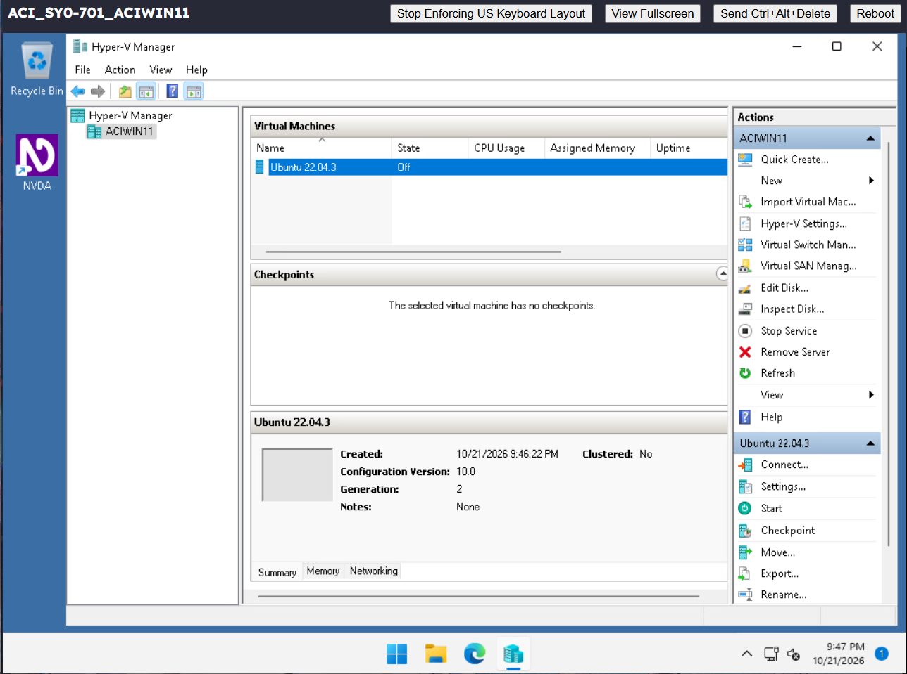
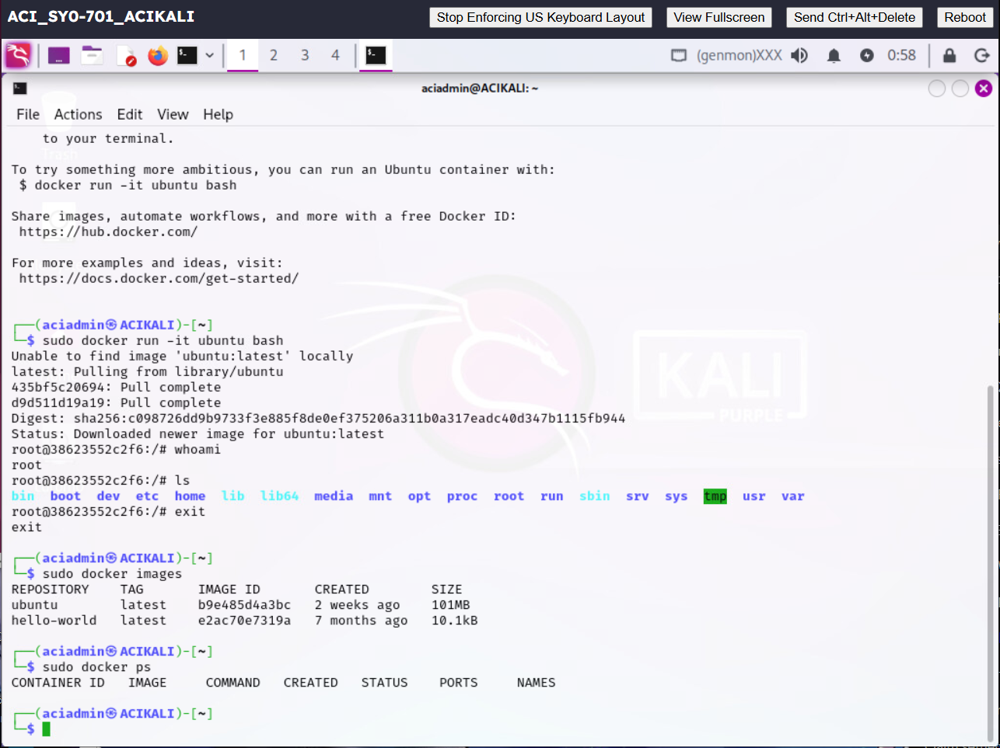
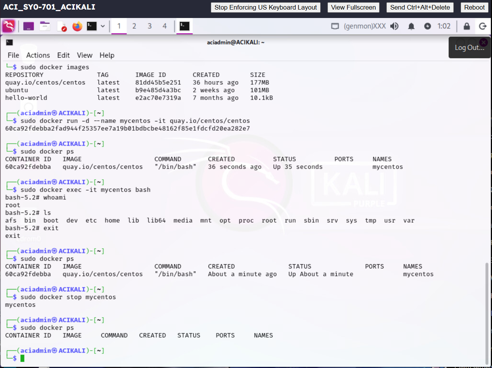
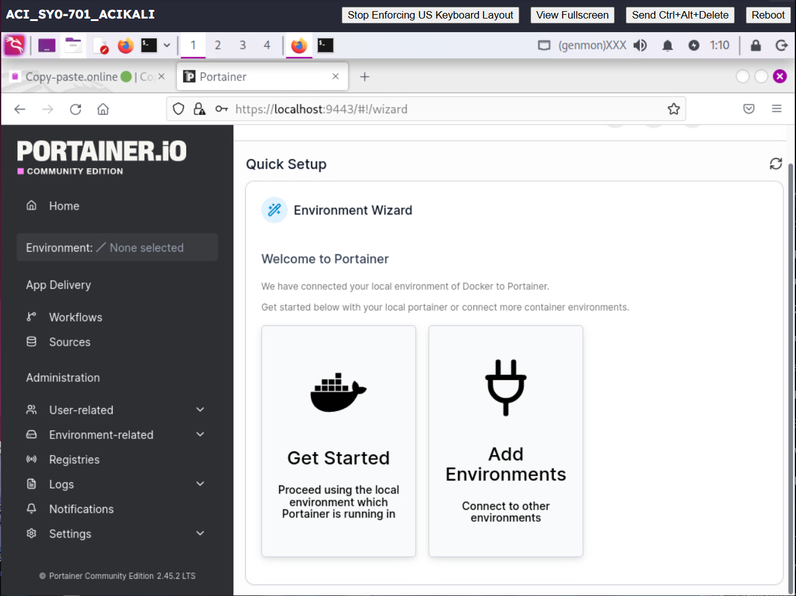
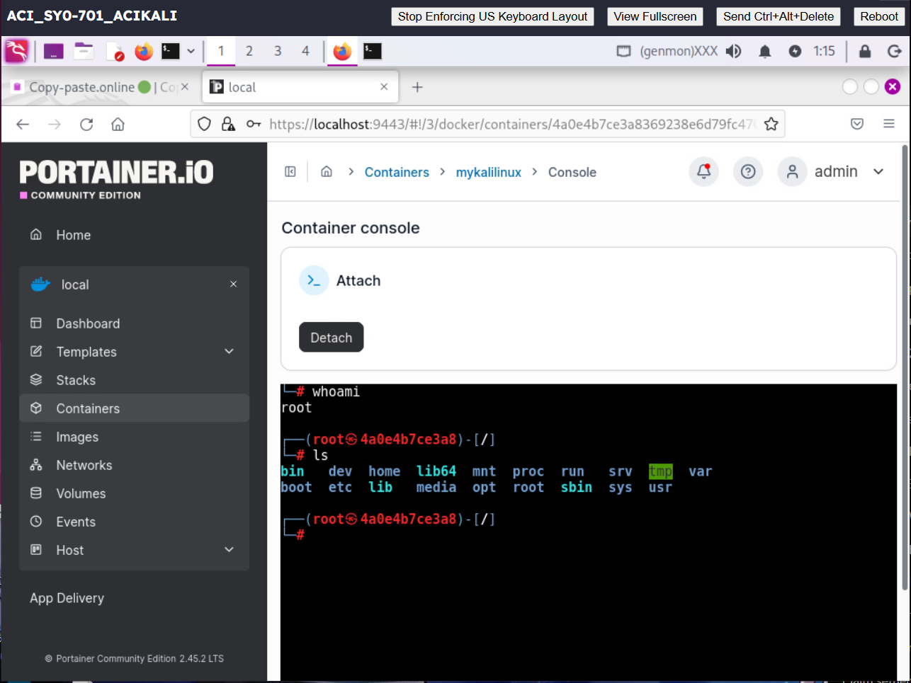
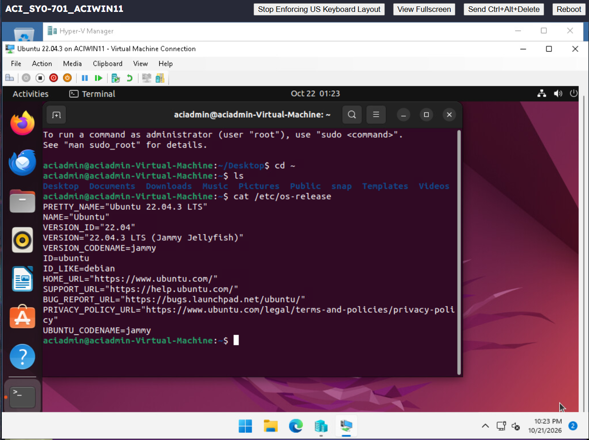

# Security Architecture Models — Hyper-V Virtualization and Docker Container Management

**Training platform:** ACI Learning — CompTIA Security+ (SY0-701) Skill Labs  
**Lab:** 06 of 18 — *Security Architecture Models*  
**Focus:** Hypervisor configuration, Ubuntu VM provisioning, Docker container lifecycle, Portainer administration, and isolation boundaries  
**Environment:** ACI-provided Windows 11 and Kali Purple training workstations  
**Evidence:** Six original screenshots captured during my guided lab session

## Overview

In this guided lab I worked with two workload-isolation approaches: a **complete Ubuntu virtual machine** hosted by Microsoft Hyper-V and **Linux containers** managed through Docker and Portainer. The goal was to understand how each model is provisioned and operated, and why they offer different performance and security properties.

The exercise scenario, software environment, and guided workflow were supplied by **ACI Learning**. The screenshots and results below document my own actions and observations. This repository does not reproduce the provider's proprietary instruction pages.

## Lab environment

| Host | Operating system / platform | Role in the exercise |
|---|---|---|
| `ACIWIN11` | Windows 11 Pro with Hyper-V | Provisioned Ubuntu 22.04.3 virtual machine |
| `ACIKALI` | Kali Purple (Linux), Docker Engine | Created and managed Linux containers through CLI and Portainer |
| `ACIDC01` | Windows Server 2022 | Part of the supplied domain environment; no separate findings documented |

These are fictional training systems, not production infrastructure.

---

## Exercise 1 — Create an Ubuntu virtual machine in Hyper-V

### Configuration

Using the Hyper-V New Virtual Machine Wizard on `ACIWIN11`, created a VM with the lab-specified configuration:

| Setting | Configured selection |
|---|---|
| Name | `Ubuntu 22.04.3` |
| VM generation | **Generation 2** (UEFI-based) |
| Startup memory | **2,048 MB**; dynamic memory setting retained |
| Networking | Hyper-V **Default Switch** |
| Virtual hard disk | **25 GB** VHDX |
| Installation media | `ubuntu-22.04.3-desktop-amd64.iso` supplied in the lab |
| Secure Boot | Disabled as required by the ACI nested lab environment |



**Observed result:** Hyper-V Manager displayed `Ubuntu 22.04.3` on `ACIWIN11` with **Generation 2** and an initial **Off** state. The screenshot directly verifies VM creation and generation; memory, disk, networking, and Secure Boot settings are recorded from the guided configuration sequence, but are not all visible in this screenshot.

**Security note:** Generation 2 supports UEFI-based features such as Secure Boot. ACI required Secure Boot to be disabled because of a compatibility conflict in its virtualized exercise environment. Disabling Secure Boot is **not** a general recommendation for Ubuntu deployments; in a production configuration, maintain compatible secure boot protections whenever possible.

### Installation

Started the VM and completed the Ubuntu desktop installer against the assigned virtual disk. While installation was running, proceeded to the separate Docker exercises on the Kali workstation.

---

## Exercise 2 — Manage containers using the Docker CLI

### Validate Docker with `hello-world`

Pulled and ran the minimal `hello-world` image:

```bash
sudo docker pull hello-world
sudo docker images
sudo docker run hello-world
```

**Observed result:** Docker printed **`Hello from Docker!`**, confirming that the engine could fetch an image, create a container, and execute its process. No screenshot was retained for this introductory check because later screenshots provide stronger evidence of actual container interaction.

### Launch an interactive Ubuntu container

```bash
sudo docker run -it ubuntu bash
# Inside the container:
whoami
ls
exit
# Back on the Docker host:
sudo docker images
sudo docker ps
```



**Observed results:**

- The Ubuntu container opened an interactive Bash shell and returned **`root`** for `whoami`.
- `ls` returned a Linux filesystem listing from **inside the container**.
- After `exit`, the prompt returned to the Kali host.
- `docker images` listed **`ubuntu:latest`** and **`hello-world:latest`**.
- `docker ps` showed no currently running containers after the interactive Ubuntu shell exited.

**Important distinction:** The Docker image was `ubuntu:latest`; it was **not established to be the same version** as the separate Ubuntu 22.04.3 Hyper-V VM.

### Run, inspect, and stop a detached CentOS container

```bash
sudo docker pull quay.io/centos/centos
sudo docker run -d --name mycentos -it quay.io/centos/centos
sudo docker ps
sudo docker exec -it mycentos bash
# Inside the container:
whoami
ls
exit
# Back on the Docker host:
sudo docker ps
sudo docker stop mycentos
sudo docker ps
```



**Observed results:** `mycentos` ran in detached mode. An additional shell launched by `docker exec -it` executed as `root`; exiting that shell did **not** terminate the background container. The container continued to appear in `docker ps` until `docker stop mycentos` was executed, after which the running-container list was empty.

**Key learning:** A container's lifecycle depends on its primary process. Exiting a shell added with `docker exec` is different from stopping that primary process or stopping the container itself.

---

## Exercise 2 — Manage containers in Portainer

Deployed Portainer Community Edition to provide browser-based administration of the same Docker engine.

### Portainer deployment

Representative commands from the lab:

```bash
sudo docker volume create portainer_data
sudo docker run -d \
  -p 8000:8000 -p 9443:9443 \
  --name portainer --restart=always \
  -v /var/run/docker.sock:/var/run/docker.sock \
  -v portainer_data:/data \
  portainer/portainer-ce:latest
sudo docker ps
sudo docker logs portainer
```

Accessed the locally hosted web interface at `https://localhost:9443` and completed initial administrator setup using the lab's temporary credentials and setup token. **No credentials or setup tokens are included here.**



**Observed result:** Portainer Community Edition **2.45.2 LTS** displayed its Quick Setup wizard and reported that it had connected to the local Docker environment. This screenshot is the **setup wizard**, not the later management dashboard.

### Deploy and access a Kali container through the GUI

In Portainer's local environment, used **Containers → Add container** and selected:

| Option | Selection |
|---|---|
| Name | `mykalilinux` |
| Image | `kalilinux/kali-rolling` |
| Console | Interactive & TTY |

Deployed the container and attached to its console. Ran `whoami` and `ls` through the web interface.



**Observed result:** The attached Portainer console returned **`root`** and displayed expected Linux directories, confirming that container interaction worked through the browser-based management interface.

**Security note:** Mounting `/var/run/docker.sock` gives Portainer powerful access to the host's Docker daemon, so controlling access to Portainer is a serious security responsibility. Running as `root` *inside* a container does not by itself demonstrate unrestricted root privileges on the host, although dangerous configurations can weaken isolation.

The ACI exercise also directs stopping the GUI-created container and reviewing Portainer logs. Those final GUI cleanup actions are part of the guided workflow but **are not independently evidenced** by the supplied screenshots.

---

## Exercise 3 — Complete and verify the Ubuntu VM deployment

After the Ubuntu installer finished, restarted the Hyper-V VM as instructed by ACI and completed Ubuntu's initial desktop setup. Opened a terminal **inside the VM** and ran:

```bash
cd ~
ls
cat /etc/os-release
```



**Observed results:**

| Check | Evidence |
|---|---|
| Guest OS booted | Ubuntu desktop displayed inside a Hyper-V Virtual Machine Connection window |
| Terminal usable | Shell executed `cd ~`, `ls`, and `cat /etc/os-release` |
| Distribution identified | `PRETTY_NAME="Ubuntu 22.04.3 LTS"` |
| Release codename | `jammy` / **Jammy Jellyfish** |

ACI also asks learners to load a website inside the Ubuntu VM to validate network connectivity. That browser result was **not separately captured or confirmed in the provided evidence**, so internet connectivity is not claimed as independently verified here. The final graphical shutdown is likewise not shown in the evidence.

---

## Comparison — VMs and containers

| Aspect | Hyper-V Ubuntu VM | Docker Linux container |
|---|---|---|
| Operating system | Full guest OS and kernel | User-space environment sharing the host's kernel |
| Provisioning | Hypervisor virtual hardware + ISO installation | Image pull + container start |
| Startup and overhead | Typically larger and slower | Typically lighter and faster |
| Isolation model | Virtualized hardware / guest OS boundary | Namespaces, cgroups and other OS-level isolation mechanisms |
| Management used here | Hyper-V Manager + guest desktop | Docker CLI and Portainer GUI |
| Security considerations | VM configuration, patching, secure boot, guest/host separation | Daemon access, container privileges, image provenance, patching, runtime restrictions |

**Reflection:** This exercise reinforced that VMs and containers are not interchangeable. A VM packages an entire operating system and supports a stronger guest boundary, while a container packages an application or user-space workload and relies on isolation provided by the shared host kernel. Docker's image/container distinction, detached execution, and Portainer's access to the Docker socket are particularly relevant when administering security tooling and infrastructure.

## Evidence index

| File | What it documents |
|---|---|
| `screenshots/01-ubuntu-hyperv-vm-created.PNG` | Created Generation 2 Ubuntu VM in Hyper-V Manager |
| `screenshots/02-ubuntu-container-interactive.PNG` | Interactive Ubuntu container; `whoami`, `ls`, exit, image list, no running containers |
| `screenshots/03-centos-container-management.PNG` | Detached CentOS container; `exec`, shell exit, continued running, manual stop |
| `screenshots/04-portainer-local-setup.PNG` | Portainer connected to the local Docker environment |
| `screenshots/05-portainer-kali-container-console.PNG` | Kali container controlled through Portainer's console |
| `screenshots/06-ubuntu-vm-deployment-verified.PNG` | Ubuntu 22.04.3 LTS booted inside Hyper-V and verified by `os-release` |

## Publication notes

- The training workflow, VM images, and exercise environment are from **ACI Learning, Security Architecture Models**, CompTIA Security+ (SY0-701) Skill Labs.
- All screenshots represent my own work in the controlled ACI environment; ACI instruction screenshots are not republished.
- Passwords, setup tokens, key material, and provider-authored training PDFs are excluded.
- This report distinguishes what the screenshots directly verify from settings followed as part of the guided procedure and steps not independently captured.
