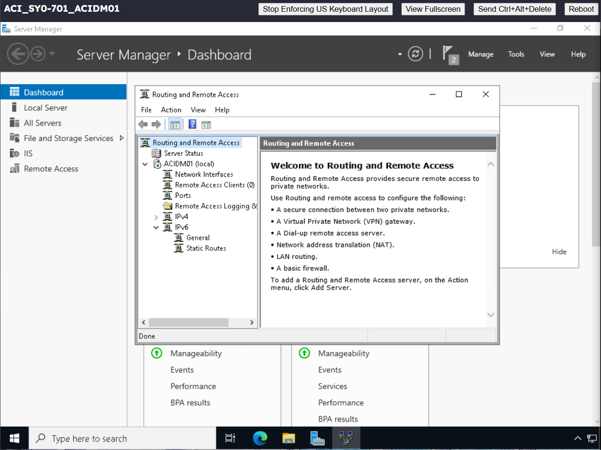
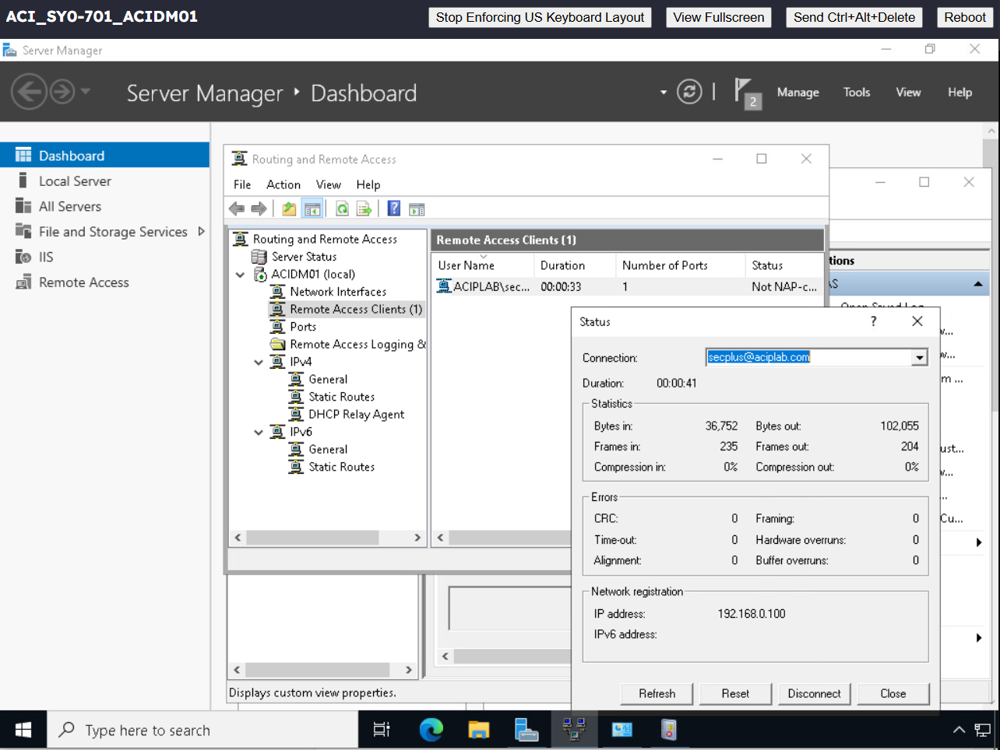
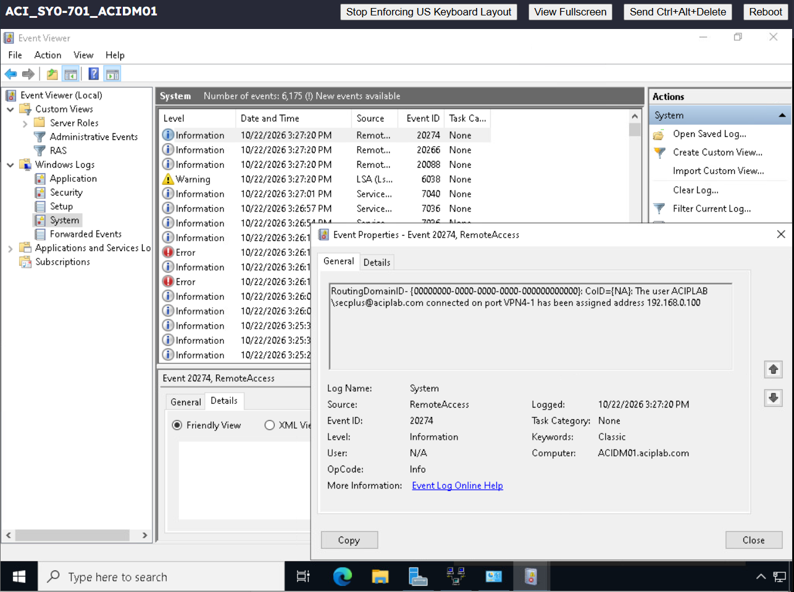
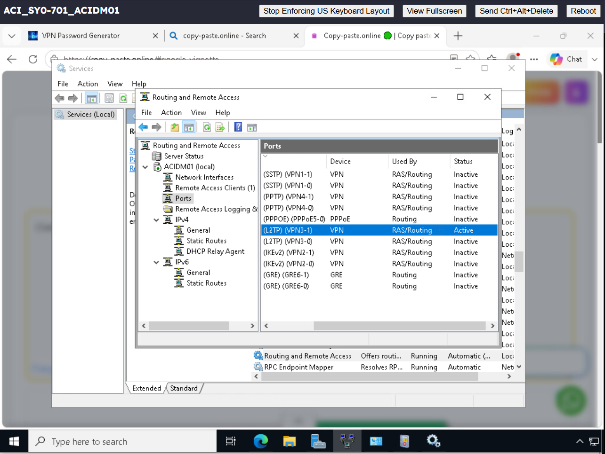
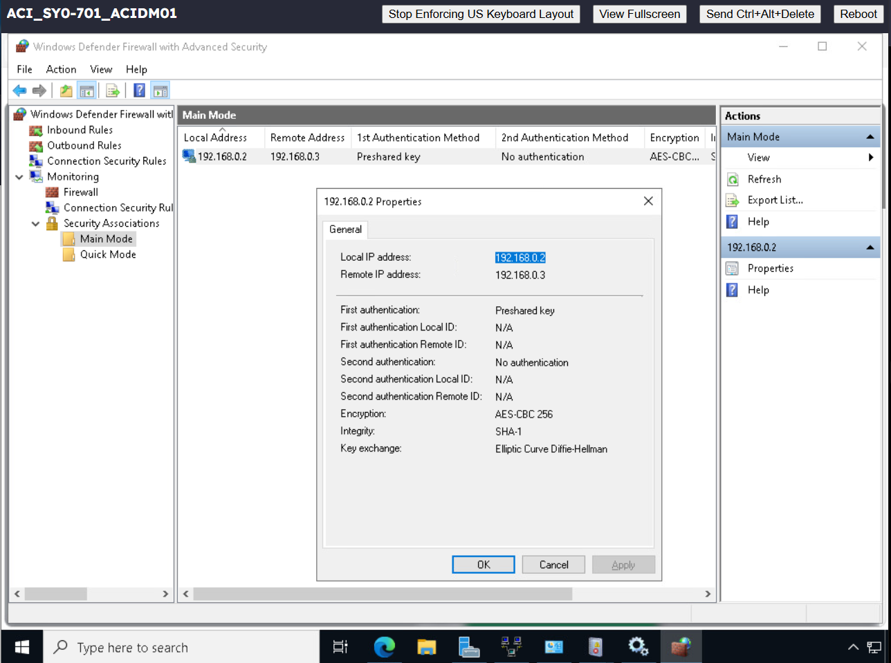
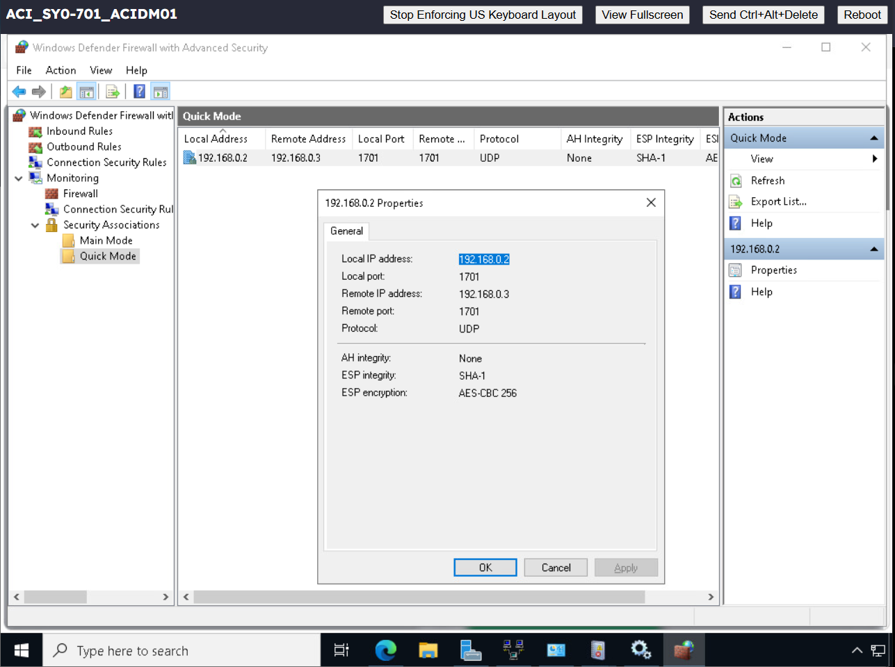

# Securing Enterprise Infrastructures — Windows Server VPN, Active Directory, and IPsec

**Training platform:** ACI Learning — CompTIA Security+ (SY0-701) Skill Labs  
**Lab:** 07 of 18 — *Securing Enterprise Infrastructures*  
**Focus:** RRAS VPN configuration, Active Directory authorization, client addressing, remote-access monitoring, L2TP/IPsec negotiation  
**Environment:** ACI-provided, isolated Windows Server 2022 and Windows 11 training network, plus Kali Purple  
**Evidence:** Six screenshots captured from my own guided lab session

## Overview

In this guided lab, I deployed a Windows Server VPN using **Routing and Remote Access (RRAS)**, provisioned a dedicated Active Directory VPN user, connected a Windows 11 workstation, and investigated server-side connection events. I then configured **L2TP/IPsec with a pre-shared key** and inspected Windows Firewall's **Main Mode** and **Quick Mode security associations** to identify the algorithms negotiated for the session.

The procedures and training environment were provided by **ACI Learning**. This project documents my observed results and technical interpretation rather than reproducing ACI's proprietary instructions. All addresses and accounts belong to the simulated lab environment.

## Environment and traffic flow

| Device | Operating system | Role / relevant address |
|---|---|---|
| `ACIDM01` | Windows Server 2022 | RRAS VPN server; underlying IP `192.168.0.2` |
| `ACIDC01` | Windows Server 2022 | Active Directory domain controller for `aciplab.com` |
| `ACIWIN11` | Windows 11 Pro | VPN client; underlying IPsec peer `192.168.0.3` |
| `ACIKALI` | Kali Purple | Independent connectivity test using `ping` |

The VPN static IPv4 pool was **`192.168.0.99`–`192.168.0.100`**. During the first connection, RRAS assigned **`192.168.0.100`** to the VPN client. The lab instructions describe `.99` as the server-side VPN address. The `.3` address shown in the IPsec security associations is the client's **underlying network address**, which is not the same as the VPN-assigned address `.100`.

---

## Exercise 1 — Install and configure a Windows Server VPN

### Deploy the RRAS role and service

On `ACIDM01`, installed the Windows Server **Remote Access** role with **DirectAccess and VPN (RAS)**, then used the **Deploy VPN only** option. In the Routing and Remote Access console, selected **Custom configuration → VPN access** and started the RRAS service.

**Observed:** The RRAS console displayed `ACIDM01 (local)` with an active status indicator and **Remote Access Clients (0)**. This validates that the VPN role was configured and that no client had connected yet; it does not, on its own, prove remote connectivity.

### Address assignment, logs and firewall

Configured the following settings per the lab scenario:

| Component | Lab setting / action |
|---|---|
| RRAS IPv4 allocation | Static pool: `192.168.0.99`–`192.168.0.100` |
| RRAS logging | **Log all events** |
| Windows Defender Firewall | Allowed Routing and Remote Access for Domain, Private and Public profiles in the guided setup |
| Event Viewer | Created a custom view named `RAS` filtering source `RasClient` |

**Operational caution:** Enabling RRAS across all firewall profiles is a broad training configuration, not a least-privilege recommendation. A production deployment would constrain permitted ports, interfaces and networks to actual requirements. `RasClient` pertains primarily to client-side VPN activity; the **server-side** connection evidence in this exercise was found in the **System** log under source **RemoteAccess**.

## Exercise 2 — Provision a VPN user and validate connectivity

### Active Directory user and authorization

On `ACIDC01`, created an OU named `Users VPN` and a training user named **Security Plus**, logon `Secplus`. Following the lab, added the user to **Remote Desktop Users** and set **Dial-in → Network Access Permission → Allow access**.

**Security nuance:** OU membership is organizational and does not itself confer VPN permission. Membership in **Remote Desktop Users** is not required for this VPN connection and should only be granted where RDP access is explicitly justified. The lab's convenient password/initial-logon settings are not suitable production guidance; credentials are intentionally omitted from this repository.

### Windows 11 client connection

Configured the built-in Windows VPN client with a connection named **`MyVPN`** pointing to `192.168.0.2`, then authenticated as the authorized domain test user.

**Observed on the RRAS server:**

- **One** remote-access client, `Secplus`, was connected.
- Client VPN address: **`192.168.0.100`**.
- Status dialog showed **36,752 bytes in** and **102,055 bytes out** at the time of capture.
- The visible connection-error counters were **zero**.

The initial Windows VPN profile used the default **Automatic** selection; ACI describes the intended initial protocol as PPTP. The screenshot establishes successful access and addressing, **not independently the precise protocol/algorithm used for that first session**. Legacy PPTP is not recommended for modern deployments.

### Correlate the RemoteAccess event and test connectivity

On `ACIDM01`, investigated **Windows Logs → System** and identified the `RemoteAccess` event recording the client assignment.

| Evidence field | Observed value |
|---|---|
| Event source | `RemoteAccess` |
| Event ID | **20274** |
| Event time | October 22, 2026, 3:27:20 PM (lab clock) |
| Account | `Secplus` under the `ACIPLAB` domain |
| VPN port | `VPN4-1` |
| Assigned address | **`192.168.0.100`** |

Performed an independent **ICMP reachability test** from `ACIKALI` to `192.168.0.100`. The console output was reported as **8 packets sent, 0% loss, and approximately 0.800 ms average RTT**. This test result was observed during the exercise but was **not preserved in a separate screenshot**. Ping confirms reachability, not the strength of the VPN's cryptographic protections.

## Exercise 3 — Configure and investigate L2TP/IPsec

### Configure a shared secret and connect

Disconnected the original VPN session, configured a **lab-only pre-shared key** in RRAS's Security settings, and restarted the service. Created a separate Windows 11 profile, **`MyL2TPVPN`**, with VPN type **L2TP/IPsec with pre-shared key**, using the matching lab secret and the dedicated domain user's authentication credentials.

**Observed:** **`(L2TP) (VPN3-1)`** displayed **Active** in the RRAS Ports view, while the visible PPTP and IKEv2 port entries were inactive. The server also displayed one remote-access client. This confirms an active L2TP session; the next two screenshots reveal the negotiated IPsec protection.

**Security caution:** The training exercise directs learners to obtain a shared secret via a public website. Real deployment keys should instead be generated and handled using a trusted, local or organizationally approved cryptographic process. This repository contains **no PSK**, token, reusable login credential, or key-generation output.

### Inspect Main Mode security association

Under **Windows Defender Firewall with Advanced Security → Monitoring → Security Associations → Main Mode**, inspected the active association for the server and Windows client.

| Field | Negotiated value |
|---|---|
| Local peer | `192.168.0.2` |
| Remote peer | `192.168.0.3` |
| Initial authentication | **Pre-shared key** |
| Additional/second authentication | **None** |
| Encryption | **AES-CBC 256** |
| Integrity | **SHA-1** |
| Key exchange | **Elliptic Curve Diffie-Hellman (ECDH)** |

**Interpretation:** This security association records protection for the IKE negotiation phase. ECDH is the negotiated key-agreement mechanism; AES-CBC protects confidentiality; the integrity algorithm is listed as SHA-1. The screenshot does **not** identify the specific ECDH curve or reveal the secret values.

### Inspect Quick Mode security association

In **Security Associations → Quick Mode**, opened the corresponding association's Properties dialog.

| Field | Negotiated value |
|---|---|
| Local and remote addresses | `192.168.0.2` ↔ `192.168.0.3` |
| Protocol | **UDP** |
| Local and remote ports | **1701** / **1701** |
| AH integrity | **None** |
| ESP integrity | **SHA-1** |
| ESP encryption | **AES-CBC 256** |

**Interpretation:** UDP 1701 identifies the L2TP traffic being protected. Although **AH** integrity was not negotiated, **ESP integrity (SHA-1)** was present. The observed ESP configuration demonstrates negotiated **confidentiality and integrity protection** for traffic covered by the association. This confirms negotiated security parameters; it is not equivalent to a packet capture or a formal cryptographic security audit.

### Comparing the two negotiation stages

| Stage | Role in this connection | Evidence |
|---|---|---|
| Main Mode | Establish authenticated and protected negotiation context | PSK, ECDH, AES-CBC 256, SHA-1 |
| Quick Mode | Establish the IPsec security association(s) used to protect the selected traffic | UDP 1701; ESP AES-CBC 256 and SHA-1 |

## Findings and security considerations

1. **Access and authorization:** A domain user with explicit Dial-in permission established a VPN session. The server logged the account, VPN port and assigned address.
2. **Connectivity:** The client received an address from the intended pool, and a separate Kali ping test reached that VPN address without packet loss in the reported run.
3. **Cryptographic verification:** An active L2TP connection had associated Main Mode and Quick Mode entries showing **AES-CBC 256** and **SHA-1**, including ESP integrity and encryption for L2TP-related traffic.
4. **Risk considerations:** The guided exercise used lab-only conveniences such as broad firewall profile permissions, a manually granted dial-in access setting, shared/training credentials, an externally generated PSK, and legacy cryptographic protocol options. These should **not** be copied uncritically into a production deployment.
5. **Evidence boundaries:** Connected status and logged negotiation details demonstrate the configuration and session observed; they do not establish full VPN hardening, resistance to every attack, or the absence of later failures.

## Evidence index

| File | Demonstrates |
|---|---|
| `screenshots/01-rras-vpn-server-enabled.PNG` | RRAS enabled on server; zero clients before connecting |
| `screenshots/02-vpn-client-connected.PNG` | Authenticated VPN client, assigned IP and traffic statistics |
| `screenshots/03-vpn-remoteaccess-event.PNG` | Event 20274 correlating account, port and assigned VPN address |
| `screenshots/04-l2tp-vpn-connected.PNG` | Active L2TP port in RRAS |
| `screenshots/05-ipsec-main-mode-sa.PNG` | Main Mode negotiated authentication, cipher, integrity and key exchange |
| `screenshots/06-ipsec-quick-mode-sa.PNG` | Quick Mode ESP encryption and integrity for UDP 1701 |

## Wrap-up and portfolio notes

The final ACI procedure directs **disconnecting the test VPN client** from RRAS and closing the lab management windows. This cleanup was recommended after evidence collection; its completion is **not independently verified by the screenshots**.

This exercise showed how an enterprise VPN depends on multiple layers: **server configuration, directory-backed user authorization, firewall rules, address assignment, connection monitoring, and IPsec negotiation**. Reviewing Event 20274 and the Main/Quick Mode associations was especially useful practice in substantiating security conclusions with observable Windows evidence.

**Attribution and handling:** Original workflow and exercise environment © ACI Learning; images document my work inside the authorized lab. This project does not include the provider's instructional PDF, copied instruction figures, plaintext passwords, pre-shared keys, credential databases, or other secret material.
