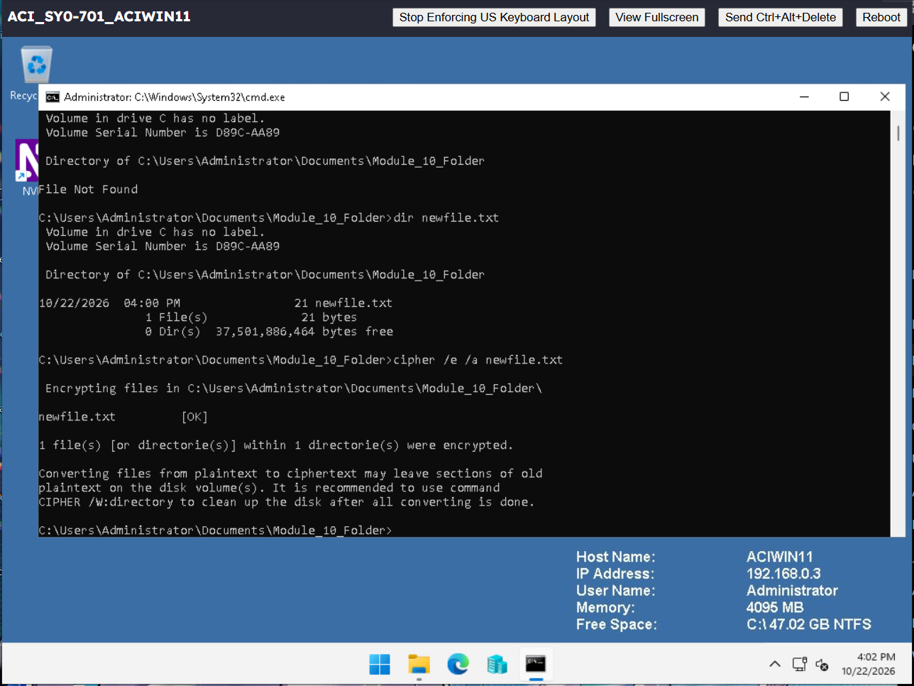
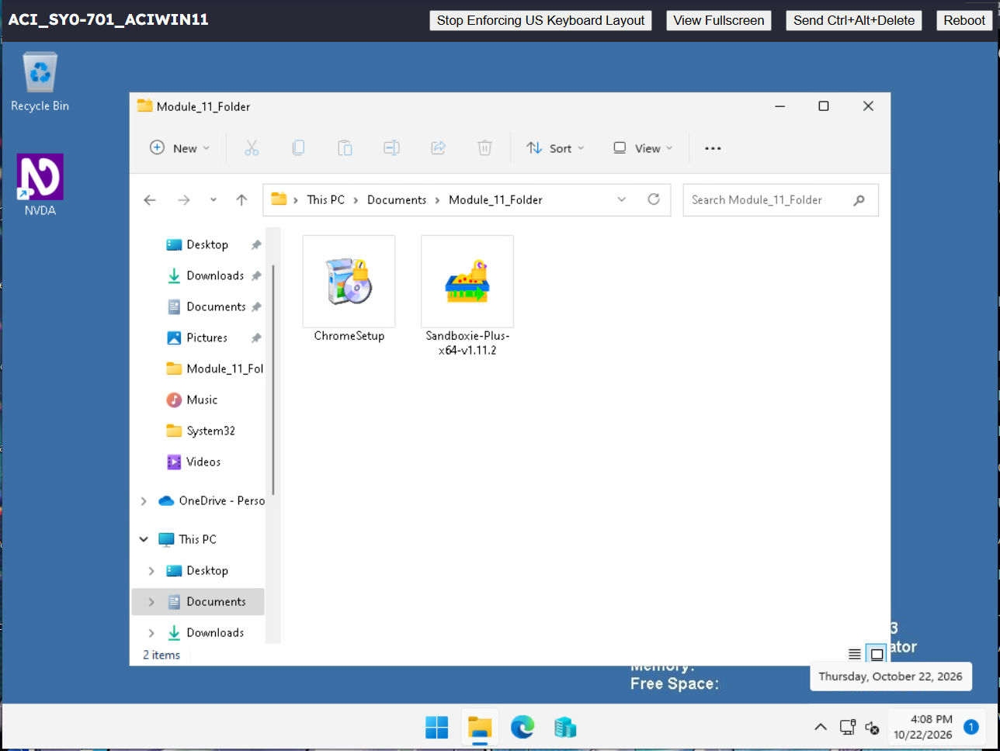
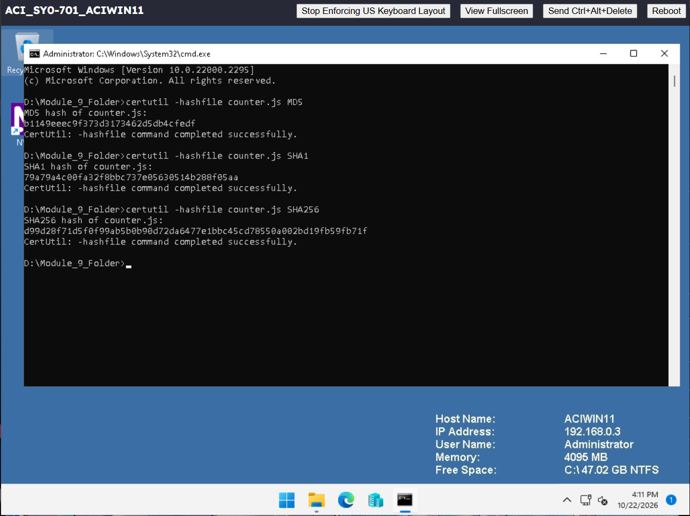
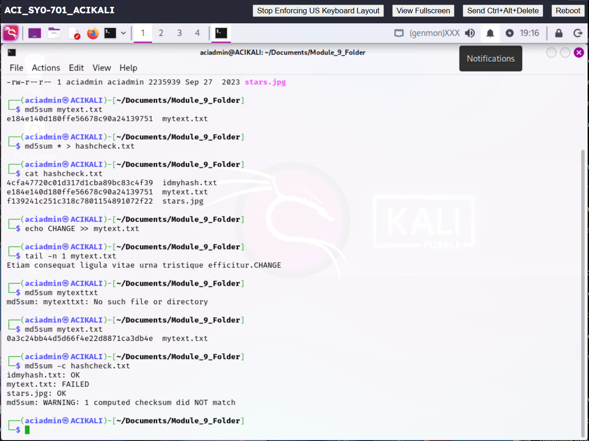
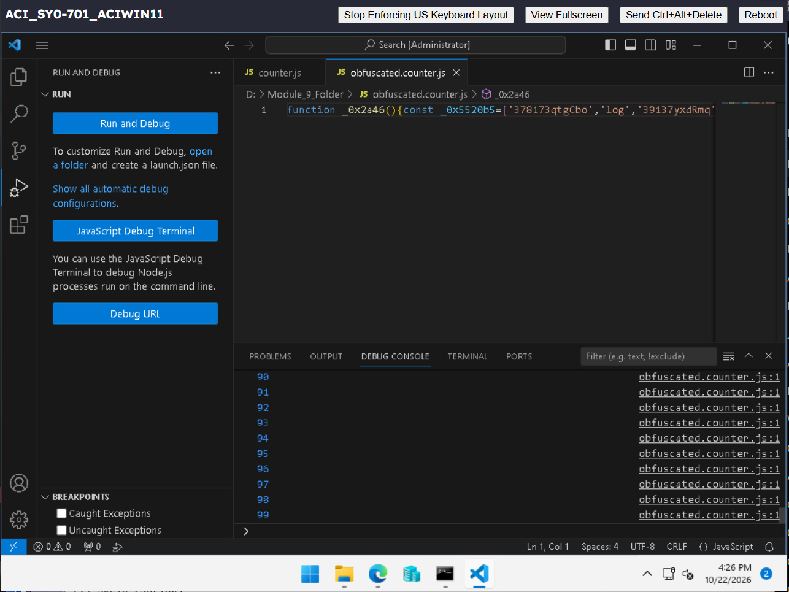

# Data Protection Strategies — EFS, File Hashing, and JavaScript Obfuscation

**Training platform:** ACI Learning — CompTIA Security+ (SY0-701) Skill Labs  
**Lab:** 08 of 18 — *Data Protection Strategies*  
**Focus:** File and folder encryption; integrity baselines and modification detection; hash identification; JavaScript obfuscation  
**Environment:** ACI-provided Windows 11 Pro (`ACIWIN11`) and Kali Purple (`ACIKALI`) training systems  
**Evidence:** Five screenshots from my own guided lab session

## Overview

I completed three exercises illustrating distinct data protection techniques: **Windows Encrypting File System (EFS)** for confidentiality, **cryptographic hashes** for integrity checking, and **JavaScript code obfuscation** to make program logic harder to inspect. I verified EFS on a test file and a folder, measured digests with Windows and Linux tools, detected a deliberate file modification against saved checksums, and executed readable and obfuscated versions of a JavaScript program.

The training environment and exercise design were provided by **ACI Learning**. This README documents my results and interpretation rather than reproducing the provider's instructional material. Screenshots are from my own activity in the authorized lab.

## Exercise 1 — Encrypt files and folders with Windows EFS

### Encrypt one file with `cipher`

On `ACIWIN11`, I created `newfile.txt` in the provided `Documents\Module_10_Folder` and used the Windows `cipher` utility:

```cmd
echo This is a new file > newfile.txt
cipher /e /a newfile.txt
cipher /c newfile.txt
```

- `cipher /e` requests EFS encryption.
- `/a` explicitly includes a named **file**, not only directories.
- `newfile.txt` is a **relative path**, resolved against the current working directory. This avoids relying on the absolute-path typo in the provided exercise.
- `cipher /c` reports encryption details, including users eligible to decrypt, recovery information and key metadata.



**Observed:** The encryption command reported `newfile.txt [OK]` and that one file was encrypted. I subsequently ran `cipher /c newfile.txt` and observed sections for compatibility, authorized decryption users, recovery certificates, and key information; this extra check was **not separately screenshotted**.

**Security interpretation:** EFS uses cryptographic keys and associated certificates to protect NTFS file contents. It is not simply the user's Windows password encrypting the file. This exercise did **not** test decryption from an unauthorized account or recovery after key loss; successful file encryption alone should not be interpreted as proof of those controls. The command also warned that previous plaintext remnants may remain on disk.

### Encrypt an existing folder and its contents

On `ACIWIN11`, I opened `Module_11_Folder` properties, selected **Advanced → Encrypt contents to secure data**, and applied the change to **the folder, subfolders, and files**, rather than only the parent folder.



**Observed:** File Explorer displayed padlock indicators for two files inside the folder: `ChromeSetup` and `Sandboxie-Plus-x64-v1.11.2`. This visually supports that the folder-level encryption operation was applied to its contents; the screenshot is not an independent cross-account access test.

**Takeaway:** EFS protects stored file content (*data at rest*) at the NTFS file/folder level. It does not, by itself, replace encryption for data transmitted over networks.

## Exercise 2 — Calculate hashes and detect changes

### Windows: compare digest algorithms

On `ACIWIN11`, from `D:\Module_9_Folder`, I generated hashes of the same `counter.js` source file:

```cmd
certutil -hashfile counter.js MD5
certutil -hashfile counter.js SHA1
certutil -hashfile counter.js SHA256
```



| Algorithm | Digest size | Hex characters | Security note |
|---|---:|---:|---|
| MD5 | 128 bits | 32 | Not collision-resistant; inappropriate where an attacker can craft inputs |
| SHA-1 | 160 bits | 40 | Collision-vulnerable; avoid for new collision-sensitive applications |
| SHA-256 | 256 bits | 64 | Appropriate for modern general-purpose file integrity hashing |

**Observed:** All three `certutil` operations succeeded and produced different-length outputs for the same unchanged file. We also discussed SHA-384 and SHA-512 as supported alternatives. A hash is not encryption: it does not conceal file contents.

### Linux: establish a baseline, modify a file, and verify

On `ACIKALI`, in `~/Documents/Module_9_Folder`, I created and inspected an MD5 baseline for the lab's files:

```bash
md5sum mytext.txt
md5sum * > hashcheck.txt
cat hashcheck.txt
```

Then I deliberately modified one file and checked its integrity against the stored baseline:

```bash
echo CHANGE >> mytext.txt
tail -n 1 mytext.txt
md5sum mytext.txt
md5sum -c hashcheck.txt
```



**Observed:** The original hash for `mytext.txt` was:

```text
e184e140d180ffe56678c90a24139751
```

After appending `CHANGE`, the new hash was:

```text
0a3c24bb44d5d66f4e22d8871ca3db4e
```

The saved-baseline verification returned:

```text
idmyhash.txt: OK
mytext.txt: FAILED
stars.jpg: OK
md5sum: WARNING: 1 computed checksum did NOT match
```

This proves that the verification detected the deliberate content change. Because the original file did not appear to end with a newline, the `tail` output showed `CHANGE` directly following its preceding text; the file still changed as intended.

**Practical lessons:**

- `>` writes or overwrites an output file; `>>` appends data to a file.
- The shell wildcard `*` matches non-hidden names in the current directory and may include directories; it is not a recursive file inventory. Rerunning that command when `hashcheck.txt` already exists can also cause unexpected results, so an explicitly enumerated input list is safer.
- A valid **baseline must be saved before the change** and protected from tampering. Saving a new checksum *after* modifying a file would make the modified state the new baseline.
- A mismatch proves that the contents differ from the baseline, **not** who changed them or whether it was malicious.
- MD5 was used because the guided exercise specified it; SHA-256 would be preferable for many security-sensitive integrity workflows.

### Identify candidate hash algorithms

I examined the five example hash strings in `idmyhash.txt` using:

```bash
cat idmyhash.txt
hashid idmyhash.txt
```

ACI's exercise identifies the five example algorithms as **MD2, MD5, SHA-1, SHA-256, and SHA-512**. My actual `hashid` output proposed varying candidate lists, including less familiar named formats and algorithms. It did not uniquely establish the correct algorithm for each input.

**Interpretation:** A hash's length and structure can narrow down candidates, but many algorithms or application-specific password-hash formats look similar. The source application and surrounding context are needed for confident identification.

### Relationship to file integrity monitoring

This manual process mirrors part of a file integrity monitoring (FIM) workflow: create a known state, detect a changed state, and surface a mismatch. A FIM platform such as Wazuh can automate collection, comparison, alerting and enrichment; the standalone `md5sum -c` result does not provide that full monitoring context.

## Exercise 3 — Execute and obfuscate JavaScript

### Establish expected program behavior

In Visual Studio Code on `ACIWIN11`, I opened `D:\Module_9_Folder\counter.js` and used the Node.js debugger. The original, readable JavaScript program used a `for` loop to print numbers **1 through 99**. I observed it execute successfully before comparing an obfuscated counterpart.

### Execute the obfuscated version

I inspected the JavaScript obfuscation tool described in the lab. Its website navigation had changed since the instructions were written: instead of a **Playground** navigation item, the accessible entry point was labeled **Try Free Standard Obfuscation**. For the execution comparison, I opened ACI's supplied `obfuscated.counter.js` in Visual Studio Code and ran it using Node.js.



**Observed:** The obfuscated file's source displayed difficult-to-read identifiers (for example, `_0x...`) and a long, compact code line. Its Debug Console showed the counting sequence reaching **99**, consistent with the original program's behavior. The screenshot displays the tail of the output, while the full count from 1 was observed during execution.

**Security interpretation:** Obfuscation changes the code's **readability**, not necessarily its functional behavior. Techniques may include renaming identifiers, hiding strings, transforming control flow and adding misleading constructs. Obfuscation can raise the cost of casual inspection of proprietary logic, but **it is not encryption and does not guarantee source secrecy**. Both legitimate software and malware can use obfuscation, so its presence alone does not establish malicious intent. Code behavior and context are required for that assessment.

**Handling note:** Avoid submitting confidential or proprietary source code to third-party web-based obfuscators without approval. The source code in this exercise was provided as disposable training material.

## Compare the three techniques

| Technique | Primary objective | Evidence from this lab | Limitation |
|---|---|---|---|
| **EFS encryption** | Confidentiality of stored files | `cipher` reported encryption success; File Explorer showed encrypted-file overlays | Does not independently secure data in transit; key handling matters |
| **Hashing** | Identify changes relative to a trusted baseline | `md5sum -c` reported `mytext.txt: FAILED` after modification | Does not attribute the change or hide contents; baseline integrity matters |
| **Code obfuscation** | Make program logic harder to understand | Obfuscated JavaScript executed with the same observed counting behavior | Not a cryptographic secrecy guarantee or proof of malicious intent |

## Evidence index

| Screenshot | What it establishes |
|---|---|
| [`01-efs-file-encryption.PNG`](screenshots/01-efs-file-encryption.PNG) | Windows EFS encryption command succeeded on a test file |
| [`02-efs-folder-encryption.PNG`](screenshots/02-efs-folder-encryption.PNG) | Encrypted-file indicators for both files in the selected folder |
| [`03-windows-file-hashes.PNG`](screenshots/03-windows-file-hashes.PNG) | MD5, SHA-1 and SHA-256 computed on the same JavaScript file |
| [`04-linux-file-integrity-check.PNG`](screenshots/04-linux-file-integrity-check.PNG) | Original and changed hashes, plus failed verification against the saved baseline |
| [`05-javascript-obfuscation-verified.PNG`](screenshots/05-javascript-obfuscation-verified.PNG) | Obfuscated source file and successful Node.js console output |

## Conclusion

This exercise reinforced that different data security objectives require different controls. **EFS encryption** protects confidentiality of files at rest; **hashing** helps detect unauthorized or accidental modification when compared with a trustworthy baseline; **obfuscation** makes code analysis harder but does not establish secrecy or trustworthiness. Manually checking file integrity was especially relevant to the file-monitoring and security-operations work I am developing.

**Attribution and scope:** ACI Learning provided the lab environment and exercise instructions. All screenshots show my own lab execution. This repository intentionally excludes the lab provider's PDF, its instructional screenshots, private keys, user credentials and other sensitive material.
