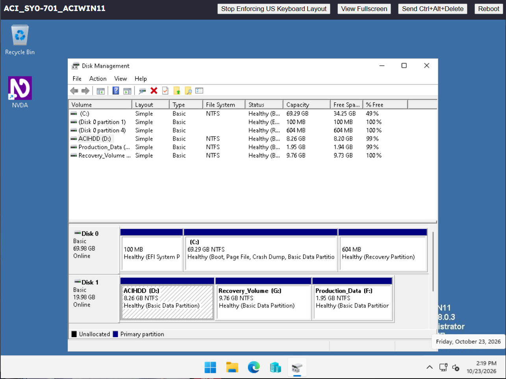
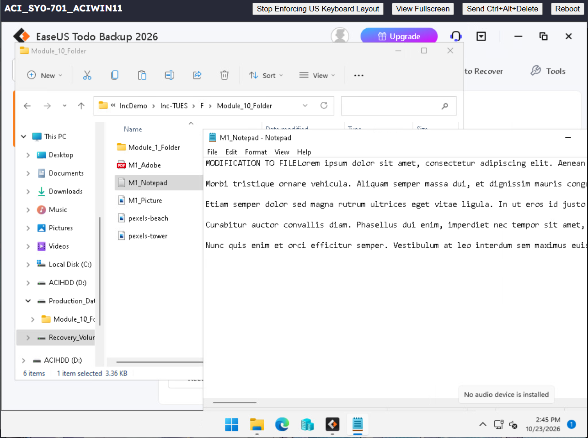
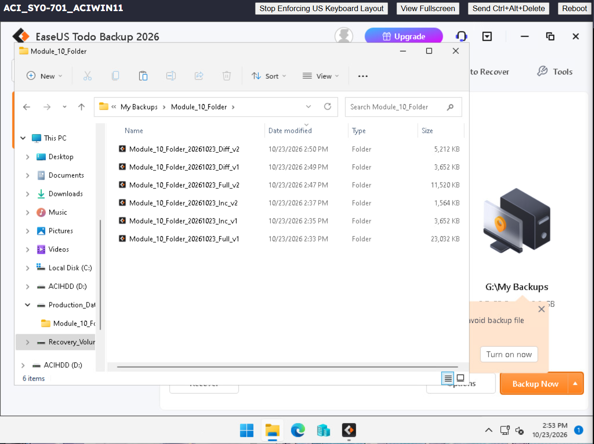
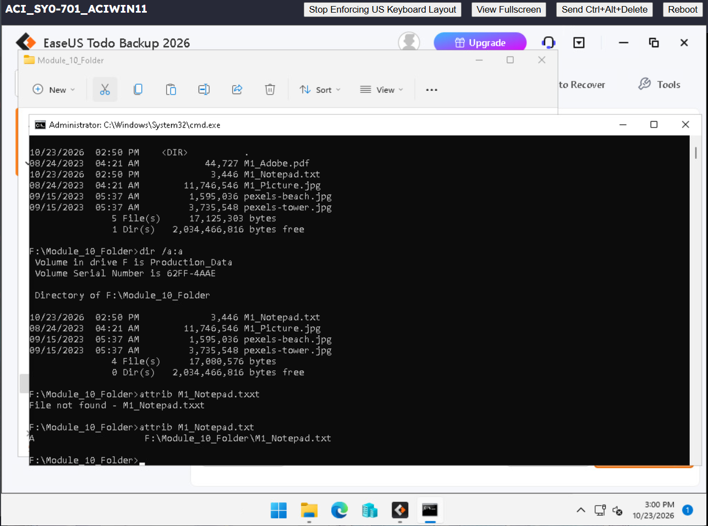

# Resilience in Security Architecture — Windows Backup and Recovery

**Training:** ACI Learning · CompTIA Security+ (SY0-701) Skill Labs  
**Lab:** 09 of 18 — *Resilience in Security Architecture*  
**Focus:** Volume preparation, full/incremental/differential backups, point-in-time restoration, Windows Archive attribute  
**Environment:** ACI-provided `ACIWIN11` (Windows 11 Pro, domain workstation) and EaseUS Todo Backup **2026**  
**Evidence:** Four screenshots captured during my hands-on lab session

## Overview

In this lab, I prepared separate production-data and recovery volumes, performed **two full backups, two incremental backups, and two differential backups**, and restored three different incremental recovery points to verify that the expected files were available at each point in time. I also inspected and changed Windows file Archive attributes using File Explorer and Command Prompt.

The lab scenario, source files, and training environment were supplied by **ACI Learning**. This is a record of my actions, evidence, results, and analysis—not a reproduction of the provider's lab guide. Backup activity was performed in an authorized training environment, not on production systems.

## Lab environment and storage layout

The lab uses an existing data disk on `ACIWIN11`. I shrank the original `D:` partition and created two NTFS volumes:

| Volume | Purpose | Observed capacity |
|---|---|---:|
| `ACIHDD (D:)` | Original training materials and source files | 8.26 GB |
| `Production_Data (F:)` | Production-like files to back up | 1.95 GB |
| `Recovery_Volume (G:)` | Backup storage and restored recovery points | 9.76 GB |



**Verified:** All three partitions were displayed as **NTFS** and **Healthy** on Disk 1. Disk 0, which hosts Windows, was left unchanged.

I copied the training dataset to `F:\Module_10_Folder`, prepared `G:\IncDemo` and `G:\DiffDemo`, and installed the free edition of EaseUS Todo Backup. Actual backup files were stored beneath `G:\My Backups\Module_10_Folder`.

**Resilience limitation:** Although the source and backup destinations are separate *partitions*, they reside on the **same physical disk**. This setup is appropriate for demonstrating restoration, but it would not protect data against the failure or loss of that disk. A production strategy should keep independently recoverable copies, ideally including protected off-site or offline/immutable copies.

## Exercise 1 — Prepare volumes and backup software

- Shrunk the existing `D:` partition by **2,000 MB** to create `F:` (`Production_Data`).
- Shrunk it again by **10,000 MB** to create `G:` (`Recovery_Volume`).
- Used NTFS and confirmed both new volumes showed Healthy status.
- Copied and renamed the provided training dataset as `F:\Module_10_Folder`.
- Prepared `G:\IncDemo` and `G:\DiffDemo` for isolated restore tests.
- Installed and launched **EaseUS Todo Backup 2026**, a newer interface than the version shown in the lab handout.

## Exercise 2 — Full and incremental backups with verified recovery

I configured a file backup of **`F:\Module_10_Folder`**, with the backup destination on **`G:\My Backups`**. The exercises simulated successive days; all operations were performed during the same lab session.

| Simulated day | Operation | Source data change before backup |
|---|---|---|
| Sunday | Full backup | Initial production dataset |
| Monday | Incremental #1 | Added `pexels-tower.jpg` |
| Tuesday | Incremental #2 | Added `pexels-beach.jpg`; inserted `MODIFICATION TO FILE` into `M1_Notepad.txt` |

### Restore checkpoints

I used EaseUS's recovery history to restore the full and both incremental *recovery points* into distinct directories under `G:\IncDemo`:

| Recovery point | Restore directory | Verified/expected result |
|---|---|---|
| Sunday full | `G:\IncDemo\Full-Sun` | Full restoration completed; represents original files before Monday/Tuesday changes |
| Monday incremental | `G:\IncDemo\Inc-MON` | Confirmed `pexels-tower` present and `M1_Notepad` still **unmodified** |
| Tuesday incremental | `G:\IncDemo\Inc-TUES` | Confirmed both added images present and modified Notepad text restored |



The Tuesday screenshot shows the recovered file path `IncDemo → Inc-TUES → F → Module_10_Folder`, the presence of `pexels-beach` and `pexels-tower`, and `M1_Notepad` opened with the inserted text. The text was inserted directly before the existing `Lorem ipsum` sentence rather than on a separate line; this still demonstrates that the modified content was restored.

**Result:** A restored *incremental recovery point* is a reconstructed dataset; it is **not** limited to only the changed files stored in one incremental backup artifact. Tuesday's reconstruction depends on the Sunday full backup, Monday incremental, and Tuesday incremental.

## Exercise 3 — Differential backups and storage comparison

I reset `F:\Module_10_Folder` from the original training dataset, ran another full backup, then repeated the same Monday and Tuesday file changes with **differential** backups instead of incremental ones. EaseUS produced six artifacts across both exercises. Their names and sizes were visible in `G:\My Backups\Module_10_Folder`:

| Observed artifact | Type | Displayed size |
|---|---|---:|
| `Module_10_Folder_20261023_Full_v1` | First full | **23,032 KB** |
| `Module_10_Folder_20261023_Inc_v1` | Monday incremental | **3,652 KB** |
| `Module_10_Folder_20261023_Inc_v2` | Tuesday incremental | **1,564 KB** |
| `Module_10_Folder_20261023_Full_v2` | Second full | **11,520 KB** |
| `Module_10_Folder_20261023_Diff_v1` | Monday differential | **3,652 KB** |
| `Module_10_Folder_20261023_Diff_v2` | Tuesday differential | **5,212 KB** |



### Findings

- The **Monday** incremental and differential backups were both **3,652 KB**, consistent with each capturing the newly added `pexels-tower` since the full baseline.
- The **Tuesday incremental** was **1,564 KB**: it needed only the changes since Monday (`pexels-beach` and the edited Notepad file).
- The **Tuesday differential** was **5,212 KB**: it captured changes since the latest full baseline, including the Monday image as well as Tuesday's changes.
- Additional backup storage *after* each full backup was **5,216 KB incremental** (3,652 + 1,564) versus **8,864 KB differential** (3,652 + 5,212). Thus the differential sequence stored **3,648 KB more** additional backup data in this test.

**Data-quality note — unequal initial full backups:** The first full backup was **23,032 KB**, while the second was **11,520 KB**, so comparing the *total chain sizes* directly would be misleading. I noticed that the initial incremental exercise had an **extra nested `Module_1_Folder`** in the source dataset, which plausibly explains the larger first baseline. This was a lab preparation mistake, not evidence that incremental backup inherently requires a larger full backup. The incremental and differential results *after their respective baselines* still illustrate the expected behavior. I did not run a controlled repeat with exactly identical baseline source trees.

### Recovery tradeoff

| Factor | Incremental | Differential |
|---|---|---|
| Records changes since | Most recent full **or incremental** backup | Most recent **full** backup |
| Size of successive backup artifacts | Typically smaller | Can grow as changes accumulate |
| To restore Tuesday | Sunday full **+ Monday incremental + Tuesday incremental** | Sunday full **+ Tuesday differential** |
| Consequence of a missing Monday artifact | Tuesday's incremental chain may be unusable | Monday differential is not required to restore Tuesday |

**Interpretation:** Incremental backup chains prioritize smaller, quicker subsequent backup runs, while differential backups usually provide a simpler recovery chain at a storage cost. Recovery Point Objective (RPO) governs acceptable data loss; Recovery Time Objective (RTO) governs acceptable time to restore operations. The choice depends on both.

`G:\DiffDemo` was created but a separate **differential restoration was optional** in the supplied exercise and was **not performed or claimed** here.

## Exercise 4 — Investigate the Windows Archive attribute

The Windows Archive (`A`) file attribute can indicate that a file has been created or modified and is ready for an archive-based backup workflow. I used File Explorer's **Attributes** column and the **Advanced Attributes** dialog to clear *File is ready for archiving* on `M1_Adobe.pdf`.

I then opened Command Prompt in `F:\Module_10_Folder` and ran:

```cmd
dir
dir /a:a
attrib M1_Notepad.txt
```



**Observed:** Ordinary `dir` listed **five files**, including `M1_Adobe.pdf`. `dir /a:a` listed **four files**, excluding `M1_Adobe.pdf`. The `attrib M1_Notepad.txt` command displayed the `A` attribute for the text file. An initial filename typo produced a `File not found` message; correcting the filename yielded the expected result.

**Scope:** This confirms attribute visibility and manipulation. It **does not establish that EaseUS Todo Backup 2026 uses the Archive bit internally** for change tracking; modern backup products may use other detection methods.

## What I learned

1. A **backup report is not sufficient evidence of recoverability**. Restoring a point in time and checking actual file contents is a stronger test.
2. Incremental and differential methods differ in **backup dependency chains**, not just archive sizes.
3. Testing different backup strategies requires an **identical source baseline**. A duplicated directory can invalidate a headline total-size comparison even when the underlying exercises still work.
4. Windows file attributes can be inspected through both GUI and command-line tools, but their meaning should not be confused with a specific backup application's implementation.
5. A recovery partition on the same disk is useful for a lab, but **does not provide protection from physical disk failure**.

## Evidence index

| Screenshot | Demonstrates |
|---|---|
| [`01-production-recovery-partitions.PNG`](screenshots/01-production-recovery-partitions.PNG) | Healthy Disk 1 partitions and their capacities |
| [`02-incremental-restoration-verified.PNG`](screenshots/02-incremental-restoration-verified.PNG) | Tuesday's reconstructed recovery point, images, and modified text |
| [`03-incremental-vs-differential-backup-sizes.PNG`](screenshots/03-incremental-vs-differential-backup-sizes.PNG) | Six backup artifacts and comparative sizes |
| [`04-windows-archive-bit-verified.PNG`](screenshots/04-windows-archive-bit-verified.PNG) | `dir /a:a` and `attrib` validation after clearing a file's Archive attribute |

## Scope and attribution

This repository contains only my writeup and screenshots of my work in the authorized ACI Learning lab. It does not include course handouts, provider-supplied installation packages, actual backup archives, production data, or passwords. Exercise dates are **simulated backup stages** within the same session—not separate days of operations.
