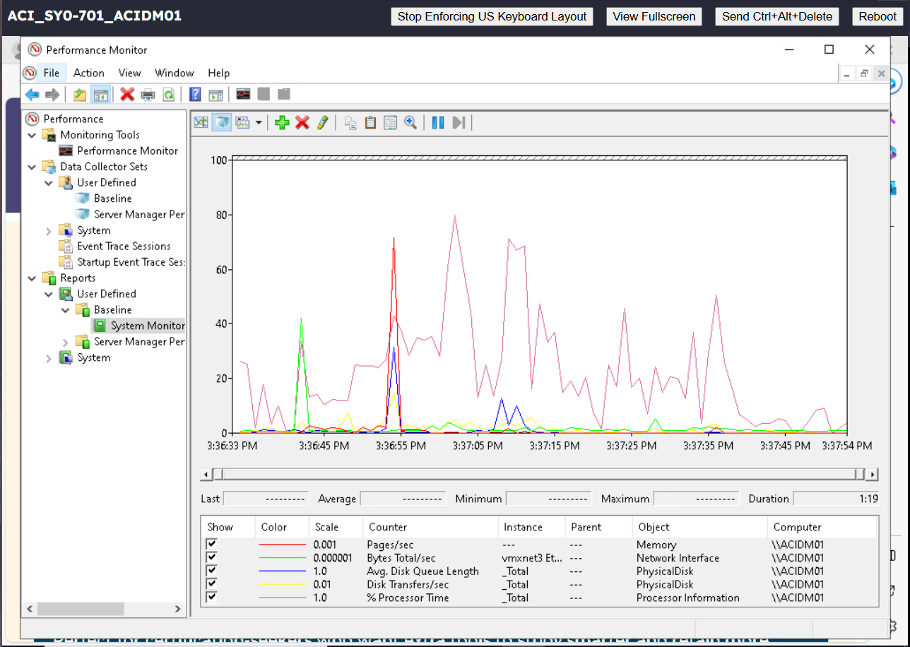
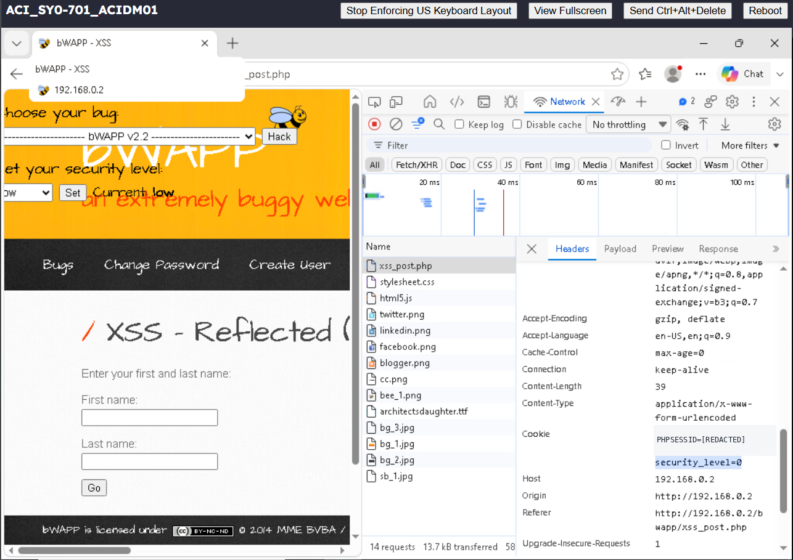
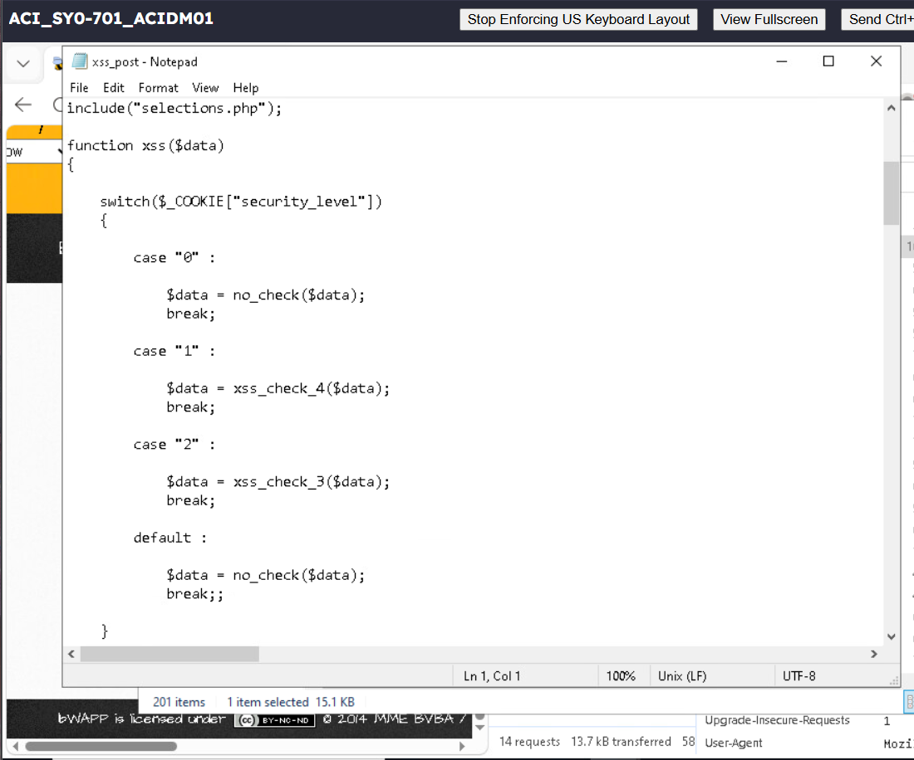
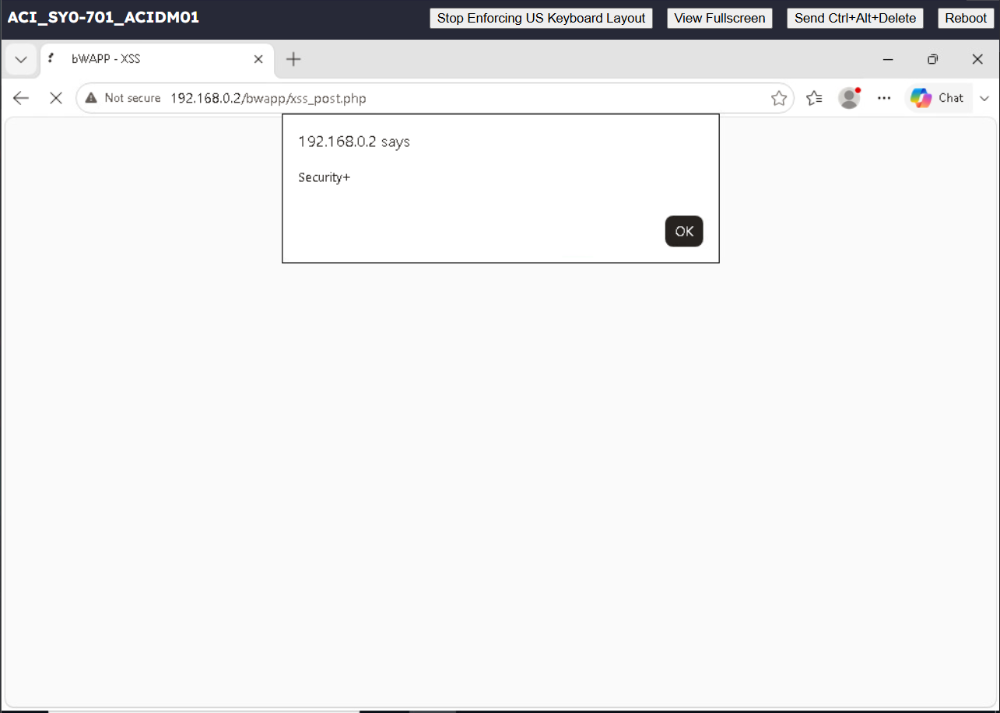
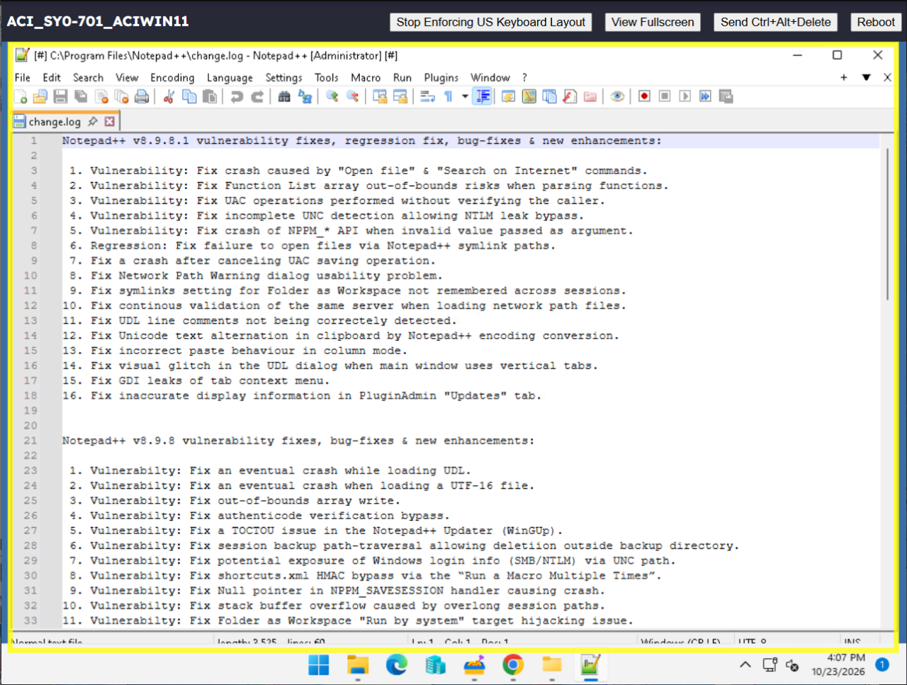
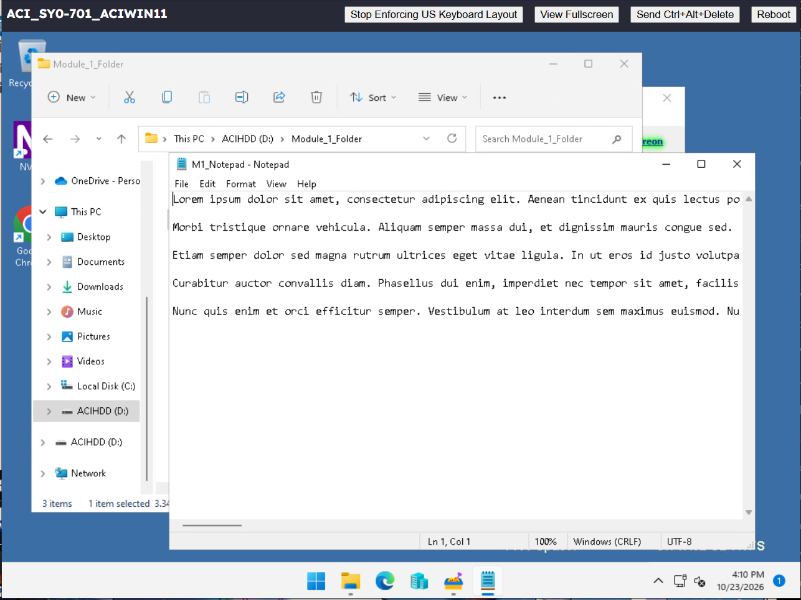

# Securing Computing Resources — Baseline Monitoring, Input Validation, and Sandboxing

**Training:** ACI Learning · CompTIA Security+ (SY0-701) Skill Labs  
**Lab:** 10 of 18 — *Securing Computing Resources*  
**Environment:** ACI-provided Windows Server 2022 (`ACIDM01`), Windows 11 Pro (`ACIWIN11`), bWAPP, XAMPP, and Sandboxie Plus  
**Evidence:** Six screenshots captured during my lab session on October 23, 2026

## Overview

I performed three hands-on exercises exploring how to monitor computing resources, examine web application input handling, and contain application activity inside a sandbox:

1. Configured Microsoft Performance Monitor counters and recorded a short system-performance baseline.
2. Inspected bWAPP's security-level cookie and PHP source code, then demonstrated reflected cross-site scripting (XSS) and HTML injection in an intentionally vulnerable application.
3. Installed and used Sandboxie Plus to run Notepad++ in isolation, then verified that its installation and the file change were not visible on the host after sandboxed processes were terminated.

All tests took place in the **authorized ACI Learning training environment**. This repository documents my execution, observations, and interpretation rather than reproducing the lab guide. The XSS demonstrations were confined to the designated local vulnerable application.

## Exercise 1 — Windows performance baseline

**System:** `ACIDM01` (Windows Server 2022)

I opened Windows Performance Monitor and configured a `Baseline` Data Collector Set using the existing processor counter and four additional counters:

| Counter | Purpose |
|---|---|
| `Processor Information(_Total)\% Processor Time` | CPU utilization |
| `Memory\Pages/sec` | Rate of paging I/O resulting from hard page faults |
| `Network Interface(*)\Bytes Total/sec` | Network bytes transmitted and received per second |
| `PhysicalDisk(_Total)\Avg. Disk Queue Length` | Average disk I/O requests queued or being serviced |
| `PhysicalDisk(_Total)\Disk Transfers/sec` | Completed read/write operations per second |

I briefly browsed the ACI Learning and CompTIA websites during collection, stopped the Data Collector Set, then opened the recorded `System Monitor Log.blg` in Performance Monitor.



**Observed:** The report shows **1 minute 19 seconds** of recording, with CPU utilization peaks near 80% on the displayed graph and smaller intermittent network and disk-activity spikes. Each counter has its own graph scale, so apparent graph heights should not be interpreted as directly comparable raw measurements.

**Interpretation:** A performance baseline provides context for identifying abnormal behavior, but **this brief browsing session is a demonstration, not a representative long-term production baseline**. A useful security/operations baseline would cover varied workloads and time periods. Performance anomalies are leads for investigation, not proof of compromise.

## Exercise 2 — bWAPP input validation and reflected XSS

**System:** `ACIDM01` (Windows Server 2022)  
**Environment:** XAMPP Apache/MySQL hosting the intentionally vulnerable bWAPP application on `192.168.0.2`

### Inspect security-level cookies

I launched Apache and MySQL, signed into bWAPP using its provided training account, selected **Cross-Site Scripting — Reflected (POST)**, and used Microsoft Edge Developer Tools (**Network → `xss_post.php` → Headers**) to inspect requests.

| bWAPP UI setting | Request-cookie parameter observed |
|---|---|
| Low | `security_level=0` |
| Medium | `security_level=1` |
| High | `security_level=2` |

The `PHPSESSID` remained the same while the `security_level` cookie changed, consistent with the same browser session switching between training security settings.



**Security note:** The screenshot in this repository has its **PHP session identifier redacted**. The numeric `security_level` value remains visible. A user-controlled cookie should not be treated as an authoritative source for production access-control decisions; bWAPP uses it intentionally for training.

### Review PHP source code

I opened `D:\xampp\htdocs\bWAPP\xss_post.php` and inspected the `xss($data)` function, which selects a handler using `$_COOKIE["security_level"]`:

| Cookie value | Handler | Observed source behavior |
|---|---|---|
| `0` | `no_check($data)` | Returns supplied data unchanged |
| `1` | `xss_check_4($data)` | Uses `addslashes($data)` |
| `2` | `xss_check_3($data)` | Uses `htmlspecialchars($data, ENT_QUOTES, $encoding)` with a UTF-8 default |
| Unrecognized/default | `no_check($data)` | Falls back to no validation/encoding |

The implementations are in the included `functions_external.php`. In particular, `addslashes()` escapes some characters useful in string quoting, but **does not safely encode HTML output**. `htmlspecialchars()` encodes HTML-significant characters in the relevant HTML-text context; it should not be described as a universal XSS defense for every output context.

I also noticed that the PHP switch statement's **default branch calls `no_check()`**, a weak fail-open-style default that would be undesirable for security controls in production.



### Test input handling

With bWAPP set to **low**, I submitted a harmless proof-of-concept JavaScript alert in the Last name field:

```html
<script>alert("Security+")</script>
```

The browser displayed a dialog containing **Security+**, confirming JavaScript execution in the browser due to reflected, insufficiently encoded input.



At **medium**, I submitted `<b>doe</b>` and observed **doe** rendered in bold in the welcome message. This confirms interpretation of untrusted HTML markup, demonstrating **HTML injection**. It does *not by itself* establish arbitrary JavaScript execution at medium security.

The **high** setting's `htmlspecialchars()` implementation was inspected in source, but **was not dynamically tested** as part of these lab steps.

**Security takeaway:** Prefer context-appropriate output encoding and robust server-side validation. Unsafe reflections can allow browser-side script execution; merely adding backslashes is not proper HTML-context protection.

## Exercise 3 — Sandboxing with Sandboxie Plus

**System:** `ACIWIN11` (Windows 11 Pro)

I installed and configured **Sandboxie Plus** and installed Google Chrome on the host. I then launched Chrome via Sandboxie's `DefaultBox`, downloaded Notepad++ from the official website, and ran the Notepad++ installer through the sandboxed process.

The Notepad++ window displayed a **yellow border** and `[#]` title markers, both visible indicators that the application was running within Sandboxie. The version displayed during this session was **Notepad++ v8.9.8.1**.



In sandboxed Notepad++, I opened `D:\Module_1_Folder\M1_Notepad` and saved a modification prefixed with `SANDBOX CHANGE`. I then selected **Terminate All Programs** for `DefaultBox` and checked the host without launching tools inside the sandbox.

**Observed:**

- Searching the Windows host for Notepad++ did not show a host installation after terminating the sandboxed session (reported during the lab).
- Opening `D:\Module_1_Folder\M1_Notepad` in ordinary Windows Notepad showed the original `Lorem ipsum...` content **without** `SANDBOX CHANGE` (visible in the screenshot).



**Interpretation:** The observed application execution and file modifications were isolated from the host for this exercise. Terminating sandboxed applications does **not necessarily delete** sandbox contents, and one successful isolation test does **not** establish that a sandbox is immune to every bypass or escape.

## Key takeaways

- Performance monitoring is useful when normal behavior has been characterized across appropriate workloads and time periods; **counter scales and units matter** when interpreting results.
- Source-code review can reveal weaknesses that dynamic tests alone might miss, such as bWAPP's **default branch selecting `no_check()`**.
- A successful reflected JavaScript alert demonstrates browser-side execution; interpreting an HTML formatting tag is narrower evidence of **HTML injection**.
- Proper **HTML output encoding** is different from string escaping with `addslashes()`.
- Application sandboxing can make downloaded executables and file changes appear available to sandboxed processes while limiting changes visible to the host, but **isolation should be validated and never assumed perfect**.

## Screenshot index

| Screenshot | Evidence |
|---|---|
| [`01-performance-baseline-report.PNG`](screenshots/01-performance-baseline-report.PNG) | Recorded five-counter Windows Performance Monitor baseline |
| [`02-bwapp-security-cookie-low.PNG`](screenshots/02-bwapp-security-cookie-low.PNG) | Request cookie with `security_level=0`; session token redacted |
| [`03-bwapp-input-validation-source.PNG`](screenshots/03-bwapp-input-validation-source.PNG) | PHP switch statement mapping cookie values to handlers |
| [`04-bwapp-reflected-xss-low.PNG`](screenshots/04-bwapp-reflected-xss-low.PNG) | Browser JavaScript alert triggered at low security |
| [`05-sandboxed-notepad-installation.PNG`](screenshots/05-sandboxed-notepad-installation.PNG) | Notepad++ executing inside Sandboxie DefaultBox |
| [`06-sandbox-host-file-isolation-verified.PNG`](screenshots/06-sandbox-host-file-isolation-verified.PNG) | Original host text file unaffected by sandboxed edit |

## Scope and attribution

**ACI Learning** provided the training environment, instructions, and sample files. This repository contains my analysis and screenshots of the activities I completed. It excludes the course handout, installer packages, session secrets, third-party application binaries, and unrelated lab materials. It is not a production assessment or a claim that any real-world application was tested without authorization.
