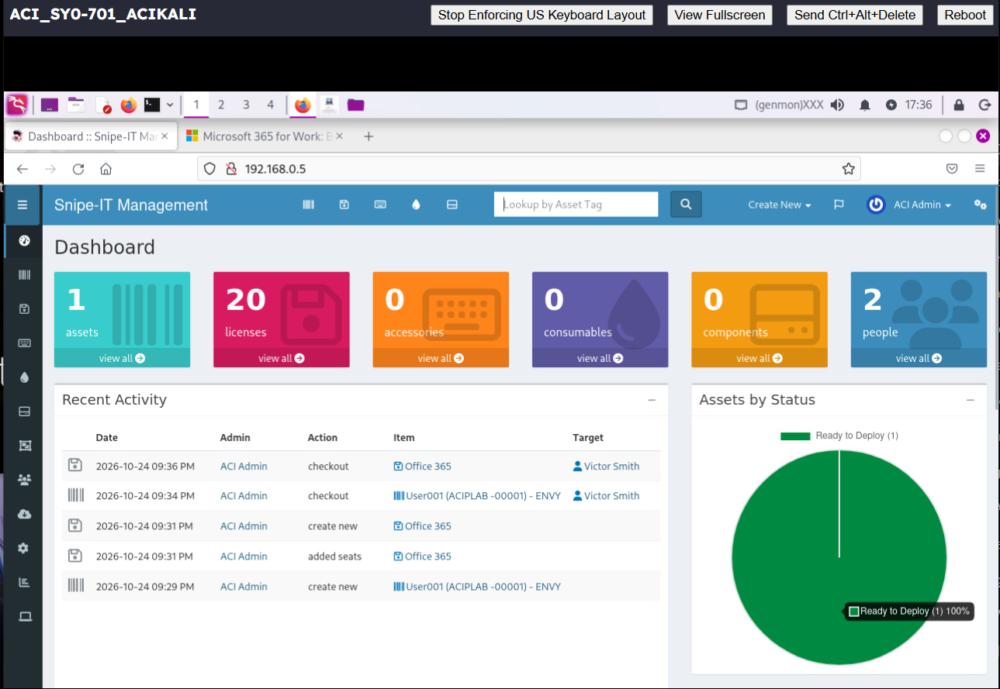
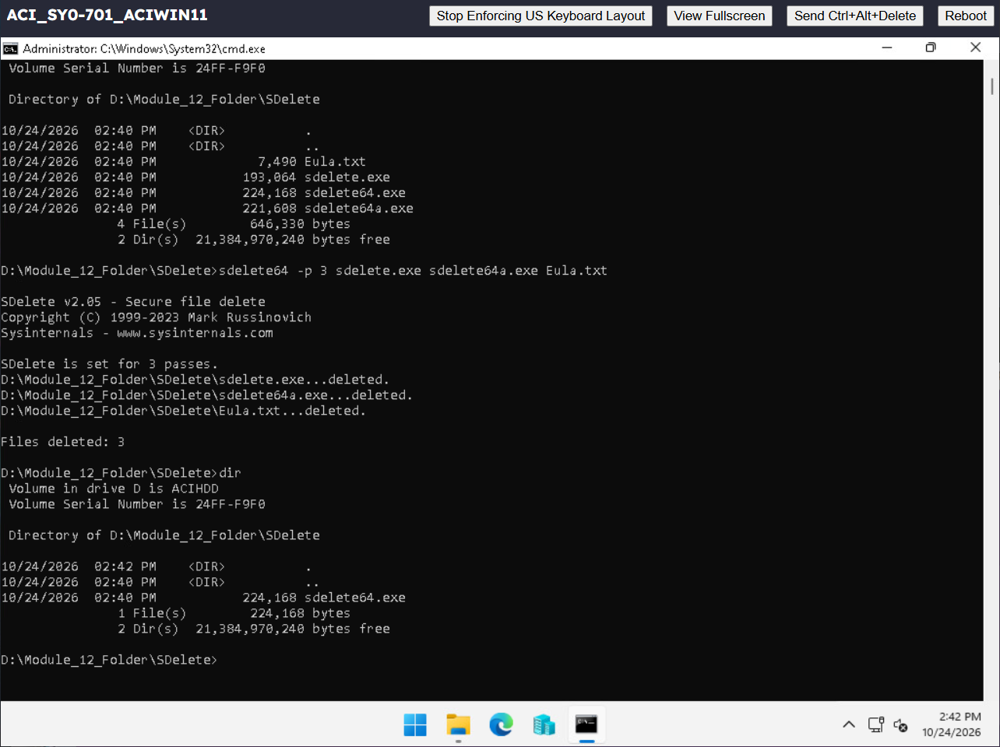
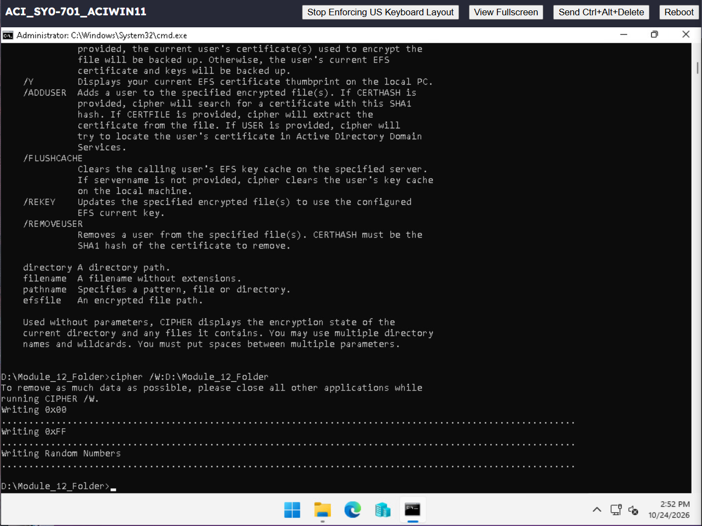

# Asset Management Techniques — Snipe-IT Inventory and Windows Data Sanitization

**Training:** ACI Learning · CompTIA Security+ (SY0-701) Skill Labs  
**Lab:** 11 of 18 — *Asset Management Techniques*  
**Environment:** Kali Purple (`ACIKALI`), Windows 11 Pro (`ACIWIN11`), Windows Server 2022 domain controller (`ACIDC01`), Snipe-IT, Microsoft Sysinternals SDelete, and Windows Cipher  
**Date:** October 24, 2026  
**Evidence:** Three screenshots captured during my authorized lab session

## Overview

I practiced two parts of IT asset lifecycle management: registering and assigning equipment and licenses in **Snipe-IT**, and executing file/free-space overwrite operations in an isolated Windows training environment.

The exercises demonstrated how an asset management platform links hardware and software entitlements to employees, and how administrators can use SDelete and Cipher to make ordinary recovery of deleted data more difficult. Results are described as observed in the lab; no claim of verified physical media sanitization is made.

## Exercise 1 — Deploy and track an asset and software license

**System:** `ACIKALI` (Kali Purple), using Firefox to connect to the ACI-hosted Snipe-IT service (`192.168.0.5`).

### Configure organization and administration

I created the following training records:

| Configuration | Value |
|---|---|
| Company | `ACIPLAB Inc` |
| Location | `US HQ` — Denver, Colorado, United States |
| Password settings | Prevent common passwords; require a letter, number, and symbol |
| Asset tags | Enable auto-incrementing tags with `ACIPLAB -` prefix |
| Barcode labels | Enable square codes |
| Label fields | Company, asset name, asset tag, serial, and model |

The password rules were configured according to this training exercise. Real-world password policy should be evaluated against current organizational standards; composition rules alone do not establish password strength.

### Register an HP ENVY laptop

I created `Laptop` (Asset) and `Productivity Software` (License) categories, the `HP` and `Microsoft` manufacturer records, and an HP ENVY model entry using the supplied training image.

| Hardware field | Recorded value |
|---|---|
| Model | HP ENVY `17-CR1087NR` |
| Asset name | `User001` |
| Serial | `123456` (training value) |
| Asset tag | `ACIPLAB -00001` (shown in dashboard activity) |
| Initial status label | `Ready to Deploy` |
| Assigned user | Victor Smith (`vsmith`) |

I created a fictional Snipe-IT user, Victor Smith (`vsmith`), checked out the laptop to that user, and generated an asset label with identifying fields. The dashboard's **Ready to Deploy** status category remained visible; that label should not be mistaken for proof that checkout did not happen, since the activity log separately records the user assignment.

### Register and assign an Office 365 license

I created a sample `Office 365` license inventory under Microsoft, with **20 seats** and a **placeholder** product key. I assigned one seat to Victor Smith using the license checkout workflow.

**Observed:** Snipe-IT's dashboard recorded two checkout events targeting **Victor Smith** — the HP ENVY laptop and Office 365. It showed one asset and 20 license seats. The checkout activity was verified visually; **19 remaining unassigned seats is the expected arithmetic outcome**, but the submitted dashboard screenshot does not directly show the available-seat count after checkout.



I then used Snipe-IT's administrative **Backups → Generate Backup** feature. The backup was reported created during the lab. Its contents and a complete database restoration were not independently tested.

**Security significance:** Asset inventories support accountability, patch and vulnerability management, license tracking, lost-device investigations, and employee offboarding. The inventory system also needs its own access controls and tested backup/recovery process.

## Exercise 2 — Windows data sanitization

**System:** `ACIWIN11` (Windows 11 Pro), working only with ACI-provided training files on the `D:` volume.

### Targeted deletion using Sysinternals SDelete

I extracted SDelete from `D:\Module_12_Folder`, opened Command Prompt in its extracted folder, reviewed usage help, and listed the sample files. I then executed:

```cmd
sdelete64 -p 3 sdelete.exe sdelete64a.exe Eula.txt
```

**Observed result:** SDelete v2.05 reported three overwrite passes configured, followed by successful deletion messages for all three specified files:

```text
SDelete is set for 3 passes.
...sdelete.exe...deleted.
...sdelete64a.exe...deleted.
...Eula.txt...deleted.
Files deleted: 3
```

A subsequent `dir` command listed only `sdelete64.exe` among the files in the extracted directory. This confirmed the selected files no longer appeared in the directory after the operation.



**Limitation:** Successful tool output and directory removal do not prove every physical copy of the original bytes was erased. SSD wear leveling, remapped storage blocks, snapshots, and virtual-disk behavior can make overwrite-based sanitization incomplete.

### Overwrite free space using Windows Cipher

After returning to the parent directory, I inspected Cipher's help and executed:

```cmd
cipher /W:D:\Module_12_Folder
```

**Important scope:** The folder path identifies a location on **D:**; `cipher /W` operates on **unused space across that volume**, not just the named folder, and is not intended to delete existing files.

**Observed result:** Command Prompt displayed all three overwrite stages and returned to the prompt without a visible error:

```text
Writing 0x00
Writing 0xFF
Writing Random Numbers
D:\Module_12_Folder>
```



**Limitation:** The output verifies that the utility completed its workflow as shown, **not** that a forensic recovery attempt failed or that all historical data copies were eliminated. Modern SSDs, storage virtualization, and snapshot systems may retain data beyond what a filesystem-level wipe can reach. Multi-pass overwriting should not be treated as a universal sanitization guarantee.

## SDelete vs. Cipher `/W`

| Tool | Operation in this lab | Verified outcome |
|---|---|---|
| `SDelete -p 3` | Targeted overwrite/delete of three named sample files | Three deletion reports; files absent in subsequent `dir` output |
| `cipher /W` | Overwrote available unused space on D: | Displayed zero, `0xFF`, and random-data phases; returned to prompt |

**Key difference:** SDelete acted on **existing named files**, while `cipher /W` acted on **free space that might contain remnants of previously deleted files**. Both operations were performed in the disposable, authorized ACI lab environment.

## Key takeaways

- Asset management is not just a list of equipment: it connects each device and license to a **person, organization, location, and lifecycle status**.
- Unique asset tags and labels help IT track equipment independently of other identical hardware models.
- Software license assignments provide a record of entitlements and support offboarding and seat reclamation.
- Backing up the inventory database is valuable, but **generating a backup is not equivalent to testing a restoration**.
- A successful secure-delete command should be reported precisely: **tool execution and directory outcomes are observable**, while forensic irrecoverability requires stronger evidence and media-appropriate sanitization methods.

## Screenshot index

| Screenshot | Evidence |
|---|---|
| [`01-snipeit-license-assignment.PNG`](screenshots/01-snipeit-license-assignment.PNG) | Snipe-IT dashboard activity logging the HP ENVY and Office 365 checkouts to Victor Smith |
| [`02-sdelete-secure-file-deletion.PNG`](screenshots/02-sdelete-secure-file-deletion.PNG) | SDelete three-pass command and post-deletion directory verification |
| [`03-cipher-free-space-overwrite.PNG`](screenshots/03-cipher-free-space-overwrite.PNG) | Cipher `/W` zero, ones, and random-data overwrite phases |

## Scope and attribution

The training environment, sample resources, and exercise instructions were provided by **ACI Learning**. This repository documents my actions, observed results, and security interpretation rather than reproducing the course materials. All accounts, asset identifiers, and license information used in the exercises were training examples. The repository contains no production credentials, real software license keys, or executable utilities.
