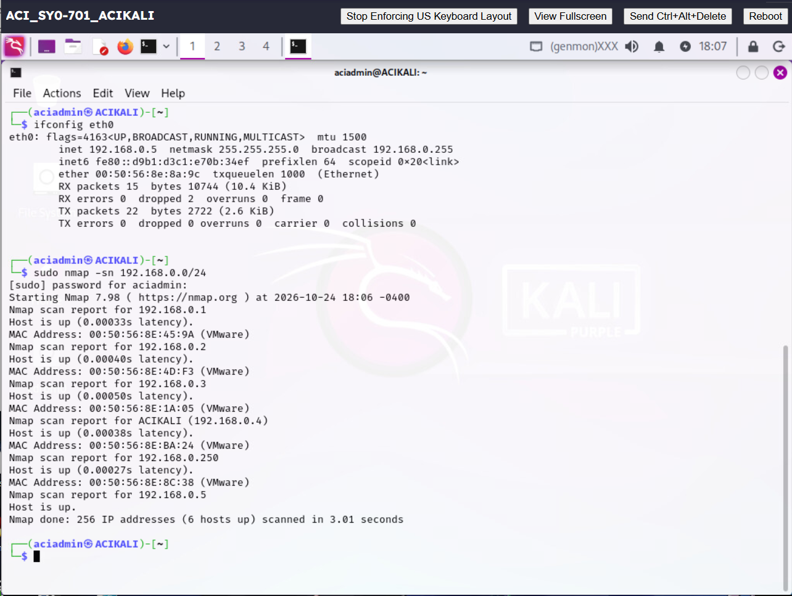
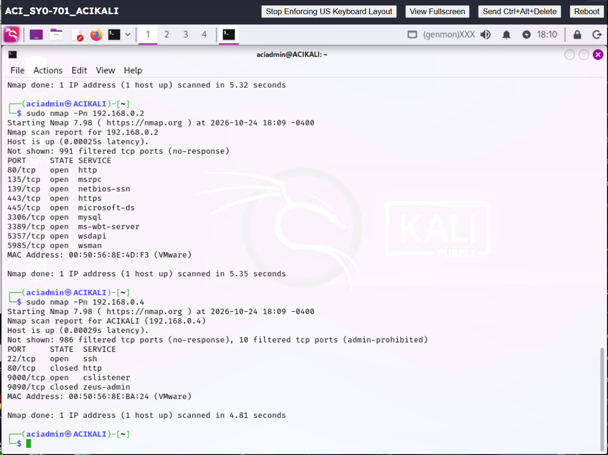
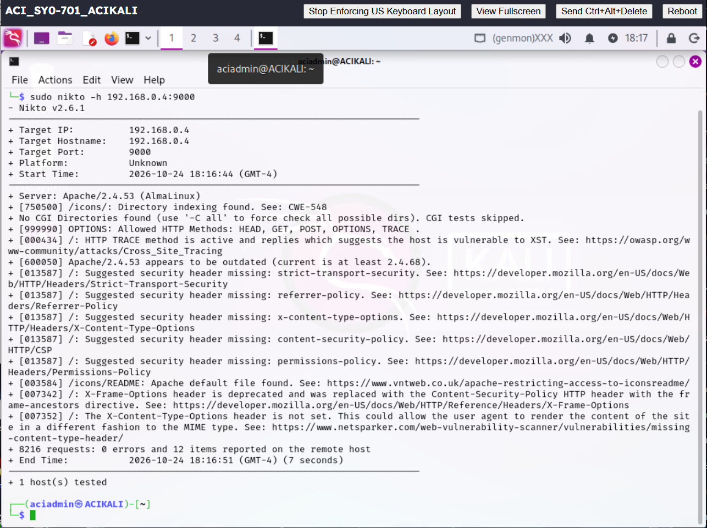
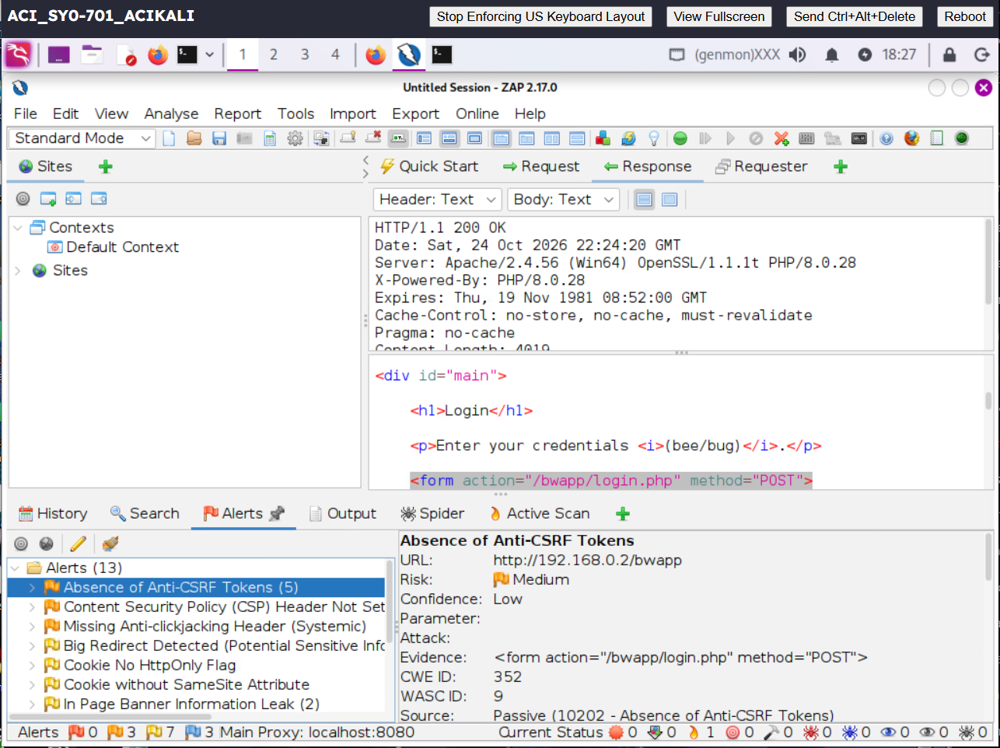
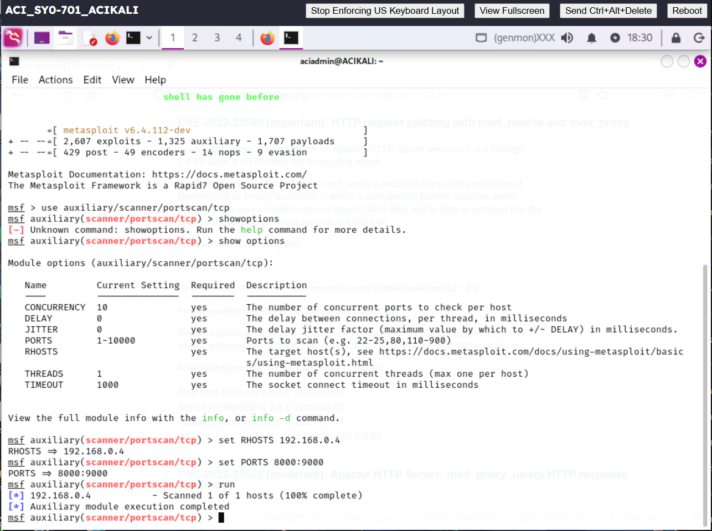
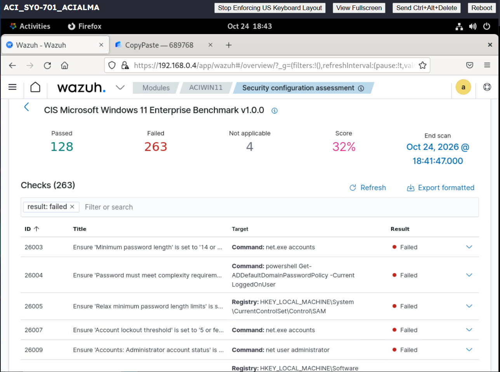

# Vulnerability Management — Network, Web Application, and Endpoint Assessment

**Training:** ACI Learning · CompTIA Security+ (SY0-701) Skill Labs  
**Lab:** 12 of 18 — *Vulnerability Management*  
**Date:** October 24, 2026  
**Environment:** Authorized ACI Learning virtual network; Kali Purple (`ACIKALI`), Windows Server 2022 (`ACIDM01`, `ACIDC01`), Windows 11 Pro (`ACIWIN11`), and AlmaLinux (`ACIALMA`)  
**Tools:** Nmap, Nikto, OWASP ZAP, Metasploit auxiliary scanner, Wazuh SIEM/SCA  
**Evidence:** Six screenshots captured during my lab session

## Overview

I completed two vulnerability management exercises in an isolated training network. First, I discovered hosts, enumerated network services, and used complementary scanners to identify possible web-server and web-application security issues. Second, I connected a Windows 11 endpoint to a Wazuh manager and reviewed its Security Configuration Assessment (SCA) findings against a CIS benchmark.

The workflow emphasized **identification, corroboration, interpretation, and reporting**. I did **not** exploit scanner findings, remediate the Windows benchmark failures, or validate a post-remediation score. Open ports, software-version strings, and automated alerts are not by themselves proof of an exploitable vulnerability.

## Exercise 1 — Detect web application vulnerabilities

### 1. Discover the lab network using Nmap

**System:** `ACIKALI`. I started Apache and MySQL in XAMPP on the intended Windows web-server target, then checked Kali's network interface with `ifconfig eth0` and performed host discovery:

```bash
sudo nmap -sn 192.168.0.0/24
```

**Observed:** Nmap scanned **256 addresses** and reported **six active hosts** in approximately **3.01 seconds**: `192.168.0.1`, `.2`, `.3`, `.4`, `.5`, and `.250`.



**Note:** The interface output identified Kali as `192.168.0.5`, while Nmap's name resolution labeled `192.168.0.4` as `ACIKALI`. I did not verify the reason for that hostname mismatch; subsequent findings are associated with the observed **IP addresses**, not inferred hostnames.

### 2. Enumerate exposed TCP services

I ran targeted scans against the authorized lab addresses:

```bash
sudo nmap -Pn 192.168.0.1
sudo nmap -Pn 192.168.0.2
sudo nmap -Pn 192.168.0.4
```

The submitted evidence shows these results:

| Target | Observed open TCP ports | Interpretation |
|---|---|---|
| `192.168.0.2` | `80`, `135`, `139`, `443`, `445`, `3306`, `3389`, `5357`, `5985` | HTTP/HTTPS and MySQL alongside Windows management and sharing services |
| `192.168.0.4` | `22`, `9000` | SSH and an additional service on port 9000 |

Port `80` and port `9090` were reported **closed** on `.4`; other ports were filtered. The initial port-based Nmap service label for `9000` was `cslistener`, which is not conclusive software identification.



**Security interpretation:** Exposed services expand the attack surface, but each service requires contextual review (business purpose, network reachability, authentication, version, and patch status) before deciding whether it is an unnecessary or vulnerable exposure.

### 3. Assess web servers using Nikto

I ran Nikto against both instructed web-service targets:

```bash
sudo nikto -h 192.168.0.2
sudo nikto -h 192.168.0.4:9000
```

The detailed captured screenshot is for **`192.168.0.4:9000`**. Nikto v2.6.1 reported:

| Item | Observed result |
|---|---|
| Server banner | `Apache/2.4.53 (AlmaLinux)` |
| Requests | **8,216** |
| Scan errors | **0** |
| Items reported | **12** |
| HTTP TRACE | Allowed and responsive |
| Directory listing | `/icons/` indexing reported |
| Default resource | `/icons/README` detected |
| Response headers | Multiple missing or questioned security headers, including CSP, Referrer-Policy, X-Content-Type-Options, Permissions-Policy, and HSTS |



Nikto flagged the Apache version as outdated. The exercise also included reviewing the Apache project's published version-specific CVE information. **A server banner is not sufficient evidence that every CVE affecting the upstream version is exploitable**; distribution-maintained packages may include backported security fixes, and vulnerabilities may depend on configuration or modules. Missing HSTS also has to be interpreted in the context of whether HTTPS is provided.

The scan against `.2` was completed, but its detailed results were not submitted as screenshot evidence; I do not attribute unobserved Nikto findings to that scan.

### 4. Examine the bWAPP application using OWASP ZAP

**Target:** `http://192.168.0.2/bwapp`, the deliberately vulnerable application provided by ACI. I configured an automated ZAP scan with **AJAX Spider** enabled and inspected the Alerts panel.

**Observed:** ZAP 2.17.0 reported **13 alert categories**. The highlighted **Absence of Anti-CSRF Tokens** item had **five instances**, with **Medium** risk and **Low** confidence. The captured evidence points to a POST form on `/bwapp/login.php` lacking a token detectable by the scanner.

Other visible alert categories included a missing CSP header, an anti-clickjacking header issue, missing `HttpOnly` and `SameSite` cookie attributes, and information leakage in page content. The response banner displayed Apache `2.4.56` (Win64), OpenSSL `1.1.1t`, and PHP `8.0.28`.



**Security interpretation:** An automated anti-CSRF finding indicates a need to inspect the form and its actual defenses. The scan did **not** demonstrate a successful CSRF exploit or confirm that every flagged issue was exploitable. Results would need validation and prioritized remediation in a real assessment.

### 5. Cross-check port 9000 using Metasploit and Nmap

I initialized Metasploit and selected its **auxiliary TCP port scanner** (not an exploit module):

```text
use auxiliary/scanner/portscan/tcp
show options
set RHOSTS 192.168.0.4
set PORTS 8000:9000
run
```

**Observed:** The module reported **one host scanned** and **execution completed**, but did **not** print a positive open-port finding for `9000/tcp` in the submitted output. I initially typed `showoptions` without a space; Metasploit rejected it, and I corrected the command to `show options`.



I then used Nmap service version probing:

```bash
nmap -sV -p 9000 192.168.0.4
```

**Observed (reported after execution):** `9000/tcp` was **open**, and the service was identified as **Apache httpd 2.4.53 (AlmaLinux)**. This agreed with Nikto's banner observation, while the auxiliary Metasploit scan did not report an open port. The discrepancy was not resolved in this lab.

**Takeaway:** Tool outputs should be corroborated, especially when a default port-to-service mapping or an absence of reported results could lead to a mistaken conclusion.

## Exercise 2 — Monitor a Windows endpoint with Wazuh

### 6. Start the manager and register a Windows agent

**Manager:** `ACIALMA` at `192.168.0.4`  
**Endpoint:** `ACIWIN11` (Windows 11 Pro)

I checked and started the preinstalled Wazuh Manager:

```bash
sudo systemctl status wazuh-manager
sudo systemctl start wazuh-manager
sudo systemctl status wazuh-manager
```

**Observed:** The manager was **active (running)**, and its web dashboard was accessible. Using Wazuh's agent deployment interface, I configured a **Windows** agent with manager address `192.168.0.4`, agent name `ACIWIN11`, and group `default`; then installed and started the service on Windows.

**Observed (dashboard verification):** **1 total agent; 1 active agent.** No installation failure was reported.

**Security interpretation:** A central manager receives endpoint telemetry and assessment results from the agent. In this exercise, Wazuh was used for **Security Configuration Assessment (SCA)**, whereas a previous lab used Wazuh for **File Integrity Monitoring (FIM)**. These answer different questions: whether configurations meet a baseline versus whether monitored files have changed.

### 7. Assess the CIS Windows 11 benchmark

In Wazuh, I selected `ACIWIN11` and opened **CIS Microsoft Windows 11 Enterprise Benchmark v1.0.0** under Security Configuration Assessment.

| Assessment metric | Observed value |
|---|---:|
| Passed | **128** |
| Failed | **263** |
| Not applicable | **4** |
| Dashboard score | **32%** |
| Date in interface | October 24, 2026 |



The visible failed checks included:

| Check ID | Visible benchmark requirement / topic | Result |
|---|---|---|
| `26003` | Minimum password length of at least 14 characters | Failed |
| `26004` | Password complexity requirements | Failed |
| `26005` | Relax minimum password length limits setting | Failed |
| `26007` | Account lockout threshold | Failed |
| `26009` | Built-in Administrator account status | Failed |

These are **benchmark noncompliance findings**, not proof of active compromise or confirmed exploitable software vulnerabilities. The workstation is domain-joined, so effective policies and the exact evaluation context should be checked before changing configuration; for example, local and domain account policies may differ.

**Important scope boundary:** I did not remediate the 263 failed checks, verify any false positives, create risk exceptions, or re-run the assessment after hardening. The lab guide ends after inspecting failed checks, so the observed **32% is a baseline assessment result, not a remediation outcome**. There is no universal percentage that independently establishes a system is secure.

## Interpretation and potential next steps

The assessed results suggest several distinct follow-on activities **not executed in this lab**:

1. **Validate:** Confirm whether each failure reflects the endpoint's effective configuration and whether the check applies to its domain-joined role.
2. **Prioritize:** Consider impact, likelihood, exposure, asset importance, and available compensating controls instead of pursuing a score alone.
3. **Remediate or document exceptions:** Apply approved hardening changes, or formally record the basis for nonapplicability, false positive, or accepted risk.
4. **Reassess:** Rerun Wazuh SCA and compare individual check outcomes before and after changes.

## Key takeaways

- **Network discovery and port enumeration** identify candidates for assessment, not confirmed vulnerabilities.
- **Nikto and ZAP** reveal different perspectives: server configuration and web-application behavior. Their alerts need context and verification.
- **Version detection** can support CVE research, but package backports and configuration determine actual applicability.
- **Metasploit's auxiliary scan** completed without reporting an open port; Nikto and version-aware Nmap separately identified Apache on `9000/tcp`. Reporting the disagreement accurately matters.
- **Wazuh SCA** measures conformity to a selected set of security checks. The **32% score** indicates many benchmark failures in this snapshot, not a quantified probability of compromise.
- Effective vulnerability management proceeds from **identification → validation → prioritization → remediation/exception → verification → reporting**; this lab chiefly demonstrated identification and initial analysis.

## Screenshot index

| File | Evidence |
|---|---|
| [`01-nmap-network-discovery.PNG`](screenshots/01-nmap-network-discovery.PNG) | Six hosts found during authorized `/24` discovery |
| [`02-nmap-service-enumeration.PNG`](screenshots/02-nmap-service-enumeration.PNG) | TCP ports on web-server and Linux assessment targets |
| [`03-nikto-web-server-assessment.PNG`](screenshots/03-nikto-web-server-assessment.PNG) | Apache/2.4.53 on port 9000 and twelve Nikto findings |
| [`04-owasp-zap-vulnerability-findings.PNG`](screenshots/04-owasp-zap-vulnerability-findings.PNG) | ZAP alert categories and anti-CSRF finding details |
| [`05-metasploit-portscan-results.PNG`](screenshots/05-metasploit-portscan-results.PNG) | Auxiliary scan configuration, completion, and no positive port finding |
| [`06-wazuh-cis-security-assessment.PNG`](screenshots/06-wazuh-cis-security-assessment.PNG) | CIS Windows 11 assessment results and examples of failed checks |

## Scope and attribution

**ACI Learning** provided the isolated training environment, instructions, and deliberately vulnerable services. All scans and assessment activities were limited to this authorized lab. The repository contains my observations and screenshots, not the proprietary course handout or binaries. No remediation, exploitation of scanner findings, post-hardening compliance improvement, or production network assessment is claimed.
