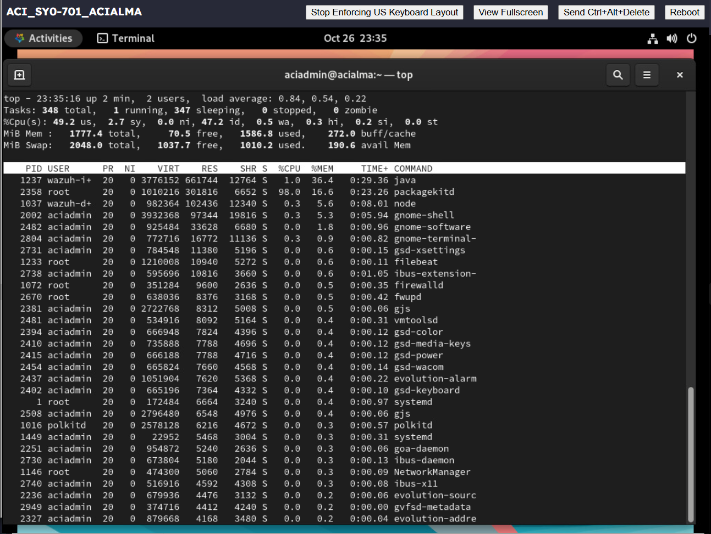
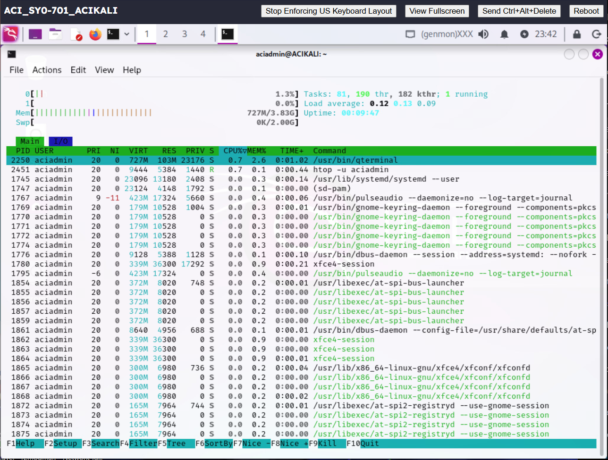
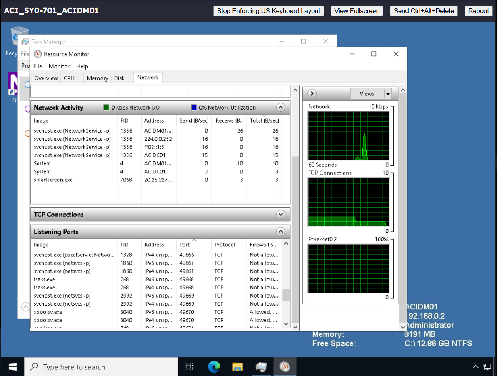

# Lab 13 — Monitoring Computing Resources

**Training:** ACI Learning Security+ (SY0-701) practice lab  
**Focus:** Monitoring resource utilization and inspecting processes on AlmaLinux, Kali Linux, and Windows Server  
**Status:** Completed in an isolated, authorized training environment

## Objective

Learn to monitor process-level CPU, memory, disk, and network activity using native Linux and Windows utilities. Identify processes by user and PID, investigate resource usage, and examine listening network sockets. The objective was **resource visibility and basic process management**, not malware detection or incident confirmation.

## Lab environment and tools

| System | Role in lab | Monitoring tool |
| --- | --- | --- |
| ACIALMA (AlmaLinux 9.1) | Linux monitoring practice | `top` |
| ACIKALI (Kali Purple 2023.1) | Interactive Linux monitoring | `htop` |
| ACIDM01 (Windows Server 2022) | Windows resource and connection monitoring | Task Manager, Resource Monitor |

The lab guide also specified ACIDC01 as a powered-on supporting system. All testing was performed in the ACI training environment.

## Exercise 1 — Monitoring Device Resource Utilization

### Task 1: AlmaLinux — `top`

Launched `top` to view live process and system statistics, explored `top -n 10` to limit the number of updates, and used interactive shortcuts to sort processes and inspect their ownership:

```bash
top
top -n 10
# In top: Shift+M sorts by memory usage; Shift+N sorts by PID.
top -u aciadmin
# In top: press m twice to change the memory display to bars; q exits.
```

**Recorded observations (single snapshot):**

- Physical memory: **1,777.4 MiB** total, **1,586.8 MiB** used, approximately **190.6 MiB available**.
- Swap in use: approximately **1,010.2 MiB** of 2,048 MiB.
- `java` (PID 1237) displayed **36.4% MEM**. Its account appeared Wazuh-related, but that screenshot alone did not establish the precise service or whether its use was abnormal.
- `packagekitd` (PID 2358) displayed **98.0% CPU** at the moment captured; the host had only been running for about two minutes, so startup activity is a plausible explanation rather than a confirmed issue.

The output demonstrated how `%CPU`, `%MEM`, `RES`, `PID`, and process names can help narrow down performance investigations.



*Figure 1 — `top` displaying AlmaLinux resource statistics and memory-sorted processes.*

### Task 2: Kali Linux — `htop`

Updated package information, installed `htop`, examined its live resource bars and process table, and filtered the process view to the lab account:

```bash
sudo apt-get update
sudo apt install htop -y
htop
htop -u aciadmin
```

The interactive interface supports highlighting processes, sorting by clicking column headers (including **CPU%**), and process control through **F9**; **F10** exits. Only a known, appropriate process should be selected for termination.

**Recorded observations (single snapshot):**

- Physical memory use: **727 MiB of 3.83 GiB**.
- Swap use: **0 KiB of 2.00 GiB**.
- Load average: **0.12, 0.13, 0.09**.
- The filtered process list was sorted by **CPU%**; the largest visible process CPU reading was approximately **0.7%**.

Compared with the AlmaLinux capture, the Kali snapshot showed lighter resource use; these are different hosts captured at different times, not a controlled performance benchmark.



*Figure 2 — `htop -u aciadmin` displaying CPU, memory, swap, and per-user processes.*

### Task 3: Windows Server — Task Manager and Resource Monitor

Explored **Task Manager → Processes and Performance** and launched **Resource Monitor**. Inspected the **CPU**, **Memory**, **Disk**, and **Network** tabs, emphasizing **Network Activity** and **Listening Ports**.

The network capture displays processes such as `svchost.exe`, `System`, and `smartscreen.exe` in Network Activity; **Listening Ports** includes entries owned by `svchost.exe`, `lsass.exe`, and `spoolsv.exe`. Resource Monitor can associate listening ports with local processes and PIDs, while also displaying firewall-status information.

A listening socket does **not** guarantee that a port is reachable from another system. External enumeration with a tool such as Nmap is a complementary check, and neither a listed port nor a momentary spike proves compromise.



*Figure 3 — ACIDM01 Resource Monitor showing Network Activity, Listening Ports, and 60-second graphs.*

## Security relevance and analysis

| Monitoring capability | Investigation value | Important limitation |
| --- | --- | --- |
| Process CPU and memory metrics | Identify resource-intensive processes for further inspection | High usage can be normal or transient |
| User and PID filtering | Attribute activity to a process and account | Process ownership does not establish intent |
| Disk activity | Identify heavy reads/writes and affected files | Backups, updates, or maintenance can look unusual |
| Network Activity | Associate traffic with an image, PID, and endpoint | An unfamiliar connection is not necessarily malicious |
| Listening Ports | Identify local sockets and owning processes | Firewall and network controls affect external reachability |

**Key takeaway:** These are triage and troubleshooting tools. Analysts should compare observed activity with expected workload, system baselines, process details, and independent evidence before labeling an event suspicious or recommending termination of a process.

## Outcome

Completed the lab's three monitoring tasks and collected three screenshots documenting:

1. Live AlmaLinux process/resource monitoring with `top`.
2. Kali process filtering and interactive monitoring with `htop`.
3. Windows network activity and listening-port inspection through Resource Monitor.

**Scope note:** No intrusion, malicious process, or exploit was demonstrated. The captures reflect point-in-time observations in an ACI practice lab, not a production security assessment.

## Evidence index

| File | Evidence |
| --- | --- |
| `screenshots/01-almalinux-top-resource-monitoring.PNG` | AlmaLinux `top`, resource statistics, memory-based sorting |
| `screenshots/02-kali-htop-process-monitoring.PNG` | Kali `htop`, CPU sorting, `aciadmin` process filtering |
| `screenshots/03-windows-resource-monitor-network.PNG` | Windows Resource Monitor's Network Activity and Listening Ports |

## Reference

ACI Learning, *Monitoring Computing Resources*, Security+ SY0-701 practice lab, 16-page lab guide (user-supplied training material). This README summarizes observed tasks and findings in original wording and does not reproduce the lab guide.
