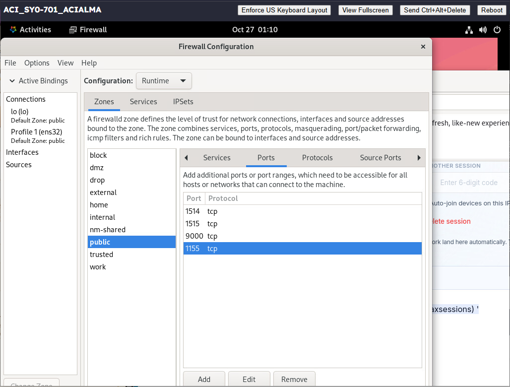
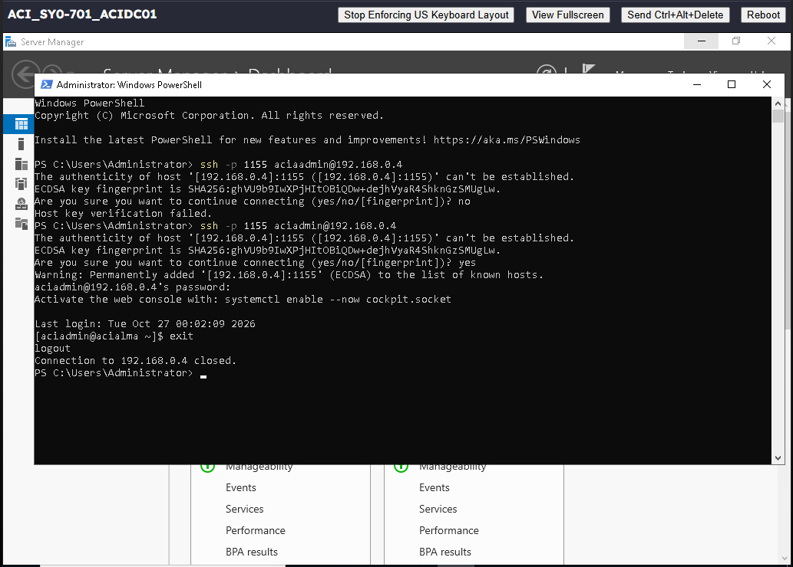
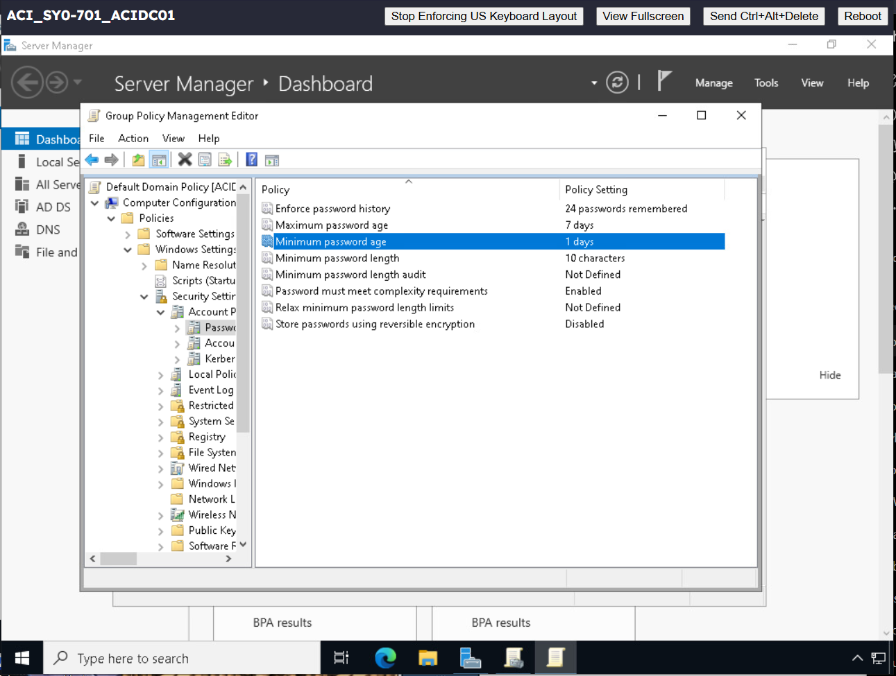
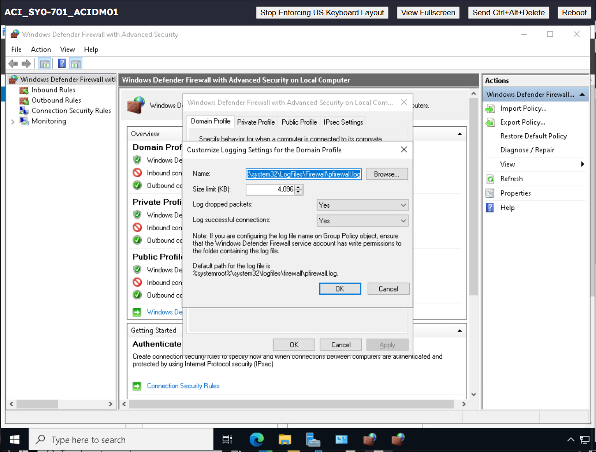

# Enhancing Enterprise Security — Linux and Windows Server Hardening

**Training:** ACI Learning · CompTIA Security+ (SY0-701) Skill Labs  
**Lab:** 14 of 18 — *Enhancing Enterprise Security*  
**Date:** October 26–27, 2026  
**Environment:** Authorized ACI Learning virtual lab; AlmaLinux 9.1 (`ACIALMA`), Windows Server 2022 domain controller (`ACIDC01`), and Windows Server 2022 domain member (`ACIDM01`)  
**Tools:** OpenSSH, Nano, SELinux `semanage`, firewalld / `firewall-config`, Windows PowerShell, Group Policy Management, Windows Defender Firewall with Advanced Security  
**Evidence:** Four screenshots captured from the lab sessions

## Overview

I completed ACI Learning exercises on **Linux server hardening** and **Windows server hardening**, combining configuration changes with verification. I changed SSH authentication and session controls, authorized a new SSH port through SELinux and firewalld, verified remote access from a Windows domain controller, adjusted training-domain password and lockout policies, and configured Windows Defender Firewall logging options.

My emphasis was on **testing effective configurations**, not merely editing values. During the SSH exercise, a conflicting included file initially overrode the root-login policy. I identified and resolved that discrepancy before restarting the service.

**Scope and limitations:** All changes were made in an authorized, disposable training environment. Some settings are stipulated by the training material and should **not** be assumed appropriate for a production environment. An application firewall exception was instructed during the Windows exercise but is **not separately captured or independently verified** in these screenshots. The final firewall logging image records two values set to `Yes` in the settings dialog; a subsequent screenshot of persisted settings or actual log entries was not collected.

## Exercise 1 — Linux Server Hardening Techniques

### 1. Modify and validate OpenSSH configuration

**Host:** `ACIALMA` (AlmaLinux 9.1).

Using `nano` to edit `/etc/ssh/sshd_config`, I configured the intended SSH values:

```conf
Port 1155
PermitRootLogin no
MaxAuthTries 3
MaxSessions 3
```

The initial attempt to use Vim was unsuccessful because expected escape-key combinations were not working through the browser-based training console. I switched to Nano and saved the file.

I validated syntax and inspected the **effective** configuration:

```bash
sudo sshd -t && echo PASS || echo FAIL
sudo sshd -T | grep -E '^(port|permitrootlogin|maxauthtries|maxsessions) '
```

**Troubleshooting finding:** Although `sshd_config` contained `PermitRootLogin no`, the effective `sshd -T` output initially reported `permitrootlogin yes`. A search revealed an early include directive plus a conflicting value in `/etc/ssh/sshd_config.d/01-permitrootlogin.conf`:

```text
/etc/ssh/sshd_config:15:Include /etc/ssh/sshd_config.d/*.conf
/etc/ssh/sshd_config:40:PermitRootLogin no
/etc/ssh/sshd_config.d/01-permitrootlogin.conf:3:PermitRootLogin yes
```

I changed the included file's directive to `PermitRootLogin no`, then repeated the syntax and effective-configuration tests.

**Verified effective configuration:**

| Option | Value |
|---|---|
| `port` | `1155` |
| `permitrootlogin` | `no` |
| `maxauthtries` | `3` |
| `maxsessions` | `3` |
| Syntax test | `PASS` (exit status `0`) |

The test emitted `main: sshd: ssh-rsa algorithm is disabled` but exited successfully. I did not weaken the host cryptographic settings or re-enable SHA-1–based `ssh-rsa` signatures.

**Security interpretation:** Disabling direct root login is a meaningful authentication restriction. Changing the SSH port can reduce incidental automated login noise, but is *not* a substitute for stronger authentication, patching, and access control. `MaxAuthTries` limits authentication attempts per connection, while `MaxSessions` constrains multiplexed sessions per connection.

### 2. Configure SELinux and firewalld for the new port

I authorized SSH on the new TCP port under SELinux and enabled it through the active `public` firewall zone:

```bash
sudo semanage port -a -t ssh_port_t -p tcp 1155
sudo semanage port -l | grep ssh_port_t
sudo firewall-cmd --get-active-zones
sudo firewall-cmd --zone=public --add-port=1155/tcp --permanent
sudo firewall-cmd --reload
sudo firewall-cmd --zone=public --list-ports
```

**Observed results:** `ssh_port_t` permitted TCP ports `1155` and `22`; interface `ens32` belonged to the `public` zone; `firewall-cmd` returned `success` when adding and reloading the rule. The permitted-port list included `1155/tcp`, `1514/tcp`, `1515/tcp`, and `9000/tcp`.

The firewall GUI (`firewall-config`) was installed and used to visually inspect the **Runtime → public → Ports** configuration. Its display corroborated the command-line output.



### 3. Restart SSH and validate a Windows-to-Linux connection

After completing the SELinux and firewall changes, I restarted `sshd` and tested remote access from `ACIDC01` using PowerShell:

```powershell
ssh -p 1155 aciadmin@192.168.0.4
```

**Observed:** The first SSH host-key prompt was declined; I retried, accepted the lab host key, authenticated, reached the AlmaLinux shell prompt, and used `exit` to close the session normally. The console displayed `Connection to 192.168.0.4 closed.`



**Takeaway:** The combination of effective-configuration checking, policy changes, and a successful client connection validates that the SSH control remained usable after hardening. In a production environment, host-key fingerprints should be verified through a trusted channel before first use.

## Exercise 2 — Windows Server Hardening Techniques

### 4. Configure domain account policies using Group Policy

**Host:** `ACIDC01`; **GPO:** `Default Domain Policy` in the `aciplab.com` training domain.

In Group Policy Management Editor, I navigated to **Computer Configuration → Policies → Windows Settings → Security Settings → Account Policies** and configured the exercise requirements.

| Policy | Verified / reported result |
|---|---|
| Maximum password age | **7 days** (verified in corrected screenshot) |
| Minimum password age | **1 day** (verified in screenshot) |
| Minimum password length | **10 characters** (verified in screenshot) |
| Password complexity | Enabled (visible in screenshot) |
| Account lockout threshold | **5 invalid attempts** (completed and reported during the exercise; not shown in the final Password Policy screenshot) |

An initial screenshot showed maximum password age at 42 days and minimum password age at seven days, which was not the intended configuration. I corrected those values and captured the final policy display.



**Policy interpretation:** A default domain password policy can apply broadly to domain identities rather than only one server. The exercise's **seven-day mandatory password expiration** is a training parameter, **not a generally recommended production default**. Modern password policy design should account for compromised-password screening, length, MFA, and business requirements. Aggressive lockouts can also create availability risks.

### 5. Examine Windows Defender Firewall and configure logging

**Host:** `ACIDM01` (Windows Server 2022 domain member).

The ACI instructions called for permitting **Performance Logs and Alerts** through the Domain firewall profile, then configuring Windows Defender Firewall with Advanced Security to log dropped packets and successful connections. I navigated to **Domain Profile → Logging → Customize** and set:

| Domain Profile logging option | Screenshot value |
|---|---|
| Log dropped packets | **Yes** |
| Log successful connections | **Yes** |
| Log file | `pfirewall.log` in the standard Windows Firewall log location |
| Log file size limit | **4,096 KB** |



I also opened **Monitoring → Firewall** and inspected the visible inbound rule list. The earlier monitoring screenshot was not retained as one of the four portfolio images because the settings screenshot more directly documents the security configuration.

**Evidence boundary:** The final screenshot shows the two drop-down values set to `Yes` while the dialog is open. It does **not** independently establish that `OK` was subsequently clicked on both dialogs, that firewall logs were produced, or that the **Performance Logs and Alerts** exception was present after saving. These details should be validated separately before making stronger operational claims.

### 6. Security operations relevance

Firewall logs can support investigation by recording traffic handled by filtering policy. Logs of blocked packets can help distinguish firewall denial from host or network failure, and allowed-connection logging can support connection reviews. However, these logs do not by themselves prove malicious activity or replace correlated endpoint/network telemetry.

## Lessons learned

- **Verify effective settings, not just file contents.** `sshd -T` exposed an earlier included `PermitRootLogin yes` that was taking precedence over my main configuration.
- **Plan for connectivity before restarting remote services.** SELinux labels and firewalld permissions were updated before restarting SSH on port 1155.
- **Triangulate controls and observed behavior.** The SSH configuration, firewall state, and successful PowerShell connection provided complementary verification.
- **Review policy scope before hardening.** Edits to Default Domain Policy can affect many accounts across a domain; lab-only password expiration settings should not be copied blindly into production.
- **Separate observed evidence from intended configuration.** Screenshot values, user-reported steps, persisted policy state, and live telemetry establish different levels of confidence.

## Evidence index

| File | Evidence |
|---|---|
| `screenshots/01-almalinux-ssh-hardening-verified.PNG` | Successful SSH authentication on port 1155 and clean disconnect |
| `screenshots/02-almalinux-firewall-configuration.PNG` | Firewall GUI displaying TCP 1155 in the public zone |
| `screenshots/03-windows-domain-password-policy.PNG` | Corrected GPO password policy values |
| `screenshots/04-windows-defender-firewall-logging.PNG` | Domain Profile dropped and successful connection logging set to Yes in UI |

## Scope / disclaimer

Work was conducted exclusively on the authorized ACI Learning training systems. This is a guided practice exercise, not a production hardening assessment, penetration test, or completed risk-acceptance/remediation record. Configuration changes should be tested, approved, and documented before use on organizational infrastructure.
