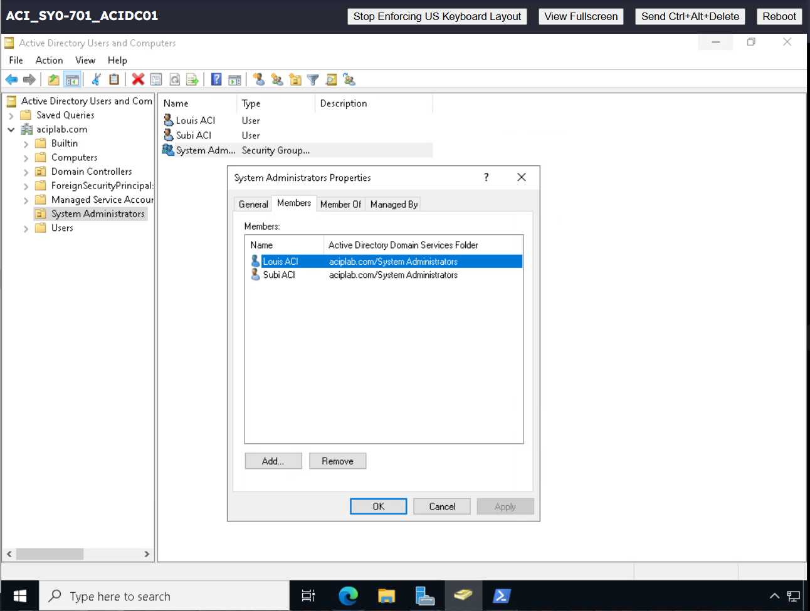
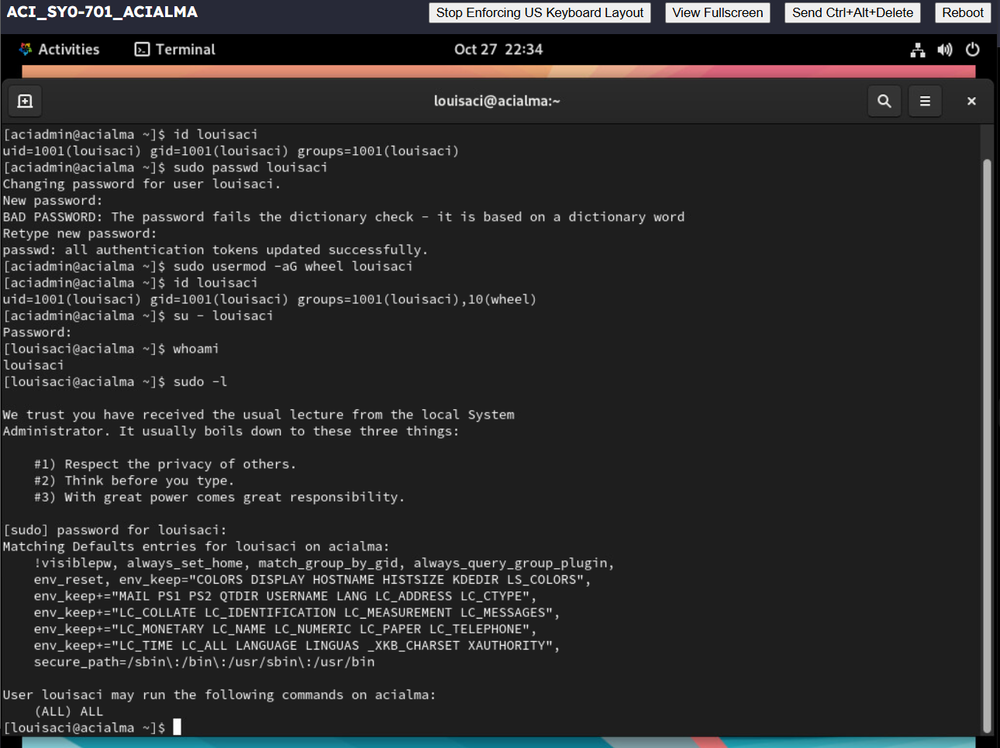
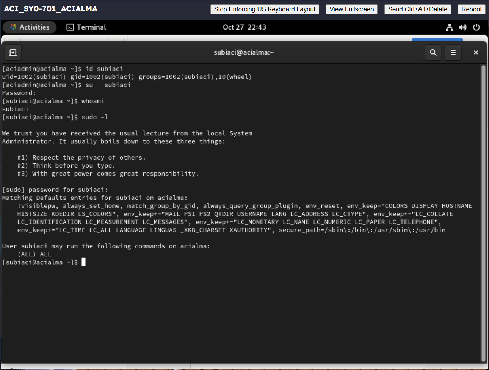

# Lab 15 — Implement Identity & Access Management

**ACI Learning · CompTIA Security+ SY0-701 practice lab**  
**Status:** Completed  
**Environments:** Windows Server 2022 (`ACIDC01`, domain `aciplab.com`) and AlmaLinux 9.1 (`ACIALMA`)

## Overview

Practiced account provisioning and authorization on two operating systems. In Windows Active Directory, created an organizational unit (OU), a global security group, and two domain users via the graphical interface and PowerShell. On AlmaLinux, created local users via the terminal and graphical interface, assigned administrative group membership, and verified their identities and sudo authorizations.

**Scope:** Authorized ACI training environment. Accounts and group assignments described here were created for an isolated instructional lab, not a production directory.

## Learning objectives

- Create and organize domain identities in Active Directory Users and Computers (ADUC).
- Provision an AD user through PowerShell.
- Use security group membership to assign access collectively.
- Create and validate local Linux accounts from the terminal and GNOME Users interface.
- Explain the difference between group membership, actual privilege assignment, and least-privilege design.

## Exercise 1 — Windows Server account provisioning

### 1. Create the OU and security group in ADUC

Created an OU named **System Administrators** within `aciplab.com` and a **Global / Security** group of the same name inside that OU. The OU organizes directory objects; the security group is the object used for permissions and group-based access.

### 2. Provision Subi ACI through ADUC

Created a domain account with logon name `subiaci`, and added the account to the new **System Administrators** group. Used a temporary training password, with a password change at next logon configured as the exercise requires.

### 3. Nest the security group into Builtin\Administrators

The lab requires nesting the **System Administrators** group into the domain's built-in **Administrators** group. This assignment was performed as reported during the lab. It confers broad elevated rights and is **not** a least-privilege pattern to adopt automatically in production.

### 4. Provision Louis ACI through PowerShell

Created `louisaci` in the same OU using the Active Directory module and added the account to the same security group.

```powershell
New-ADUser -Name "Louis ACI" -GivenName "Louis" -Surname "ACI" `
    -SamAccountName "louisaci" -UserPrincipalName "louisaci@aciplab.com" `
    -Path "OU=System Administrators,DC=aciplab,DC=com" `
    -AccountPassword (Read-Host -AsSecureString "Input Password") -Enabled $true

Add-ADGroupMember -Identity "System Administrators" -Members louisaci
Get-ADGroupMember -Identity "System Administrators" |
    Select-Object Name, SamAccountName, objectClass
```

**Verification:** In ADUC, the security group's **Members** tab displayed **Louis ACI** and **Subi ACI**.



## Exercise 2 — AlmaLinux account provisioning

### 1. Create Louis ACI from the terminal

Created a **local** user `louisaci`, set its password, and appended it to the `wheel` group.

```bash
sudo useradd louisaci
sudo passwd louisaci
sudo usermod -aG wheel louisaci
id louisaci
su - louisaci
whoami
sudo -l
```

**Observed validation:**

- UID / primary GID: `1001` / `1001`.
- Supplementary group: `wheel` (GID 10).
- `whoami`: `louisaci`.
- `sudo -l`: user authorized to run `(ALL) ALL`.

The initial password triggered a dictionary-based weakness warning. A production administrative account should use a stronger, unique secret and appropriate authentication controls.



### 2. Create Subi ACI from the GNOME Users interface

Used **Settings → Users** to create the local account `subiaci` with **Administrator** account type, then switched to the account and checked its permissions.

```bash
id subiaci
su - subiaci
whoami
sudo -l
```

**Observed validation:**

- UID / primary GID: `1002` / `1002`.
- Supplementary group: `wheel` (GID 10).
- `whoami`: `subiaci`.
- `sudo -l`: user authorized to run `(ALL) ALL`.



## Findings and security implications

| Topic | Observation | Security significance |
|---|---|---|
| Identity organization | Dedicated AD OU and global group | Separates object organization from access assignment |
| Provisioning methods | ADUC and PowerShell both successfully created domain users | Scripted workflows can reduce repeated manual work |
| Group membership | `subiaci` and `louisaci` appear in the same AD group | Centralized membership simplifies reviews and removal of access |
| Privileged group nesting | The lab nested a custom group into Builtin\Administrators | Broad rights should be strictly scoped and reviewed |
| Linux user management | Separate local accounts created by CLI and GUI | Provisioning method does not determine privilege level |
| Sudo access | Both Linux users show `(ALL) ALL` | Explicit verification is essential; broad sudo rights increase risk |

**Key distinction:** `louisaci` and `subiaci` exist independently in Active Directory and on the standalone AlmaLinux host. Matching names do **not** establish account federation or shared identity.

## Lessons learned

1. An OU does not, on its own, grant privileges; group membership and assignments determine effective authorization.
2. `usermod -aG wheel` appends a supplementary group; omitting `-a` with `-G` can replace existing supplementary memberships.
3. `id`, `whoami`, and `sudo -l` provide complementary validation of a Linux account's existence, active identity, and allowed elevation.
4. Security groups help operationalize role-based access, but adding the entire group to powerful built-in administrator groups risks over-privileging members.
5. Training examples with weak passwords or expansive administrative permissions are not automatically suitable production patterns.

## Evidence index

| File | Demonstrates |
|---|---|
| `evidence/01-active-directory-user-provisioning.PNG` | ADUC group listing Louis ACI and Subi ACI as members |
| `evidence/02-almalinux-user-provisioning.PNG` | CLI-provisioned Louis ACI, `wheel` membership, `whoami`, `sudo -l` |
| `evidence/03-almalinux-gui-user-provisioning.PNG` | GUI-provisioned Subi ACI, `wheel` membership, successful `sudo -l` |

## Limitations

The screenshots document group membership and permission listings, not exhaustive testing of every privileged operation. The lab did not include a complete least-privilege access review, offboarding/deprovisioning test, or production IAM policy rollout. No actual passwords are included in this repository.
