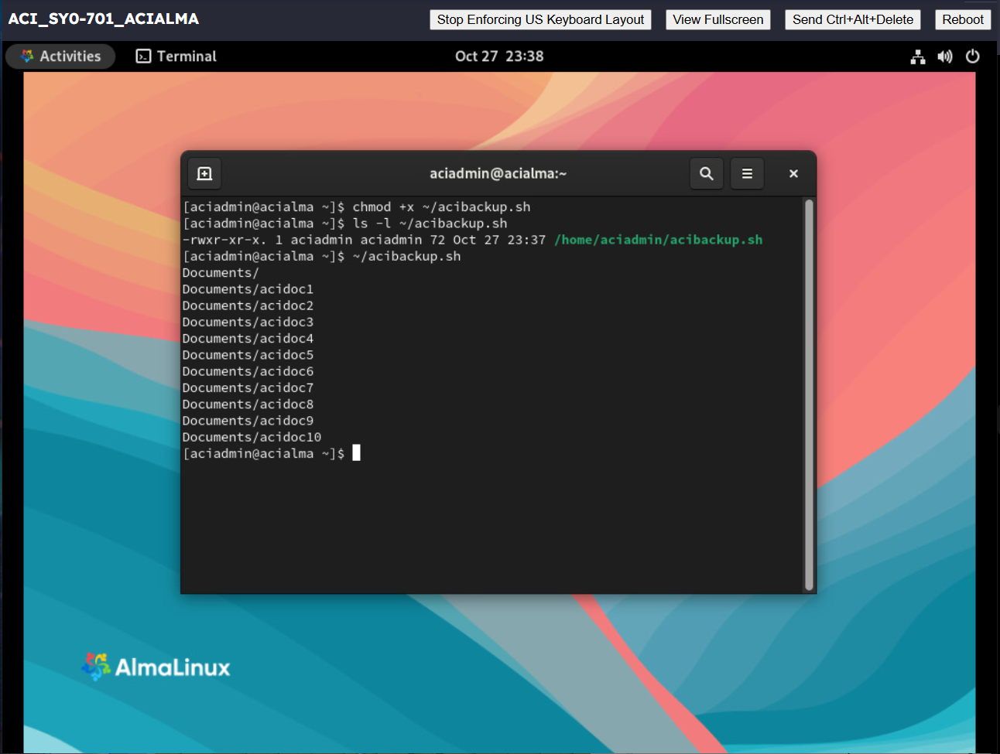
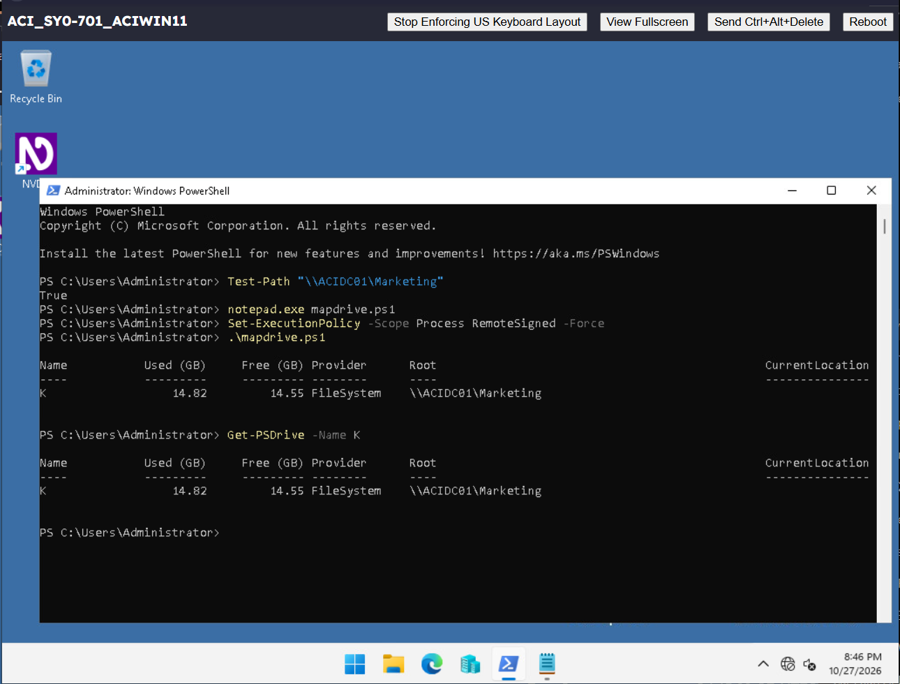
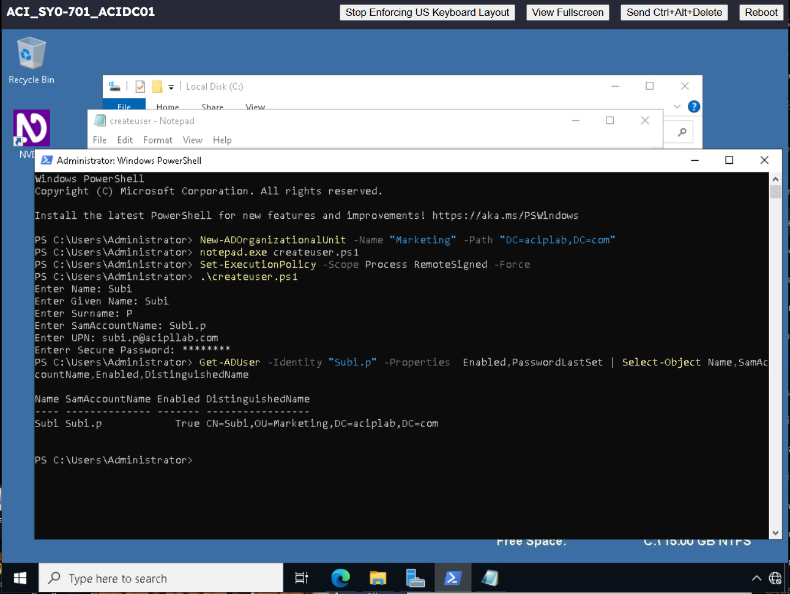

# Lab 16 — Implementation of Automation & Orchestration for Security Operations

**Training:** ACI Learning · CompTIA Security+ SY0-701 practice lab  
**Status:** Completed (three lab tasks)  
**Date:** October 27, 2026 (lab screenshots)  
**Environment:** Authorized ACI Learning virtual lab: `ACIALMA` (AlmaLinux 9.1), `ACIDC01` (Windows Server 2022 domain controller), `ACIWIN11` (Windows 11 domain workstation)  
**Tools:** Bash, `tar`, `chmod`, PowerShell, `New-PSDrive`, Active Directory PowerShell module

## Overview

Performed three administration automation exercises: created and ran a Linux Bash backup script; created a PowerShell script to map a shared network folder; and created an interactive PowerShell script for Active Directory user provisioning. The work demonstrates repeatable scripting of routine operations across Linux and Windows. The lab did **not** configure recurring schedules or a coordinated security orchestration platform.

All activities took place in an isolated, authorized training environment; nothing here was deployed into a production system.

## Learning objectives

- Create an executable Bash script to archive a folder.
- Create and test a PowerShell script that maps an SMB share.
- Automate AD user creation using parameterized, interactive input.
- Validate actual results, distinguish successful commands from stronger end-to-end verification, and understand the security implications of script execution.

## Task 1 — Linux backup automation

**Host:** `ACIALMA`

Prepared ten empty lab files, `Documents/acidoc1` through `Documents/acidoc10`, then created a `Backup` directory and the `acibackup.sh` shell script.

```bash
touch ~/Documents/acidoc{1..10}
mkdir -p ~/Backup
chmod +x ~/acibackup.sh
ls -l ~/acibackup.sh
~/acibackup.sh
```

The script's central operation uses `tar` to create a single **uncompressed** archive:

```bash
tar -cvf "$HOME/Backup/acibackup.tar" -C "$HOME" Documents
```

**Observed evidence:** `ls -l` showed the script had executable permissions (`-rwxr-xr-x`); executing it printed the `Documents/` directory plus all ten files `acidoc1`–`acidoc10`. No error appeared in the captured output.



**Verification boundary:** The screenshot documents script execution and `tar`'s verbose output. It does not show a separate `tar -tf` archive-content inspection or restore test. A complete production backup process would validate the resulting archive, test recovery, and protect backup copies from source-system failures.

## Task 2 — Map a Windows network share with PowerShell

**Hosts:** `ACIDC01` (share server) and `ACIWIN11` (client)

Created `C:\Marketing` on ACIDC01 and enabled its SMB share using Advanced Sharing. On ACIWIN11, checked the share's accessibility:

```powershell
Test-Path "\\ACIDC01\Marketing"
# Observed: True
```

Saved `mapdrive.ps1` to map the share as drive `K:`:

```powershell
New-PSDrive -Name K -PSProvider FileSystem -Root "\\ACIDC01\Marketing" -Persist -Scope Global
```

To avoid ACI's broader `Unrestricted` execution-policy instruction, used a setting limited to the current PowerShell process:

```powershell
Set-ExecutionPolicy -Scope Process RemoteSigned -Force
.\mapdrive.ps1
Get-PSDrive -Name K
```

**Observed evidence:** The script completed, and `Get-PSDrive` displayed `K` using the FileSystem provider with root `\\ACIDC01\Marketing`.



**Limitations and security:** The screenshot is from **Administrator: Windows PowerShell**. An elevated mapping may not appear in a non-elevated File Explorer window. The recorded evidence verifies the PowerShell drive mapping, not a separate File Explorer check. Network share access is still governed by share permissions and NTFS permissions. Execution policy is not a script trust or security boundary; signed code, access controls, and peer review are important for operational use.

## Task 3 — Interactive Active Directory user provisioning

**Host:** `ACIDC01` (domain `aciplab.com`)

Used PowerShell to create an Organizational Unit named `Marketing`:

```powershell
New-ADOrganizationalUnit -Name "Marketing" -Path "DC=aciplab,DC=com"
```

Created `createuser.ps1` using the `ActiveDirectory` PowerShell module. The script prompts for name fields, account names, a UPN, and a SecureString initial password, then calls `New-ADUser` with the Marketing OU as its target and requires a password change at next logon.

```powershell
Import-Module ActiveDirectory
New-ADUser `
    -Name (Read-Host "Enter Name") `
    -GivenName (Read-Host "Enter Given Name") `
    -Surname (Read-Host "Enter Surname") `
    -SamAccountName (Read-Host "Enter SamAccountName") `
    -UserPrincipalName (Read-Host "Enter UPN") `
    -Path "OU=Marketing,DC=aciplab,DC=com" `
    -AccountPassword (Read-Host -AsSecureString "Enter Secure Password") `
    -ChangePasswordAtLogon $true `
    -Enabled $true
```

Executed the script with the lab inputs for `Subi` / surname `P` / account `Subi.p` / UPN `subi.p@aciplab.com`. The password was entered interactively and is **not** documented here. The script returned to the PowerShell prompt without a visible error.

Verification command:

```powershell
Get-ADUser -Identity "Subi.p" -Properties Enabled,PasswordLastSet |
    Select-Object Name,SamAccountName,Enabled,DistinguishedName
```

**Observed result:** `Name=Subi`, `SamAccountName=Subi.p`, `Enabled=True`, and `DistinguishedName=CN=Subi,OU=Marketing,DC=aciplab,DC=com`.



**Security considerations:** The sample script demonstrates provisioning but does not validate input formats, check for existing users, enforce approval, restrict group assignments, produce structured audit logs, or perform rollback. A production workflow should include those controls and avoid hard-coded credentials.

## Automation versus orchestration

**Automation** executes a repeatable task, such as producing a backup, mapping a drive, or creating a directory user. **Orchestration** coordinates multiple dependent tasks and systems through a larger workflow, often involving triggers, approvals, logging, and exception handling. These exercises demonstrated standalone automation, not a fully orchestrated process.

## Lessons learned

1. Bash scripts turn multi-command procedures into repeatable operations; executable permissions are checked with `chmod` and `ls -l`.
2. A successful archive command is only one part of backup assurance; archive inspection and recovery testing are needed.
3. PowerShell can create persistent drive mappings from UNC paths and query them with `Get-PSDrive`; elevated and non-elevated sessions can have different mappings.
4. `New-ADUser` with prompted inputs removes repetitive manual entry while maintaining a consistent OU destination and account attributes.
5. Manual configuration remains important to understand *what* automation is changing, recognize mistakes, and troubleshoot unexpected results.

## Evidence index

| File | What it demonstrates |
|---|---|
| [`evidence/01-linux-backup-automation.PNG`](evidence/01-linux-backup-automation.PNG) | Executable `acibackup.sh` and verbose tar output listing ten test files |
| [`evidence/02-powershell-network-drive-mapping.PNG`](evidence/02-powershell-network-drive-mapping.PNG) | Successful `K:` mapping to `\\ACIDC01\Marketing` in PowerShell |
| [`evidence/03-powershell-ad-user-automation.PNG`](evidence/03-powershell-ad-user-automation.PNG) | Enabled `Subi.p` AD account in the Marketing OU, verified by `Get-ADUser` |

## Reference scripts

The [`scripts/`](scripts/) directory contains **reference recreations** of the short commands and scripts used during the guided exercise, derived from the lab walkthrough. They were not exported from the ACI machines, so the evidence screenshots—not these recreated files—are the record of what was executed.

- `scripts/acibackup.sh` — Bash document archive
- `scripts/mapdrive.ps1` — PowerShell SMB drive mapping
- `scripts/createuser.ps1` — Interactive PowerShell Active Directory account creation

**Scope:** This repository is an educational lab record, not a production-ready automation toolkit.
