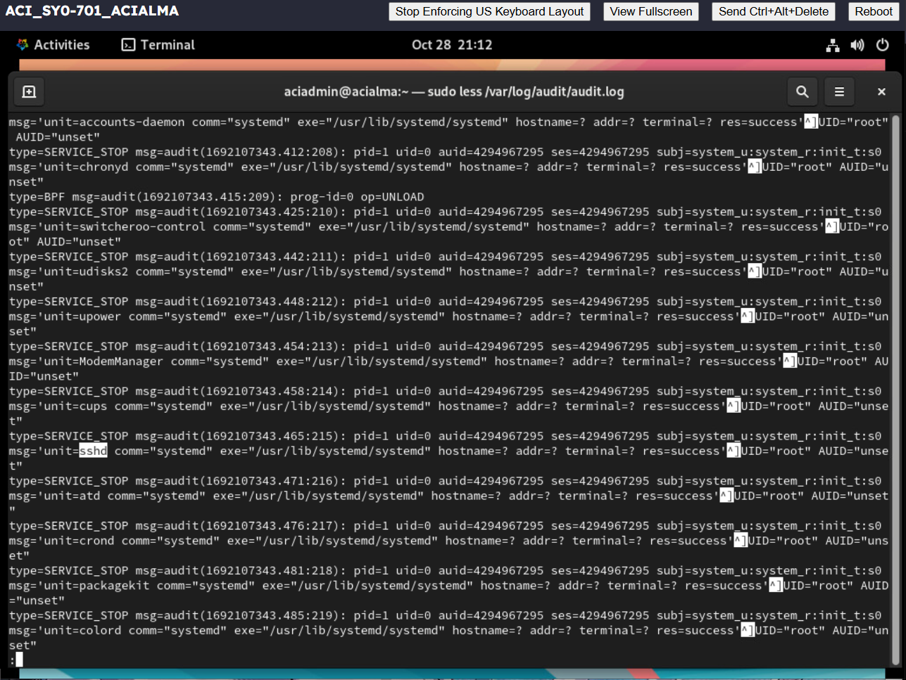
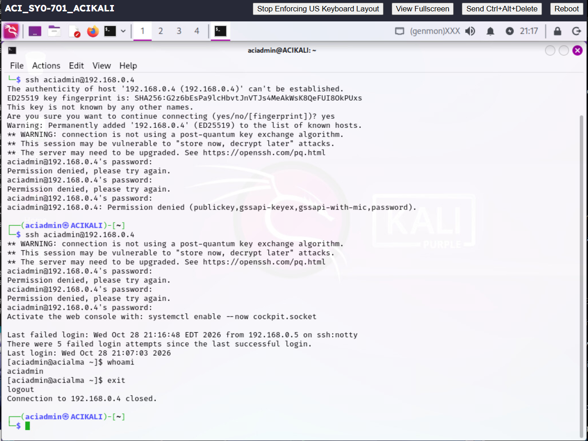
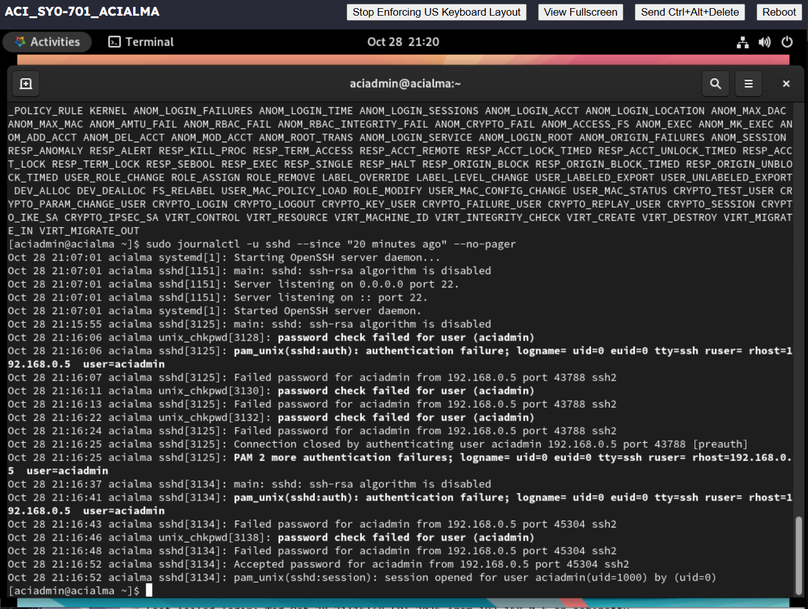
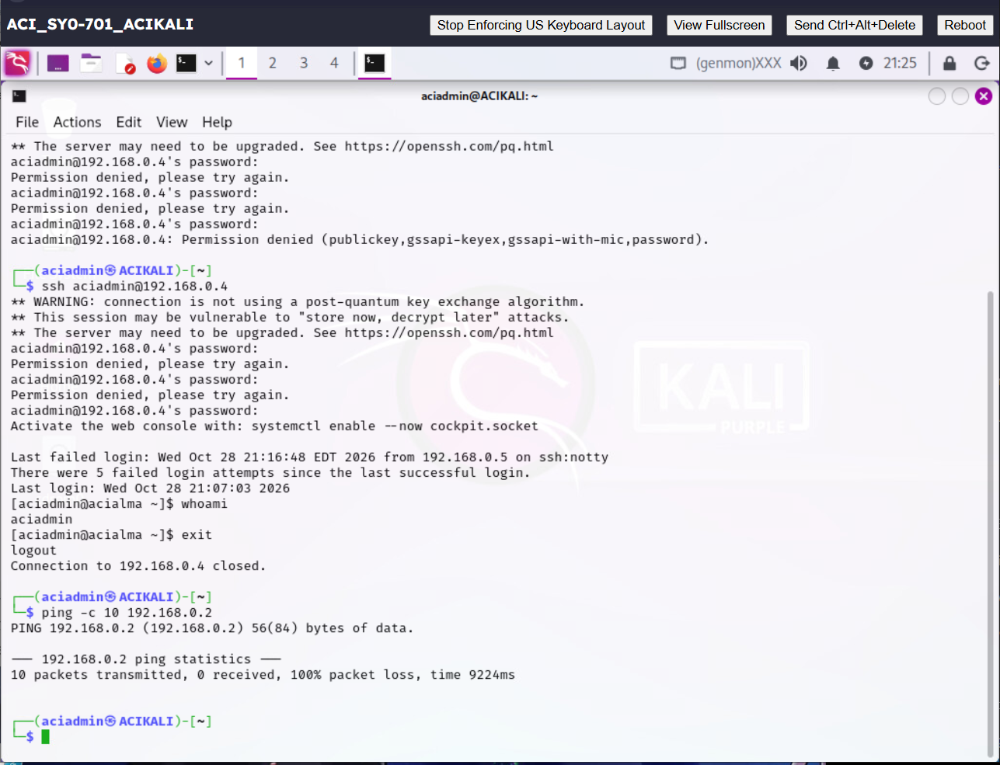
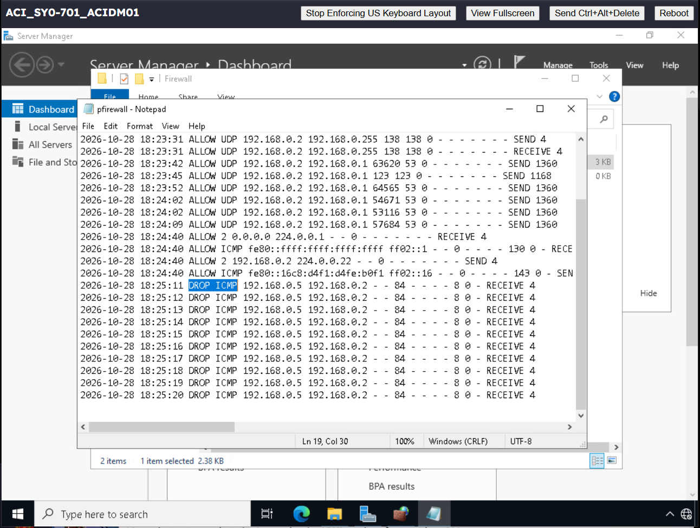

# Lab 17 — Investigative Data Sources

**Training:** ACI Learning · CompTIA Security+ SY0-701 practice lab  
**Status:** Technical exercises complete; temporary ICMP blocking rule should be disabled after evidence collection  
**Lab date:** October 28, 2026  
**Environment:** Authorized, isolated ACI Learning virtual network  
**Systems:** `ACIALMA` (AlmaLinux 9.1, `192.168.0.4`), `ACIKALI` (Kali Purple, `192.168.0.5`), `ACIDM01` (Windows Server 2022, `192.168.0.2`); ACIDC01 powered on as required  
**Tools:** `less`, Linux audit log, `tail -F`, `journalctl`, OpenSSH, `ping`, Windows Defender Firewall with Advanced Security, `pfirewall.log`

## Overview

Conducted two controlled log-investigation exercises: examining Linux audit and SSH authentication data, and correlating deliberately blocked ICMP network traffic with Windows Firewall logs. The objective was to reconstruct known activity from independent evidence sources—not merely run a scan or change a setting.

All tests were carried out against authorized training machines. No unauthorized activity or genuine compromise was detected.

## Learning objectives

- Locate and search Linux audit records for user and SSH-related activity.
- Observe intentionally failed and successful SSH authentication attempts.
- Correlate authentication attempts across SSH client output and Linux server logs.
- Configure Windows Firewall logging and generate controlled blocked traffic.
- Validate firewall `DROP` entries against source/destination addresses and an observed ICMP test.
- Distinguish observed events from evidence of a security incident.

## Investigation 1 — Linux audit records

**Target:** `ACIALMA`

Opened the system audit log and searched within the `less` viewer:

```bash
sudo less /var/log/audit/audit.log
# Within less, searched for /aciadmin and /sshd; exited with q.
```

**Observed evidence:** A match for `sshd` occurred in a `type=SERVICE_STOP` entry, showing `unit=sshd`, `comm="systemd"`, and `res=success`. This establishes that the SSH service was stopped, **not** that an authentication failed or an intruder connected. The match illustrates that searching by daemon name can return operational events unrelated to user authentication.



## Investigation 2 — Controlled SSH login failures followed by success

**Source:** `ACIKALI` (`192.168.0.5`)  
**Target:** `ACIALMA` (`192.168.0.4`), SSH on port 22 in this lab session

The Kali client initiated SSH access using `aciadmin`. The first connection failed after three incorrect passwords. On a second connection, two more attempts failed, then the correct credentials were accepted.

```bash
ssh aciadmin@192.168.0.4
whoami
exit
```

**Client-side observations:** The server reported **five failed login attempts since the prior successful login**, followed by an authenticated shell. `whoami` returned `aciadmin`, and the session ended normally with `exit`. The client also displayed a warning about not using a post-quantum key exchange algorithm. That warning is unrelated to the password failures.



To corroborate what happened, examined the server's SSH journal:

```bash
sudo journalctl -u sshd --since "20 minutes ago" --no-pager
```

| Server-local time, Oct 28 | Event | Supporting evidence |
|---|---|---|
| 21:16:07 | Failed password | `aciadmin` from `192.168.0.5`, source TCP port `43788` |
| 21:16:13 | Failed password | Same SSH connection |
| 21:16:24 | Failed password | Third failure on first connection |
| 21:16:43 | Failed password | Second connection, source TCP port `45304` |
| 21:16:48 | Failed password | Fifth failure |
| 21:16:52 | Accepted password | `aciadmin` from `192.168.0.5`, port `45304` |
| 21:16:52 | PAM session opened | User `aciadmin` (`uid=1000`) |



**Evidence boundary:** The successful client/server correlation was verified with **`journalctl -u sshd`**, not by confirming matching `USER_AUTH` entries from `audit.log`. Both the audit file and journal were examined, but their roles should not be conflated. Five failures followed by a success might merit escalation in a real environment; here they were intentional, controlled tests.

## Investigation 3 — Windows Defender Firewall ICMP blocking

**Source:** `ACIKALI` (`192.168.0.5`)  
**Destination:** `ACIDM01` (`192.168.0.2`)

In Windows Defender Firewall with Advanced Security on ACIDM01, enabled **dropped-packet** and **successful-connection** logging for the Domain, Private, and Public profiles. Created a temporary custom inbound rule named `ICMP Block` to **block ICMPv4** across the selected profiles.

From Kali, ran:

```bash
ping -c 10 192.168.0.2
```

The observed summary was **10 packets transmitted, 0 received, 100% packet loss**. By itself, a failed ping does not prove which control caused the loss.



On ACIDM01, examined the firewall log at:

```text
C:\Windows\System32\LogFiles\Firewall\pfirewall.log
```

**Observed Windows-side evidence:** The log contains **10 consecutive `DROP ICMP` records** at approximately `18:25:11` through `18:25:20` on October 28, 2026, each identifying:

- Action: `DROP`
- Protocol: `ICMP`
- Source: `192.168.0.5` (Kali)
- Destination: `192.168.0.2` (Windows member server)
- ICMP Type: `8` (Echo Request), Code: `0`
- Direction: `RECEIVE`



**Correlation:** The sending host reported ten unanswered Echo Requests, and the destination's firewall logged ten matching drops from the same source. Taken together, these support the conclusion that the configured firewall policy blocked the test traffic.

**Clock caution:** The Kali interface and Windows firewall file display differing hours. Do not assume those timestamps share the same time basis. An analyst should verify host time, time zones, synchronization, and log format before combining them into a precise multi-host timeline.

## Incident-analysis takeaways

| Question | Answer supported by collected evidence |
|---|---|
| Was `sshd` mentioned in the Linux audit log? | Yes, in a service-stop event; not automatically a suspicious login |
| Did the SSH tests generate failures? | Yes, five failures across two connections |
| Did a valid SSH login occur afterward? | Yes, the server journal recorded an accepted password and an opened PAM session |
| Was ping unsuccessful? | Yes, ten packets sent and none received |
| Did the destination firewall record corresponding drops? | Yes, ten `DROP ICMP` entries from Kali to ACIDM01 |
| Was malicious activity proven? | No. All activity was generated as part of an authorized lab exercise |

## Cleanup and scope

The temporary `ICMP Block` inbound rule should be **disabled or removed after testing** so it does not unnecessarily prevent connectivity checks. The screenshot evidence does not confirm that cleanup has occurred; it is not claimed as completed here. Firewall logging settings can be retained as appropriate to the training environment and its retention/storage needs.

This lab involved direct host log examination; it did **not** deploy a SIEM, implement continuous alerting, or conduct an actual incident response.

## Evidence files

| File | What it demonstrates |
|---|---|
| `evidence/01-linux-audit-log-analysis.PNG` | Linux audit log search and `sshd` service event |
| `evidence/02-linux-ssh-authentication-analysis.PNG` | Kali client authentication attempts and successful login |
| `evidence/03-linux-ssh-audit-correlation.PNG` | SSH server journal correlated with Kali attempts |
| `evidence/04-icmp-blocking-test.PNG` | Kali ICMP test with 100% packet loss |
| `evidence/05-windows-firewall-drop-analysis.PNG` | Windows Firewall records of ten dropped Echo Requests |

---

*Portfolio documentation based on first-hand screenshots collected during the ACI Learning training lab. The original course guide is not redistributed.*
