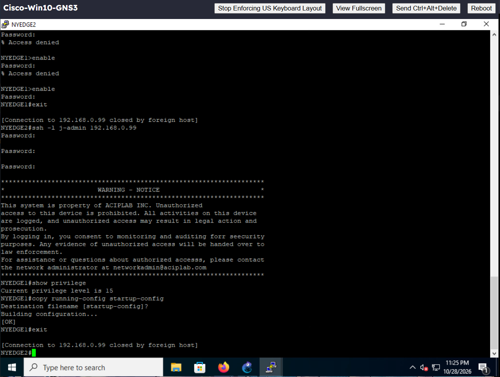
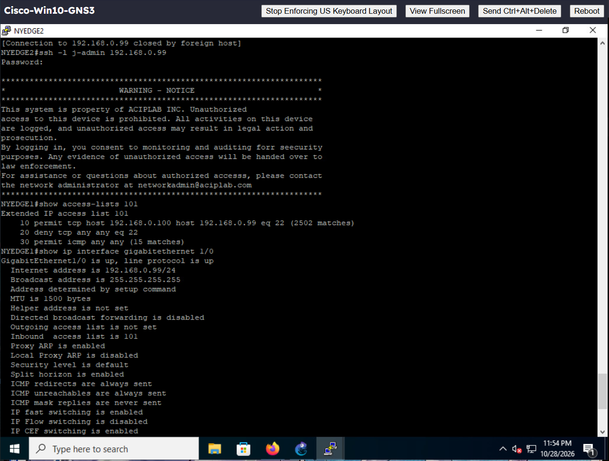
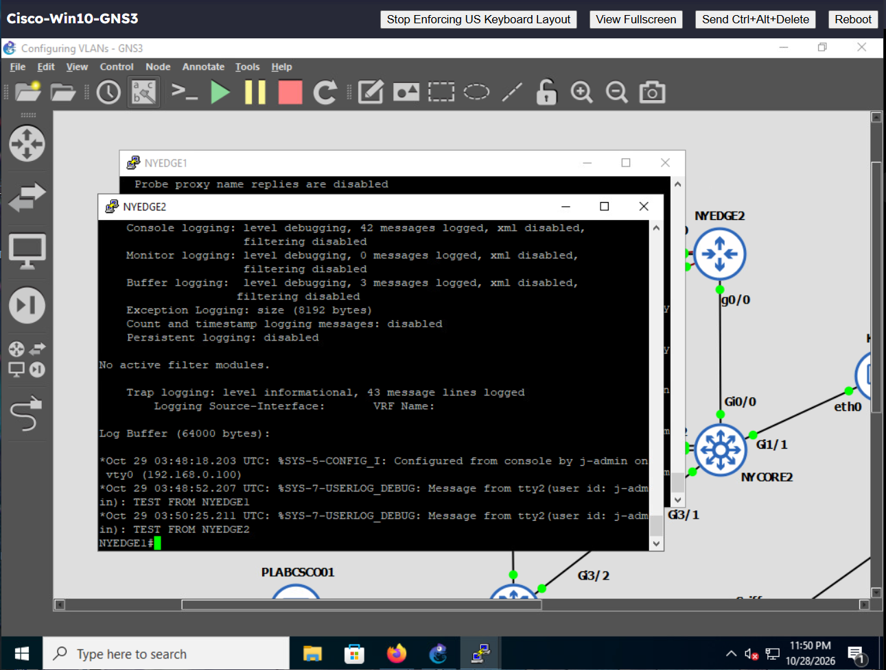

# Lab 18 — Mitigation Techniques

**Training:** ACI Learning · CompTIA Security+ SY0-701 practice lab  
**Status:** Completed; router configuration saved to startup-config  
**Lab date:** October 28, 2026 (U.S. Central time)  
**Environment:** Authorized ACI Learning virtual network using GNS3  
**Devices:** `NYEDGE1` and `NYEDGE2` — Cisco 2911 routers  
**Focus areas:** Network device hardening, SSH, AAA, access control lists, NTP, and security logging

## Overview

Configured and hardened a Cisco IOS edge router in an isolated training environment. The exercises covered local administrator credentials, SSH-only remote access, access restrictions, unnecessary service removal, time-server configuration, and local event logging. The lab concluded with verification of the authorized SSH connection, ACL enforcement on the intended interface, and two manually generated log messages.

A notable troubleshooting issue occurred when SSH authentication succeeded but the remote account initially opened at privilege level 1 rather than its configured privilege level 15. Adding local AAA EXEC authorization resolved the discrepancy; a new SSH session subsequently reported privilege level 15.

## Learning objectives

- Review a Cisco IOS running configuration and configure local administrative credentials.
- Enable SSH version 2 and restrict remote terminal access to SSH.
- Troubleshoot the difference between **authentication** and **EXEC authorization**.
- Disable router services and management paths not needed for the training scenario.
- Apply an extended IPv4 ACL inbound and verify permitted management traffic.
- Configure an NTP server and timestamped buffered syslog messages.
- Verify events in the logging buffer and preserve the configuration in NVRAM.

## Lab topology

| Device | Role | Interface | Address |
|---|---|---|---|
| `NYEDGE1` | Hardened router and SSH server | `GigabitEthernet1/0` | `192.168.0.99/24` |
| `NYEDGE2` | Authorized SSH client | `GigabitEthernet1/0` | `192.168.0.100/24` |

Management traffic was tested from `NYEDGE2` to `NYEDGE1` on TCP port 22. The devices were configured in GNS3. This table shows the interfaces used in the management-access test, not the full pre-existing GNS3 topology.

> **Credential handling:** The lab guide supplies demonstration passwords. Actual values are deliberately omitted from this public README; `<LAB_ENABLE_SECRET>` and `<LAB_ADMIN_PASSWORD>` below are placeholders, not strings to enter literally.

## Exercise 1 — Configure Router Access

### Local credentials and security banner

Reviewed `show running-config`, configured the lab's security warning message-of-the-day banner, and enabled local administrative credentials and AAA:

```cisco
configure terminal
enable secret <LAB_ENABLE_SECRET>
service password-encryption
aaa new-model
username j-admin privilege 15 secret <LAB_ADMIN_PASSWORD>
end
```

The account was visible in the running configuration as `username j-admin privilege 15 secret 5 [hashed value]`, confirming that the secret was not displayed as plaintext. Cisco IOS **Type 5** is a legacy MD5-based password hash; it should not be treated as a modern production password-storage standard. Likewise, `service password-encryption` provides limited protection for eligible plaintext configuration passwords and is not equivalent to strong encryption.

### SSH-only management

On `NYEDGE1`, configured an SSH server, generated an RSA key pair with a 2048-bit modulus, and restricted VTY lines to SSH:

```cisco
configure terminal
ip domain-name aciplab.com
crypto key generate rsa
! Selected 2048 when prompted for the RSA modulus size.
ip ssh version 2
ip ssh time-out 60
ip ssh authentication-retries 2
line vty 0 4
 transport input ssh
exit
interface gigabitethernet 1/0
 ip address 192.168.0.99 255.255.255.0
 no shutdown
exit
end
```

On `NYEDGE2`, configured the peer address and tested connectivity:

```cisco
configure terminal
interface gigabitethernet 1/0
 ip address 192.168.0.100 255.255.255.0
 no shutdown
exit
end
ping 192.168.0.99
ssh -l j-admin 192.168.0.99
```

**Observed result:** The first ping returned **4/5** replies, and a repeated ping returned **5/5**. SSH authentication succeeded and the configured warning banner appeared. `show ip ssh` reported SSH version 2; the interfaces were operational.

### Troubleshooting — SSH authenticated, but privilege was insufficient

On the first successful SSH login, the prompt was `NYEDGE1>` and repeated attempts to run `enable` returned `% Access denied`, despite the account being configured with privilege level 15.

Checked the AAA EXEC authorization configuration and added the following on `NYEDGE1`:

```cisco
configure terminal
aaa authorization exec default local
end
```

After reconnecting from `NYEDGE2` as `j-admin`, the prompt opened directly at `NYEDGE1#`. The verification command returned:

```text
NYEDGE1#show privilege
Current privilege level is 15
```

**Takeaway:** Successful authentication proves the user was accepted, but does not by itself prove that the intended administrative privilege was assigned. In this lab, local AAA EXEC authorization was required to produce the expected privileged session.



## Exercise 2 — Harden Router Access

### Disable unused IOS services

On `NYEDGE1`, entered the service-hardening commands from the training exercise:

```cisco
configure terminal
no service dhcp
no service pad
no cdp run
no ip bootp server
no ip domain-lookup
no ip finger
no ip source-route
end
```

Confirmed the resulting settings in `show running-config`. These choices apply to the **lab's requirements**; production routers may legitimately require some of these capabilities, such as DHCP or CDP, depending on their roles.

### Restrict auxiliary and console EXEC access

After establishing a working SSH management path, disabled interactive EXEC access on the auxiliary and console lines, in separate steps:

```cisco
configure terminal
line aux 0
 no password
 no exec
exit
line con 0
 no password
 no exec
exit
end
```

Verified `no exec` beneath `line con 0` in the running configuration, then successfully disconnected and re-established a remote SSH session. The sequence was deliberately cautious: SSH was tested before relying on it as the remaining management method.

**Operational caution:** Disabling console EXEC access can eliminate a valuable out-of-band recovery path if network or AAA access fails. This was required by the training exercise, but a production design would normally retain **secured emergency console access** rather than disabling it without a recovery plan.

### Apply inbound ACL 101

Configured the following extended ACL on `NYEDGE1`:

```cisco
configure terminal
access-list 101 permit tcp host 192.168.0.100 host 192.168.0.99 eq 22
access-list 101 deny tcp any any eq 22
access-list 101 permit icmp any any
interface gigabitethernet 1/0
 ip access-group 101 in
exit
end
```

Verified its contents using `show access-lists 101` and confirmed the interface association with `show ip interface gigabitethernet 1/0`.

| ACL rule | Effect | Evidence from screenshot |
|---|---|---|
| `10 permit tcp host 192.168.0.100 host 192.168.0.99 eq 22` | Permit SSH from NYEDGE2 to NYEDGE1 | **2,502 matches** |
| `20 deny tcp any any eq 22` | Deny other inbound TCP/22 traffic | Rule present; no deny-match count demonstrated |
| `30 permit icmp any any` | Permit inbound ICMP | **15 matches** |

The interface output confirmed **`Inbound access list is 101`** on `GigabitEthernet1/0`, which was `up/up` with address `192.168.0.99/24`. Ping and SSH from the authorized router still succeeded, including privilege level 15 after reconnecting.

**Verification boundary:** The permit rule was exercised, and the deny rule was present, but no SSH attempt from an unauthorized source was performed. Its rejection was not independently demonstrated.

**Implicit-deny consideration:** Because this ACL has an implicit `deny ip any any` at the end, inbound traffic not matching the specific permitted SSH or ICMP entries is also dropped. The ACL is therefore more restrictive than merely blocking unauthorized SSH and would require careful review before use on a production-facing interface.



## Exercise 3 — Configure Router Logging

### NTP server

Configured the lab's NTP server and checked its association information:

```cisco
configure terminal
ntp server 132.163.96.4
end
show ntp associations
```

**Verification boundary:** The NTP server configuration was completed. The evidence does **not** establish that NYEDGE1 achieved time synchronization with the remote server; an isolated GNS3 environment may not have access to it.

### Buffered logging and timestamps

Entered the lab's prescribed commands:

```cisco
configure terminal
logging buffered informational
logging buffered 64000
service timestamps debug datetime msec show-timezone localtime
service timestamps log datetime msec show-timezone localtime
end
send log TEST FROM NYEDGE1
show logging
```

This configures a 64,000-byte local buffer and requests date/time stamps with millisecond precision and timezone information for log/debug output. The first test message appeared in the router's logging output.

Next, from the `NYEDGE2` terminal, connected to `NYEDGE1` over SSH and generated the second test message **within the remote NYEDGE1 session**:

```cisco
ssh -l j-admin 192.168.0.99
! After authentication, prompt is NYEDGE1#.
send log TEST FROM NYEDGE2
show logging
```

**Observed log evidence:** The `show logging` output contained both `TEST FROM NYEDGE1` and `TEST FROM NYEDGE2`, with millisecond-resolution timestamps. The second label describes how the test was initiated; it does **not** mean NYEDGE2's own logging service emitted the record. The records were generated on NYEDGE1.

**Logging-level discrepancy:** Although `logging buffered informational` was entered, the final screenshot reports **`Buffer logging: level debugging`**, with a **64,000-byte** buffer. This README records the effective state displayed by IOS rather than claiming the informational threshold was verified. In an operational configuration, the logging level should be explicitly checked and corrected if it differs from the intended baseline.



### Save the configuration

Reviewed the running configuration and saved the changes:

```cisco
show running-config
copy running-config startup-config
```

The save operation completed successfully. A previous save after the AAA/SSH configuration also returned `[OK]`.

## Results and key takeaways

| Control / test | Outcome |
|---|---|
| SSHv2 remote management | Enabled and verified |
| `j-admin` authentication | Successful |
| EXEC authorization at privilege level 15 | Corrected and verified after initial failure |
| Unused router services | Disabled per lab specification |
| Auxiliary and console EXEC access | Disabled and verified in the running configuration |
| ACL 101 on inbound `GigabitEthernet1/0` | Applied and verified; authorized SSH and ICMP matched |
| Unauthorized-source SSH denial | Configured, **not separately tested** |
| NTP server | Configured; successful clock sync **not established** |
| Timestamped buffered logs | Two test messages verified |
| Effective buffered logging severity | Screenshot shows **debugging**, not informational |
| Startup configuration | Saved successfully |

## Evidence files

| File | Demonstrates |
|---|---|
| [`evidence/01-cisco-router-ssh-connectivity.PNG`](evidence/01-cisco-router-ssh-connectivity.PNG) | Authorized SSH login, warning banner, corrected privilege level 15, and configuration save |
| [`evidence/02-cisco-router-acl-configuration.PNG`](evidence/02-cisco-router-acl-configuration.PNG) | ACL 101 rules, match counters, `GigabitEthernet1/0` address/status, and inbound ACL binding |
| [`evidence/03-cisco-router-logging-verification.PNG`](evidence/03-cisco-router-logging-verification.PNG) | 64,000-byte log buffer and timestamped `TEST FROM NYEDGE1` / `TEST FROM NYEDGE2` messages |

## Scope and operational considerations

This work used authorized lab equipment, sample addresses, and demonstration credentials. It was **not** a production network-hardening deployment. No external SIEM or centralized syslog collector was configured; logging was reviewed locally with `show logging`. The ACL was not penetration-tested from a disallowed host. NTP synchronization was not positively verified.

For a real deployment, the configuration would need stronger secrets/modern hashes and key management, a tested emergency management path, an ACL reviewed against all necessary traffic, appropriate time synchronization, explicit logging severity verification, and ideally a centrally managed syslog/SIEM destination.

---

*Portfolio documentation based on hands-on execution and first-hand screenshots from the ACI Learning Mitigation Techniques practice lab. The course instructions are not redistributed.*
